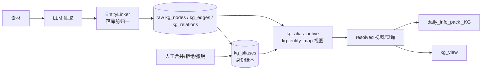
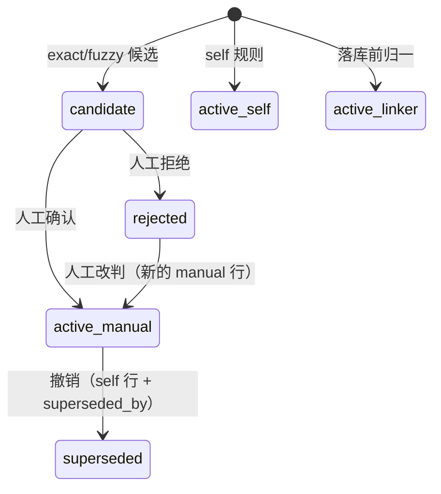
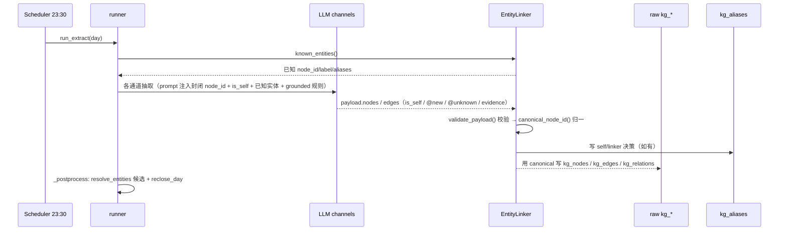
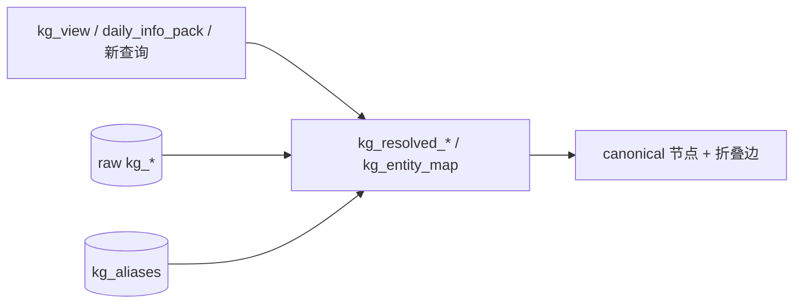
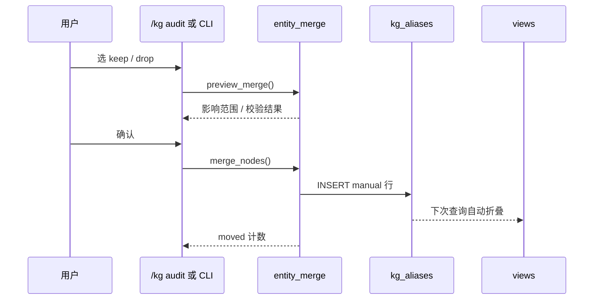

# KG 实体合并与身份解析设计（最小版）

> 状态：Draft v2 for review（2026-10-25）
> 范围：`apps/withlanggraph` langTrack KG 抽取层的实体身份与消解
> 相关：`kg-extract-plan.md`、`kg-extract-handoff.md`、`langTrack-tech.md` §9.33
> 修订说明：2026-10-24 的四表方案（entities / aliases / reviews / map）过度设计；本版改为**复用现有 `kg_aliases` + 视图**，不建新表。抽取侧约束 C 保留且升级为**硬约束**（封闭 node_id + `is_self`/`@new`/`@unknown` + grounded label + 输出校验，适用于所有实体）。

## 0. 摘要

当前 KG 把 LLM 生成的 `node_id` 当成了实体身份。同一个真人可能在不同通道、不同日期被写成多个节点（例如 `person_user` / `person_self` / `person_wo`），而消解层只把低分候选写进 `kg_aliases`，视图和日报又直接读原始节点，所以图上会出现多个“本人”。

最小版把问题拆成两件事：

- **合并动作**：人工选择 `keep` / `drop`，预览影响，单事务写一条 `kg_aliases` 决策；
- **读时解析**：用视图把 `drop` 映射到 `keep`，所有消费方读 resolved 结果。

不建 `kg_entities`、`kg_entity_reviews`、`kg_entity_map` 新表；`kg_aliases` 就是身份账本，`kg_nodes` 的 canonical 节点就是实体。`/places` 的 `merge_preview` + `merge_places` 是直接参考：预览、确认、单事务、页面可操作；区别是 KG **不改写/删除 raw 证据**，只写 alias，由视图折叠。

抽取侧 C 仍然必做，而且要升级为**硬约束**：LLM 不再自由生成身份 ID，只能输出 `person_user` / 已知 node_id / `@new` / `@unknown`，本人用 `is_self=true` 标记；**这套规则对所有实体生效，不只本人**。`@new` 的 label/aliases 必须能在原文 `evidence.quote` 中找到，不能凭空编名字。落库前由 validator + linker 把 `@new` 分配成代码生成的 ID，把本人统一到 `person_user`。这样 `用户（自己）`、`自己` 这类名称不会再变成 LLM 自造的新 ID；其他实体（妈妈/母亲、张三/小张）也一样，最坏是一个代码生成的实体或候选，可人工合并。

## 1. 设计目标

| 编号 | 目标 | 验收信号 |
|---|---|---|
| G1 | 同一实体只有一个 canonical 节点 | 本人节点在 resolved 图/日报中只出现一次；新增本人变体不会成为新实体 |
| G2 | 合并可审计、可撤销 | 每次合并/拒绝都有 reviewer、reason、时间；撤销不修改 raw 数据 |
| G3 | 所有消费方认同一份身份 | `kg_view`、`daily_info_pack._KG`、后续查询都走 resolved 视图，不再各自 JOIN raw |
| G4 | 人工合并成本低 | 候选可列出、可预览影响、可一键确认；当前 32 个 Person 规模可人工收口 |

### 非目标

- 不重写 `kg_nodes` / `kg_edges` / `kg_relations` 的原始行。
- 不降低 fuzzy 阈值来“多合并一些”。
- 不让 LLM 直接决定两个实体是否同一个人。
- 第一版不做不透明 `entity_id`、不做跨库主数据、不做 as-of 多版本映射。
- 第一版不做完整 split UI；撤销用 alias 反向指针。
- 第一版不替换 `kg_aliases`；它是唯一身份账本。

## 2. 现状与问题

### 2.1 现象

截至 2026-10-24 的本地库快照（具体名单只在本地库/审核页，不写入本文档）：

- 372 个 raw node，其中 32 个 Person。
- canonical 重复组 4 组；alias 重复组 3 组；fuzzy 候选 5 条；同名组 3 组。
- 典型的本人变体：`person_user`、`person_self`、`person_wo`。
- overview 画的是 raw node；即使 `kg_aliases` 里有 effective 映射，视图也没有折叠。
- `daily_info_pack._KG` 直接 `LEFT JOIN kg_nodes`，top-N 按 raw node 计 degree，同一个人可能占两个名额。

### 2.2 根因

| 层 | 问题 | 后果 |
|---|---|---|
| 抽取契约 | `events` / `relations` / `todos` 的 prompt 只写 `person_<短名>`，没有规定本人固定 `person_user` | LLM 自由发明 `person_self` / `person_wo` 等 ID |
| 写入 | 通道接受 LLM 返回的 `node_id`，落库前不做实体归一 | 每个新写法都可能成为新节点 |
| 消解 | `_person_nodes` 只读 `label`，不消费 `aliases` / `canonical`；exact 按同名自动合并；fuzzy 0.85 才生效 | 同人不同名漏合并；同名不同人可能误合并 |
| 视图 | `kg_view` 只把 `kg_aliases` 用于 audit，不用它投影 | 图上是 raw 节点数，不是实体数 |
| 消费方 | 日报直接 JOIN raw 表 | 身份分裂扩散到画像/日报 |

### 2.3 为什么不能靠调阈值

现有候选里已经出现明显错误的跨关系对，分数在 0.66~0.72 区间。把阈值从 0.85 降到 0.6，会把这类错误直接变成 effective 合并，污染所有下游。

同名也不等于同人：两个不同的人可能都叫“张伟”。当前 exact 按 label 自动合并到字典序最小的 `node_id`，本身就有误合并风险。

所以问题不是“阈值不够低”，而是缺少一个独立、可人工确认的合并动作和统一的读时映射。

## 3. 设计逻辑

### 3.1 三层分离



- **Raw Layer**：`kg_nodes` / `kg_edges` / `kg_relations` 等，保留 LLM 原始输出和证据。合并动作不改写、不删除它们。
- **Alias Layer**：`kg_aliases`，只回答“谁并到谁”。追加式，旧行不改。
- **Projection Layer**：`kg_alias_active` / `kg_entity_map` / `kg_resolved_*` 视图，把 raw 节点映射到 canonical，并折叠边，供所有消费方使用。

`kg_nodes.canonical` 是 LLM 给的提示列，**不是身份真源**；第一版不消费它，避免和 `kg_aliases` 两套真相。

### 3.2 新概念

| 概念 | 定义 | 承载 |
|---|---|---|
| 原始节点（Raw Node） | LLM 在某次抽取中写下的观察节点，`node_id` 只在 raw 层有意义 | `kg_nodes` |
| canonical 节点 | 一个实体当前保留的代表节点；`keep_id` 就是实体 | `kg_nodes` |
| 别名决策（Alias） | 一条“`drop` 属于 `keep`”的判定 | `kg_aliases` |
| 生效别名（Active Alias） | 当前被 resolver 采用的决策；同一 `alias` 最多一条 | `kg_alias_active` |
| 候选别名（Candidate） | 机器提出、尚未人工确认的 pair，不参与 resolved 图 | `kg_aliases.method in ('exact','fuzzy')` |
| 拒绝别名（Rejected） | 人工确认“不是同一实体”的 pair，用于抑制重复提案 | `kg_aliases.method='rejected'` |
| 已解析投影（Resolved Projection） | raw + alias 计算出的节点/边视图，自环丢弃、同关系聚合 | `kg_resolved_*` |
| 本人 canonical | 固定 `person_user`，label `用户（本人）` | `kg_nodes` + self alias |

### 3.3 核心取舍

#### 取舍一：0 张新表 vs 4 张新表

四表方案是为了做通用身份平台：不透明实体 ID、跨类型、多状态审核、物化映射。当前只有 372 节点、32 个 Person，真正需要的是：

- 一条可审计的合并记录；
- 一个读时映射；
- 一个候选列表；
- 一个合并/拒绝/撤销动作。

这些用现有 `kg_aliases` + 视图就能完成。`/places` 也没有 entity/review/map 表，canonical 的 `places` 行就是实体，merge 是动作。KG 采用同一思路，避免为了未来可能性提前建平台。

#### 取舍二：读时解析 vs 写时物化 vs 抽取侧约束

| 方案 | 合并时机 | 修历史 | 消费方改造 | 主要风险 | 结论 |
|---|---|---|---|---|---|
| A 读时解析 | 每次查询 | 能 | 中 | 消费方可能绕过视图 | **采用** |
| B 写时物化 | 抽取/审核后 | 能 | 小 | 物化表与 alias 漂移 | 以后需要时再加 |
| C 抽取侧硬约束 | 抽取落库前 | 不能 | 无 | 只管未来；必须校验输出，否则 LLM 仍会漂 | **必做的前置防线** |

A 负责修历史；C 负责别再写错。B 是以后性能不够时的缓存层，不在第一版实施。

#### 取舍三：机器提案 vs 人工判定

- 机器只做候选生成：exact label、共享 alias、共享邻居、fuzzy 分数都只是“值得看一眼”的信号。
- **只有 `manual` / `self` / `linker` 能生效**；`exact` / `fuzzy` 只是候选。
- 同名 exact 不再自动生效；它进入审核队列，避免同名不同人被硬合并。
- 拒绝也是决策：写 `method='rejected'`，以后不再重复提案。

#### 取舍四：canonical 节点作为身份

第一版直接用 `keep_id` 作为实体身份，不引入 `ent_*`：

- 优点：零新表、和 places 的 `place_id` 同构、UI/查询都简单。
- 代价：如果以后 raw node 会被 purge/重建，身份会断；跨库/多源也不够用。
- 升级路径：真需要时再加不透明 `entity_id`，`kg_aliases` 仍可复用，届时把 canonical 节点映射到 entity 即可。

当前 raw 层是 append-only，canonical 节点不会被删，所以这个取舍成立。

#### 取舍五：历史语义

第一版采用“当前身份真值”：今天确认的合并，会改变过去日期的 resolved 图和日报重算结果。raw 证据不变。

每条决策记录 `day` / `created_at` / reviewer / reason；以后需要可复现的历史快照，再加 `as_of` 参数和映射快照。第一版不引入多版本映射。

### 3.4 `/places` 的参考点

`place_semantics.merge_preview()` 是纯读预览，`merge_places()` 是单事务写操作；`/places` 页面选 `keep` / `drop`，确认后调 token 保护的 `/api/places/merge`。KG 直接借鉴这个交互：

| places | KG 最小版 |
|---|---|
| `merge_preview(keep, drop)` 纯读 | `preview_merge(keep, drop)` 纯读 |
| 校验同 device / 不同点 / 存在 | 校验同 `node_type` / 不同点 / 存在 / 不成环 |
| 单事务改 `stays/trips/anomalies` 引用 | 单事务写一条 `kg_aliases` |
| 刷新 keep 统计、删除 drop 行 | 不改 raw；视图把 drop 折到 keep |
| 页面选择 + 确认 + toast | `/kg` audit 选择 + 预览 + 确认，或 CLI |
| token 保护写接口 | 复用同一 token 机制 |

关键区别：places 可以改引用/删行，因为它的事实表是可重建的；KG 的 `kg_edges` 是证据，**不能改写或删除**。所以 KG 用 alias + 视图，不用物理合并。

### 3.5 被否决的做法

| 做法 | 否决原因 |
|---|---|
| 四表身份平台 | 当前规模不值得；多三张表、多一套状态机、多一份物化漂移风险 |
| 降低 fuzzy 阈值到 0.6 | 现有 0.66~0.72 的候选里有明显错误对，会误合并 |
| 同名 exact 自动合并 | 同名不同人现实存在；只能作为候选 |
| 只靠 prompt 枚举同义词（自己/本人/妈妈/母亲…） | 同义词无穷，LLM 仍会造新名称；必须用封闭 ID 空间 + 输出校验，把身份决定权收归代码 |
| 让 LLM 直接聚类实体 | 非确定、成本高、隐私面扩大、无法审计；LLM 只适合提案 |
| 直接 UPDATE/DELETE `kg_nodes` / `kg_edges` | 破坏 raw 证据和 append-only 血缘；历史边会断 |
| 只改 prompt 不改数据层 | 修不了历史重复，也没有人工确认/回滚 |

## 4. 数据结构

### 4.1 `kg_aliases`：唯一身份账本

复用现有表，不新建表。现有列：

```sql
CREATE TABLE IF NOT EXISTS kg_aliases (
  alias         TEXT NOT NULL,
  canonical     TEXT NOT NULL,
  method        TEXT NOT NULL,
  score         REAL,
  day           TEXT NOT NULL,
  src           TEXT,
  superseded_by TEXT,
  run_id        TEXT NOT NULL,
  created_at    TEXT DEFAULT (datetime('now', '+8 hours')),
  updated_at    TEXT DEFAULT (datetime('now', '+8 hours')),
  PRIMARY KEY (alias, day, run_id)
);
```

新增两列做人工审计（列级迁移，见 §8.1）：

```sql
ALTER TABLE kg_aliases ADD COLUMN reviewer TEXT;
ALTER TABLE kg_aliases ADD COLUMN reason TEXT;
```

`method` 约定：

| method | 是否生效 | 写入方 | 含义 |
|---|---|---|---|
| `manual` | 是 | 人工合并/撤销 | 人工确认的合并；`alias=canonical` 表示撤销 |
| `self` | 是 | 回填/self 规则 | 本人固定写法归到 `person_user` |
| `linker` | 是 | 抽取 linker | 已知 alias / 本人写法在落库前归一 |
| `exact` | 否 | `resolve_entities` | 同名候选，等待人工确认 |
| `fuzzy` | 否 | `resolve_entities` | 相似度候选，等待人工确认 |
| `rejected` | 否 | 人工拒绝 | 明确“不是同一人”，抑制重复提案 |

字段约定：

- `alias` / `canonical` 都存 `node_id`；label/aliases 仍留在 `kg_nodes`，不另建 label 映射表。
- `manual` 的 `run_id` 用 `manual-YYYYMMDDHHMMSS`，`day` 用决策日；`score=1.0`。
- `self` 的 `run_id` 用 `seed-YYYYMMDD` 或抽取 `run_id`；`src='entity_linker'`。
- `linker` 的 `run_id` 用抽取 `run_id`；`src='entity_linker'`。
- `rejected` 的 `reviewer` / `reason` 必填；`score` 记录当时的候选分。
- `superseded_by` 是反向指针，值为 `alias|day|run_id`；旧行永不改。
- 所有时间字段东八区；`created_at` = 首写，`updated_at` = 最近更新。

### 4.2 `kg_nodes`：raw + 提示

```sql
-- 现有表，不改结构
node_id, node_type, label, canonical, aliases, first_day, last_day, src, confidence, run_id
```

- `node_id`：LLM 原始 ID；合并动作不改它。
- `label` / `aliases`：linker 和候选生成使用；`aliases` 是 JSON 数组。
- `canonical`：LLM 给的提示，**第一版不消费**；不要把它当身份真源，避免和 `kg_aliases` 两套真相。
- 合并后 canonical 节点仍是 raw 节点；drop 节点保留，只是 resolved 视图不展示。

### 4.3 视图

#### `kg_alias_active`

只保留当前生效的 `manual` / `self` / `linker`；排除自指（撤销标记）；取每个 alias 最新一条。

```sql
CREATE VIEW IF NOT EXISTS kg_alias_active AS
WITH live AS (
  SELECT a.alias, a.canonical, a.method, a.score, a.day, a.run_id, a.reviewer, a.reason,
         ROW_NUMBER() OVER (
           PARTITION BY a.alias
           ORDER BY CASE a.method
                      WHEN 'manual' THEN 0
                      WHEN 'self'   THEN 1
                      ELSE 2
                    END,
                    a.day DESC, a.run_id DESC
         ) AS rn
  FROM kg_aliases a
  WHERE a.method IN ('manual', 'self', 'linker')
    AND a.alias <> a.canonical
    AND NOT EXISTS (
      SELECT 1 FROM kg_aliases b
      WHERE b.superseded_by = a.alias || '|' || a.day || '|' || a.run_id
    )
)
SELECT alias, canonical, method, score, day, run_id, reviewer, reason
FROM live WHERE rn = 1;
```

`manual` 永远压过 `self` / `linker`，避免后续自动归一覆盖人工合并或撤销。撤销后的 alias 由 linker 在归一前额外检查：命中当前 `manual` 自指行就原样返回，不再按 alias/label 归一（self 规则除外）。

#### `kg_entity_map`

递归解析 alias 链，把每个 raw node 映射到 terminal canonical。深度上限 8；写入时还要校验环。

```sql
CREATE VIEW IF NOT EXISTS kg_entity_map AS
WITH RECURSIVE walk(node_id, entity_id, depth) AS (
  SELECT n.node_id, COALESCE(a.canonical, n.node_id), 1
  FROM kg_nodes n
  LEFT JOIN kg_alias_active a ON a.alias = n.node_id
  UNION ALL
  SELECT w.node_id, a.canonical, w.depth + 1
  FROM walk w
  JOIN kg_alias_active a ON a.alias = w.entity_id
  WHERE w.depth < 8
)
SELECT node_id, entity_id
FROM walk w
WHERE NOT EXISTS (
  SELECT 1 FROM kg_alias_active a WHERE a.alias = w.entity_id
)
AND w.depth = (
  SELECT MAX(w2.depth) FROM walk w2 WHERE w2.node_id = w.node_id
);
```

#### `kg_resolved_node_members` / `kg_resolved_nodes`

```sql
CREATE VIEW IF NOT EXISTS kg_resolved_node_members AS
SELECT n.node_id, m.entity_id, n.node_type, n.label, n.first_day, n.last_day, n.src
FROM kg_nodes n
JOIN kg_entity_map m ON m.node_id = n.node_id;

CREATE VIEW IF NOT EXISTS kg_resolved_nodes AS
SELECT m.entity_id, e.node_type, e.label,
       MIN(n.first_day) AS first_day,
       MAX(n.last_day)  AS last_day,
       COUNT(*)         AS member_count,
       group_concat(n.node_id, ',') AS node_ids
FROM kg_nodes n
JOIN kg_entity_map m ON m.node_id = n.node_id
JOIN kg_nodes e ON e.node_id = m.entity_id
GROUP BY m.entity_id, e.node_type, e.label;
```

#### `kg_resolved_edges`

```sql
CREATE VIEW IF NOT EXISTS kg_resolved_edges AS
SELECT e.edge_id,
       mf.entity_id AS from_entity,
       mt.entity_id AS to_entity,
       e.relation, e.edge_level,
       e.attributor, ma.entity_id AS attributor_entity,
       e.assertion_text, e.event_time, e.valid_from, e.valid_to,
       e.invalidated, e.confidence, e.day, e.src, e.run_id,
       (mf.entity_id = mt.entity_id) AS is_self_loop
FROM kg_edges e
JOIN kg_entity_map mf ON mf.node_id = e.from_node
JOIN kg_entity_map mt ON mt.node_id = e.to_node
LEFT JOIN kg_entity_map ma ON ma.node_id = e.attributor;
```

聚合视图给图/日报用，不替代 raw 证据：

```sql
CREATE VIEW IF NOT EXISTS kg_resolved_edges_agg AS
WITH ranked AS (
  SELECT *,
         ROW_NUMBER() OVER (
           PARTITION BY from_entity, to_entity, relation
           ORDER BY day DESC, edge_id DESC
         ) AS rn
  FROM kg_resolved_edges
  WHERE invalidated = 0 AND is_self_loop = 0
)
SELECT from_entity, to_entity, relation,
       MIN(day) AS first_day,
       MAX(day) AS last_day,
       COUNT(*) AS support_count,
       MAX(CASE WHEN rn = 1 THEN edge_id END)        AS latest_edge_id,
       MAX(CASE WHEN rn = 1 THEN assertion_text END) AS latest_assertion_text
FROM ranked
GROUP BY from_entity, to_entity, relation;
```

`kg_relations` 同理增加 `kg_resolved_relations`（`from_node` / `to_node` / `attributor` 映射），第一版至少把稳定关系接上；`kg_emotions` / `kg_patterns` / `kg_worldview` 的 `subject` 映射后续按同一模式补。

### 4.4 不变量

1. **Raw 证据不变**：合并/拒绝/撤销都不 UPDATE/DELETE `kg_nodes` / `kg_edges` / `kg_relations` 的 `node_id` / `from_node` / `to_node` / 证据内容；`kg_edges` 既有的 interval closure 行为不变。
2. **Alias 追加式**：`kg_aliases` 只 INSERT；旧行不 UPDATE/DELETE。
3. **active 唯一**：同一 `alias` 最多一条生效行；由 `kg_alias_active` 的 `ROW_NUMBER()` 保证。
4. **无环**：写入前 `preview_merge` 检查 `resolve(keep) == drop`；视图深度上限 8 兜底。
5. **类型安全**：只有 `node_type` 相同的节点才能合并；Person 不能和 Project 合并。
6. **canonical 存在**：`keep` 必须是 `kg_nodes` 里存在的节点；raw 节点不 purge。
7. **本人固定**：`person_user` 是唯一本人 canonical；self 规则只映射明确的本人写法。
8. **只有 manual/self/linker 生效**：exact/fuzzy/rejected 不参与 resolved 图。
9. **视图派生**：`kg_alias_active` / `kg_entity_map` / `kg_resolved_*` 可随时 drop/重建；手工改视图数据视为 bug。
10. **审计字段**：manual/rejected 必须有 reviewer/reason；self/linker 用 `system` + 原因。
11. **日志脱敏**：日志只写 `node_id` / `canonical` / 计数，不写真实姓名和证据原文。
12. **时间字段**：所有表都有 `created_at` / `updated_at`，东八区。

### 4.5 状态与撤销



- `candidate` 只是 `kg_aliases` 里的 exact/fuzzy 行，不是单独状态表。
- `active_manual` 是 `method='manual'` 且未被 supersede 的行。
- 撤销 = 追加 `alias=drop, canonical=drop, method='manual'` 的自指行，并 `superseded_by` 旧 key；`kg_alias_active` 排除自指，链自然恢复。
- `rejected` 后人工改判：追加新的 `manual` 行；`kg_alias_active` 取最新，旧 rejected 行保留作审计。
- 非法事件（类型不一致、alias 环、canonical 不存在、同一节点）抛 `MergeConflict`，事务不写入。

## 5. 接口

### 5.1 合并服务 `entity_merge.py`

新增一个模块，高内聚，不侵入 `kg_view` / `daily_info_pack` 内部。

```python
def list_candidates(conn, limit: int = 50) -> list[dict]: ...
def preview_merge(conn, keep_id: str, drop_id: str) -> dict: ...
def merge_nodes(conn, keep_id: str, drop_id: str, reviewer: str, reason: str) -> dict: ...
def reject_merge(conn, keep_id: str, drop_id: str, reviewer: str, reason: str) -> dict: ...
def revoke_merge(conn, drop_id: str, reviewer: str, reason: str) -> dict: ...
def resolve_node(conn, node_id: str) -> str | None: ...
```

- `list_candidates()`：同名组、exact/fuzzy 行、共享 alias；排除已 active/rejected 的 pair；返回 `keep_id, drop_id, label, score, evidence, source`。
- `preview_merge()`：纯读；校验存在、同类型、不是同一个、不成环；统计受影响节点/边/关系/天数、合并后自环数、合并前后实体数、样例 edge_id。
- `merge_nodes()`：单事务；把 keep/drop 解析到各自 terminal canonical；写一条 `manual` 行；不改 raw；返回逻辑上折叠的节点/边计数。
- `reject_merge()`：写一条 `rejected` 行；不改变 resolved 图；候选查询以后排除该 pair。
- `revoke_merge()`：找到 drop 当前 active manual 行，追加自指 manual 行 + `superseded_by`；不改 raw；支持链式恢复。
- `resolve_node()`：优先查 `kg_entity_map`；无则返回 None（正常 sync 后不应发生）。

错误策略：

- `MergeConflict`：类型不一致 / 环 / 节点不存在 / 同一节点。
- 重复 merge/reject/revoke 返回 `changed=False`，不报错。
- 所有失败写结构化日志：`module=entity_merge`、`node_id`、`canonical`，不写真实姓名。

### 5.2 抽取侧约束 C（必做，硬约束）

C 分三层：prompt 约束 → 输出校验 → 落库前 linker。只做 prompt 不够，因为同义词无穷；必须让 LLM 的输出 ID 空间是封闭的。

#### 5.2.1 LLM 输出契约（硬约束）

LLM 不再自由生成身份 ID。节点只允许四种 `node_id`：

1. `person_user`：本人；
2. 已知实体列表里的 `node_id`；
3. `@new`：新人/新实体占位，由代码分配最终 ID；
4. `@unknown`：指代不明/代词（她/他/这个/那个），不落图，只记候选/日志。

这套规则对**所有 `node_type` 生效，不只本人**；`is_self` 只是本人的特例。其他实体统一用 `@new` + `label` / `aliases`，由代码分配 ID，再由 alias、候选、人工合并处理同义词。

同时增加 `is_self: true|false`。指代用户本人时必须 `is_self=true, node_id=person_user`。`label` 不是身份，也不能凭空编：`@new` 的 `label` / `aliases` 必须是原文中能找到的 span（见 §5.2.6）。`aliases` 是候选写法（可空），代码只拿它做匹配/候选，不直接当身份真值。

Prompt 片段：

```text
node_id 只允许：
- person_user（本人；必须同时 is_self=true）
- 已知实体列表中的 node_id
- @new（新实体；必须带 evidence.quote）
- @unknown（指代不明/代词；不落图）

禁止输出 person_self / person_me / 用户（自己）等自造 ID。
以上规则对所有 node_type 生效，不只本人。
指代用户本人时，一律 node_id=person_user, is_self=true；
label 可以写“我/自己/本人/用户”，但身份由 node_id 决定。
新人/新实体用 @new，label 必填，aliases 尽量写全（可空）；
label/aliases 必须能在 evidence.quote 中找到，不能凭空编名字；
“她/他/这个/那个”等指代不明用 @unknown，不要新建人。
aliases 只是候选写法，不是身份。

已知实体（能对上必须复用下列 node_id；没有对应实体才用 @new）：
- <node_id> | <label> | aliases: <alias1>, <alias2>
...
```

- 已知实体列表由 `known_entities()` 生成，最多 50 条，只给 `node_id / label / aliases`，不给边和证据原文。
- 优先级：本人 > 最近 30 天出现 > 度数高 > 其他。
- 只注入 Person / Project / Theme 等身份型节点；Event 不注入，避免 prompt 膨胀。
- prompt 契约变化时 `runner.PROMPT_VER` 从 `kg@v1` 升到 `kg@v2`；旧 run 不被幂等跳过。

#### 5.2.2 输出校验（硬约束）

`entity_linker.validate_payload()` 在落库前校验每个 node / edge：

- `is_self=true` → 强制 `node_id=person_user`，忽略 LLM 写的 `person_self` / `person_me`。
- `node_id == '@new'` → 必须带 `evidence.quote`；`label` / `aliases` 必须能在 quote 中找到（见 §5.2.6），否则重试/丢弃。通过后由代码生成最终 ID：Person 用 `person_<sha1(normalize_label(label))[:10]>`，其他类型用 `node_<type.lower()>_<sha1(...)[:10]>`；如果 label/aliases 命中已知显式 alias，则直接用 canonical。`normalize_label` 只做 `strip + Unicode NFKC + lower`，不做语义归类。
- `node_id == '@unknown'` → 不建 node；引用它的 edge 丢弃并记日志，避免“她/他/这个”变成新实体。
- `node_id` 在允许集合（`person_user` + 已知 canonical）→ 保留。
- `node_id` 不在允许集合 → **重试一次**，把错误告诉 LLM（“你使用了未授权 node_id X，请用 @new / @unknown / 已知 ID”）；重试后仍非法 → 用 label 修成 `@new`，或丢弃该 node/edge 并记日志。
- `@new` 的 `label` 必填；空 label 直接重试/丢弃，不允许用 ID 兜底。
- edge 的 `from_node` / `to_node` / `attributor` 必须在 node 归一后能解析；否则重试/丢弃，不允许带着未知 ID 落库。

这样 `用户（自己）`、`自己` 不会变成 LLM 自造的新 ID：如果 LLM 标了 `is_self=true`，直接归到 `person_user`；如果它写了未授权 ID，validator 会重试/修成 `@new`，最终 ID 由代码生成，不是 LLM 字符串。若 LLM 把“自己”当普通人且没标 `is_self`，`SELF_LABELS` 只做兜底；仍无法判断时最多生成一个代码 ID，再由人工合并，不会无限复制 LLM 自造 ID。其他实体同理：`@new` 生成代码 ID，不同 label/alias 进候选，不会无限复制 LLM 自造 ID。

#### 5.2.3 落库前 linker

新增 `entity_linker.py`（或放进 `entity_merge.py`，但建议分开）：

```python
SELF_NODE_ID = "person_user"
NEW_NODE = "@new"
SELF_LABELS = {"我", "本人", "用户（本人）", "我（用户）", "自己", "用户（自己）"}  # 仅兜底

def known_entities(conn, limit: int = 50) -> list[dict]: ...
def validate_payload(conn, payload: dict, day: str, run_id: str) -> dict: ...
def canonical_node_id(conn, node_id: str, node_type: str, label: str,
                      aliases: list[str], is_self: bool = False) -> str: ...
def normalize_payload(conn, payload: dict, day: str, run_id: str) -> dict: ...
```

`canonical_node_id()` 的判定顺序（只做确定性归一，不做 fuzzy）：

1. `is_self == True` → 返回 `person_user`。
2. `node_id` 命中 `kg_alias_active` → 返回 canonical。
3. `node_id` 命中当前 `manual` 自指行（撤销标记）→ 原样返回，不再按 alias/label 归一。
4. `node_id == person_user` → 返回 `person_user`。
5. `node_type == 'Person'` 且 `label` 在 `SELF_LABELS` → 返回 `person_user`（兜底，不替代 `is_self`）。
6. `node_id == '@new'` → 若 label/aliases 命中已知显式 alias，返回该 canonical；否则生成代码 ID。
7. `label` / `aliases` 精确命中某个 canonical 节点的**显式 aliases**，且全库唯一 → 返回该 canonical。
8. 否则返回原 `node_id`（仅当它在允许集合内；否则 validator 已拦截）。

明确不做：

- 不按“同名 label”自动归一（同名不同人）。
- 不做 fuzzy 自动归一（0.66~0.72 的错配会被放大）。
- 不改 raw 证据；如果归一，边/占位符的 `from_node` / `to_node` / `attributor` 同步用 canonical。
- 不靠枚举所有“自己”的同义词来保证正确；主机制是 `is_self` + 封闭 ID 空间。

落点：

- `channels/common.py` 的 `collect_nodes` 之后；
- `events.py` / `relations.py` / `todos.py` 的 `_collect_nodes` 之后；
- 对 `payload.nodes` 和所有引用字段统一调用 `normalize_payload`。

审计：

- 归一命中时写一条 `kg_aliases`：`alias=原 node_id`、`canonical=canonical`、`method='linker'`、`src='entity_linker'`、`run_id` 为本次 run。
- self 规则写 `method='self'`；同样保留原 ID 作为 alias。
- `@new` 生成 ID 时，label/aliases 落到 `kg_nodes`；不写 alias（它不是合并，是新实体）。
- 原 ID 即使没有进 `kg_nodes`，也保留在 alias 账本里，便于以后追溯。

#### 5.2.4 与现有 `resolve_entities` 的关系

- `resolve_entities()` 保留，但降级为**候选生成器**：继续写 exact/fuzzy 行，供人工审核。
- `resolve_alias()` 改为只认 `manual` / `self` / `linker`；exact/fuzzy 不再生效。它只返回一层 canonical；需要 terminal canonical 时用 `resolve_node()` 或 `kg_entity_map` 视图。
- `_postprocess` 顺序：`resolve_entities`（候选）+ `reclose_day`；视图自动反映 alias。
- 不再新建 `kg_entities` / `kg_entity_map` 表；`kg_entity_map` 是视图。

#### 5.2.5 不只本人：其他实体也走同一套

其他人和本人一样会出现同义写法，只是没有 `is_self` 这种硬标志。处理方式统一：

- LLM 输出 `@new` + `label` + `aliases`；
- 代码生成 ID，并把 grounded 的 aliases 写进 `kg_nodes.aliases`；未在原文出现的 alias 丢弃；
- 后续 mention 的 label/aliases 命中现有 aliases → 映射到 canonical；
- 命中不了 → 候选，人工合并/拒绝；
- 同名 label 不自动合并，避免两个同名的人被硬并；
- 候选生成从 Person 泛化到 Project / Theme 等身份型节点，不只 Person。

| LLM 输出 | 结果 |
|---|---|
| `@new` + `妈妈` + aliases `[母亲, 老妈]`（且原文出现） | 生成 `person_<hash("妈妈")>`；下次“母亲”命中 alias → 同一实体；未出现的 alias 丢弃 |
| `@new` + `张三` + aliases `[小张]`（且原文出现） | 生成 `person_<hash("张三")>`；下次“小张”命中 alias |
| `@new` + `张三`（另一个人，无 alias） | 同名但不同上下文 → 候选；人工拒绝/合并 |
| `@new` + 某个项目名 | 同样生成代码 ID；项目/主题也走同一套 |

关键：LLM 可以继续造新**名字**，但造不出新**身份 ID**；新名字最多变成候选，不会每天复制一个 `person_xxx`。完全自动消除“妈妈/母亲”这类同义词不现实；目标是把它们收进有限候选，人工一次收口。

#### 5.2.6 名字也要约束：已知枚举 + 新名 grounded + 命名策略

只约束 ID 不够；`label` / `aliases` 也要约束，否则 LLM 仍可写“用户（自己）”“大佬”“那个谁”等。三层约束 + 一个可选严格模式：

1. **已知实体：闭集枚举**
   - `known_entities()` 给 top 50；prompt 明确“能对上必须复用已知 `node_id`”，不允许再造近似名。
   - LLM 输出已知 ID 时，新增的 label/aliases 也必须 grounded（见下），否则丢弃 alias。
   - 已知 ID 也建议带 `evidence.quote`；validator 只能保证 ID 存在/类型匹配，不能保证语义选对，evidence 用于事后审计。

2. **新实体：`@new` + evidence**
   - `@new` 必须带 `evidence.quote`（原文片段，精确子串）和可选 `start` / `end`。
   - `label` / `aliases` 必须能在 `evidence.quote` 中找到（`NFKC + 去空白/标点` 后子串）；找不到 → 重试/丢弃。
   - 代码只接受 grounded 的 label/alias；LLM 不能凭空编名字。
   - 同一个 quote 里多个候选时，label 取 LLM 指定的 span，但必须能在 quote 中定位；代码不猜语义。

   ```json
   {
     "node_id": "@new",
     "node_type": "Person",
     "label": "妈妈",
     "aliases": ["母亲"],
     "evidence": {"quote": "妈妈（母亲）今天给我打电话了"}
   }
   ```

3. **命名策略（validator）**
   - `normalize_label`：`strip + Unicode NFKC + 折叠空白`；保留中文/字母/数字/常见连接符。
   - 拒绝：空、纯标点、纯代词/指示词（我/你/他/她/它/自己/本人/这个/那个）、控制字符、超过 50 字。
   - Person：代词/泛称不新建，走 `@self` / 已知 ID / `@unknown`。
   - Project / Theme：允许名词短语，但同样必须 grounded。
   - 不接受“解释性名字”（如“用户（自己）”“某人的妈妈”）除非原文出现；否则只能用原文 span。

4. **可选严格模式**
   - `KG_ENTITY_MODE=closed`：只允许已知 ID；`@new` 不落图，只写 `data/logs/entity_suggestions.jsonl` 或候选日志。适合“先不许新实体”的阶段。
   - 默认 `open`：已知 ID + grounded `@new` + 候选。
   - 不建议默认 closed：会漏新人物；除非你接受“新实体先人工审”。

一句话：**已知名字用枚举，新名字必须 grounded，代词不建实体。** 枚举所有未来名字不现实；但可以把“随便写”压成“原文里找得到 + 通过命名策略 + 可人工审核”。

### 5.3 CLI / UI

CLI 先可用，UI 照 places 做：

```powershell
uv run python -m gacore.langTrack.entity_merge --list
uv run python -m gacore.langTrack.entity_merge --preview <keep_id> <drop_id>
uv run python -m gacore.langTrack.entity_merge --merge <keep_id> <drop_id> --reviewer user --reason "..."
uv run python -m gacore.langTrack.entity_merge --reject <keep_id> <drop_id> --reviewer user --reason "..."
uv run python -m gacore.langTrack.entity_merge --revoke <drop_id> --reviewer user --reason "..."
```

UI（可选，建议做，因为这才是实际痛点）：

- `/kg?view=audit` 列出候选，选中 `keep` / `drop`；
- 调 `preview_merge` 显示影响；
- 确认后调 token 保护的 `POST /api/kg/merge`；
- 拒绝/撤销同理；
- 复用 `/places` 的 token 机制，页面默认只读，只有显式操作才写。

### 5.4 错误与返回

- `list_candidates` 返回空列表，不抛异常。
- `preview_merge` 返回 `{ok: false, error: "..."}` 表示校验失败；调用方展示原因。
- `merge_nodes` / `reject_merge` / `revoke_merge` 返回 `{ok, changed, keep_id, drop_id, moved: {...}}`。
- 事务失败整体回滚；raw 和 alias 都不会半写。

## 6. 数据流

### 6.1 抽取



- 归一发生在落库前：`is_self=true` 直接归 `person_user`；未知 ID 被 validator 重试/修成 `@new`，所以未来 `person_me`、`用户（自己）` 这类写法不会变成新 canonical。
- `@new` 的 label/aliases 必须能在 `evidence.quote` 中找到；凭空编的名字会被重试/丢弃。
- `kg_edges` 的 `from_node` / `to_node` / `attributor` 使用归一后的 ID；证据文本不变。
- `_postprocess` 失败只让本次 `status=partial`，不阻塞 raw 落库；候选可以下次补。

### 6.2 查询



- 默认查询 resolved；`raw=1` 只给 audit/debug。
- `kg_view` overview/timeline 用 `kg_resolved_nodes` + `kg_resolved_edges_agg`；audit 同时显示 raw vs resolved 计数。
- `daily_info_pack._KG` 的人物 top-N、边、待办、计数全部按 canonical 重算。

### 6.3 合并/拒绝/撤销



- 拒绝写 `rejected`，不改变视图。
- 撤销写自指 `manual` 行 + `superseded_by`，视图恢复。
- 所有操作不改 raw；错误合并的恢复成本低。

## 7. 消费方改造

### 7.1 `kg_view`

- `/kg?view=overview` 默认 resolved：节点按 canonical 聚合，边用 `kg_resolved_edges_agg`，自环丢弃。
- `/kg?view=overview&raw=1` 显示 raw，用于 audit。
- `/kg?view=audit` 增加：
  - raw node 数 / canonical 数 / 折叠掉的节点数；
  - active / candidate / rejected 计数；
  - 待确认队列（只读展示，附合并入口）；
  - 合并预览与撤销入口。
- 搜索同时匹配 canonical label 和成员 raw label；结果显示“canonical + 成员节点数”。

### 7.2 `daily_info_pack._KG`

- `_KG_PERSON_SQL`：按 `kg_resolved_nodes.entity_id` group，label 取 canonical label，degree 用 resolved edges。
- `_KG_EDGE_SQL` / `_KG_TODO_SQL`：从 `kg_resolved_edges` 取，过滤 `is_self_loop=1`。
- `_KG_COUNT_SQL`：节点数改为当日 distinct canonical 数；raw edge 数保留，另给 `entities` 字段。
- 头部文案从“节点”改为“实体”，避免读者把 raw node 数当人数。
- 日报在 23:50 跑，晚于 23:30 抽取 + `_postprocess`；人工合并在日报后发生，只影响下一次重算，不回写已发邮件。

### 7.3 其他查询

- 新代码只允许 import `entity_merge` / `entity_linker` / `kg_resolved_*`；raw 表只允许出现在 `extract/`、`entity_merge/`、audit 查询中。
- 代码审查检查点：任何 `FROM kg_nodes` / `FROM kg_edges` 的消费方 SQL，都要说明为什么不能用 resolved。
- 后续可加轻量测试：扫描已知消费方文件，发现 raw JOIN 时失败；先以文档约定 + review 为主，不搞脆弱的全局 grep。

## 8. 迁移与回填

### 8.1 Schema 迁移

- 不建新表。
- `_migrate_kg_alias_review_cols(conn)`：`PRAGMA table_info(kg_aliases)` 检查 `reviewer` / `reason`，缺则 `ALTER TABLE ADD COLUMN`。
- `migrate_extract_tables()` 末尾调用 `ensure_entity_views(conn)` 建/更新视图。
- **不递增 `PRAGMA user_version`**：该版本号被 location v2 占用；KG schema 沿用存在性探测约定。
- 视图用 `CREATE VIEW IF NOT EXISTS`；如果要改定义，先 `DROP VIEW` 再建（视图无数据，安全）。

### 8.2 回填步骤

1. 建视图 `kg_alias_active` / `kg_entity_map` / `kg_resolved_*`。
2. self 回填：对 Person 节点：
   - `node_id == person_user`：canonical 自己；
   - `label in {"我","本人","用户（本人）","我（用户）"}`：写 `method='self'`、`canonical='person_user'`；
   - `person_handle` 这类平台 handle（label `用户`）不自动，进候选。
3. legacy `kg_aliases`：现有 exact/fuzzy 行保留为候选；`resolve_alias` 改为只认 manual/self/linker 后，它们自然不生效。
4. 生成候选：同名组、exact/fuzzy 行、共享 alias；不建 review 表，`list_candidates()` 查询即可。
5. 校验：raw 行数不变；`kg_entity_map` 覆盖全部 `kg_nodes`；self 折叠后只有一个 canonical；候选数符合预期。

回填可重复跑；新节点只补 self/linker 行，不重复写 manual/rejected。

### 8.3 回滚

- 消费方切回 raw 查询即可；`kg_aliases` 和视图保留，不丢数据。
- 错误合并：`--revoke <drop_id>`，视图恢复；raw 不受影响。
- 视图损坏：drop 后重建；没有物化表要修。
- 需要彻底移除：drop 视图；`reviewer/reason` 列保留无害；`kg_aliases` 里的 manual 行可保留作历史。

### 8.4 性能

- 当前 372 节点 / 461 边，递归视图目标 < 100ms（本地 SQLite）。
- `kg_alias_active` 走 `kg_aliases(alias)` 索引；`kg_entity_map` 只递归少数 alias 链。
- 如果未来节点 > 1 万且 resolved 查询 > 500ms，再把 `kg_entity_map` 物化成表（方案 B）；视图/接口不变。
- 不要为了性能提前物化；当前没有证据表明需要。

## 9. 一致性校验

### 9.1 目标 → 逻辑 → 数据 → 接口

| 目标 | 设计逻辑 | 数据支撑 | 接口 |
|---|---|---|---|
| G1 一个实体一个 canonical | alias 账本 + 读时映射 | `kg_aliases` / `kg_alias_active` / `kg_entity_map` | `resolve_node` / `merge_nodes` |
| G2 可审计可撤销 | 追加式决策 + 反向指针 | `kg_aliases.superseded_by` / reviewer / reason | `reject_merge` / `revoke_merge` |
| G3 消费方一致 | 统一 resolved 视图 | `kg_resolved_nodes` / `kg_resolved_edges` | `kg_view` / `daily_info_pack` |
| G4 人工成本低 | 候选 + 预览 + places 式 UI | `list_candidates` / `preview_merge` | CLI / `/kg` audit |

### 9.2 逻辑 → 数据

- “机器提案” = `kg_aliases.method in ('exact','fuzzy')`。
- “人工确认/拒绝” = `method='manual'` / `method='rejected'` + reviewer/reason。
- “撤销” = 自指 manual 行 + `superseded_by`。
- “本人固定” = `method='self'` + `person_user`。
- “落库前归一” = `method='linker'`。
- “读时映射” = `kg_alias_active` + `kg_entity_map` 视图。
- “历史语义” = `day` / `created_at`；第一版不做 as-of，明确记录。

### 9.3 接口 → 目标

- 每个目标至少有一个接口：G1 `merge_nodes/resolve_node`；G2 `reject/revoke`；G3 resolved views；G4 `list_candidates/preview_merge`。
- 没有“为了以后可能用”而新增的表或接口。

### 9.4 术语一致性

全文统一使用：

- 原始节点 / raw node（`node_id`）
- canonical 节点 / canonical（`keep_id`）
- 别名决策 / alias
- 生效 / active，候选 / candidate，拒绝 / rejected
- 已解析投影 / resolved projection

不再用“entity_id”指代第一版身份；第一版身份就是 canonical `node_id`。

### 9.5 层次一致性

- `extract/` 只负责写 raw + 调用 linker；不直接写 manual 决策。
- `entity_merge/` 只负责合并/拒绝/撤销；不渲染页面、不拼日报文案。
- `entity_linker/` 只负责抽取侧归一；不做人工审核。
- `kg_view` / `daily_info_pack` 只读 resolved，不写 alias。
- CLI/UI 只调用 service，不直接 SQL。

## 10. 测试与验收

| 编号 | 测试 | 期望 |
|---|---|---|
| T1 | 迁移前后 raw 行数 | `kg_nodes` / `kg_edges` / `kg_relations` 行数不变 |
| T2 | `reviewer/reason` 列 | 迁移幂等；重复跑不报错 |
| T3 | 视图覆盖 | `kg_entity_map` 覆盖全部 `kg_nodes`，无重复 |
| T4 | 本人折叠 | `person_user` / `person_self` / `person_wo` 映射到 `person_user`；resolved 只有一个本人 |
| T5 | manual merge | `A->B` 后 resolved 折叠；raw 不变 |
| T6 | 链式 merge | `A->B->C` 解析到 C；撤销 B->C 后 A 回到 B |
| T7 | reject | 拒绝的 pair 不再生成候选；resolved 不变 |
| T8 | 环/类型/同点 | 抛 `MergeConflict`，事务不写入 |
| T9 | 自环过滤 | `kg_resolved_edges` 中 `is_self_loop=1` 默认不进入图/日报 |
| T10 | 聚合代表 | `kg_resolved_edges_agg.latest_assertion_text` 来自最新 edge，不是 `MAX(text)` |
| T11 | 日报 top-N | 日报人物 top-N 按 canonical 计，不再出现两个本人 |
| T12 | 视图模式 | 默认 resolved；`raw=1` 显示 raw；audit 计数一致 |
| T13 | C prompt 硬约束 | events/relations/todos prompt 含封闭 `node_id` 集合（`person_user` / 已知 ID / `@new` / `@unknown`）、`is_self` 规则、grounded label/aliases 规则；`PROMPT_VER=kg@v2` |
| T14 | C validator/linker | `is_self=true` 时即使 LLM 写 `person_self` 也归到 `person_user`；其他实体未知 ID 重试/修成 `@new`；`@new` 生成稳定代码 ID；`妈妈`/`母亲` 通过 aliases 归并；同名 label 不自动归一；边引用同步 |
| T14b | 名字 grounded | `@new` 的 label/aliases 不在 `evidence.quote` 中 → 重试/丢弃；grounded → 接受；纯代词 → `@unknown`；已知 ID 的新 alias 也必须 grounded |
| T14c | 严格模式 | `KG_ENTITY_MODE=closed` 时未知实体不落图，只写 suggestion 日志；`open` 时走 grounded `@new` |
| T15 | 性能 | 372 节点/461 边 resolved 查询 < 100ms |
| T16 | 隐私 | 测试 fixture 不含真实姓名；日志只写 ID |

测试全部用临时 SQLite，不触真实 `langTrack.db`、不调 LLM、不触网。

## 11. 风险与未拍板点

### 11.1 风险

| 风险 | 影响 | 缓解 |
|---|---|---|
| canonical 节点作为身份 | 以后 raw purge/重建会断 | 当前 raw append-only；升级时加不透明 entity_id |
| 递归视图/环 | 查询绕圈或空结果 | `preview_merge` 校验环；深度上限 8；T8 |
| 候选队列是查询出来的 | 没有 deferred / 多 reviewer | 当前自用够；需要时再加 review 表 |
| exact/fuzzy 不再自动生效 | 现有自动合并会“散开” | 先回填 self；其余进候选，人工确认 |
| 同名不同人 | 误合并 | exact 只做候选；人工拒绝写 negative；不自动 |
| UI 写操作 | 误点/越权 | token 保护、预览、确认、撤销；默认只读 |
| prompt 注入膨胀 | 抽取变慢/变贵 | 只注入 top 50，只给 label/alias，不给边/证据 |
| LLM 漏标 `is_self` / 继续输出非法 ID / 对其他人造新 label | 仍可能多出新实体或候选 | validator 重试一次；失败修 `@new` 或丢弃；`SELF_LABELS` 兜底；其他实体走 aliases + 候选 + 人工合并 |
| grounded 过严 | 合法的隐含指代（她/他/这个）被拒 | 用 `@unknown` 或已知 ID；别名只在原文出现时接受；不为了覆盖率牺牲可审计 |
| closed 模式漏新实体 | 新人物/项目不进图 | 默认 `open`；closed 只作为明确阶段开关，未知写 suggestion 日志 |
| `kg_aliases` method 混用 | 语义不清 | 代码里用常量/枚举；文档固定表；测试覆盖 |
| 日志泄私 | 个人数据进日志/文档 | 日志只写 ID；文档用合成例子；真实名单只在本地库 |

### 11.2 需要拍板的点

1. **同名 exact 是否自动合并？**
   建议：不自动，全部进候选；self/linker/manual 例外。当前 exact 自动合并有误合并风险。

2. **历史语义：当前身份真值，还是 as-of？**
   建议：第一版当前真值，记录 `day` / `created_at`；需要可复现时再加 as-of。

3. **合并入口先 CLI 还是先 UI？**
   建议：UI 优先，照 places 做预览 + 确认 + token；CLI 作为兜底。因为“看图时发现重复点一下”才是实际痛点。

4. **平台 handle 是否算本人？**
   建议：不自动；进候选，由你确认。self 只覆盖 `person_user` + 明确 label。

5. **C 的 linker 是否允许按显式 aliases 归一？**
   建议：允许，但只限“全库唯一的显式 alias”，不做同名 label、不做 fuzzy。

6. **是否接受“LLM 只提名，不命名身份”？**
   建议：接受，且**适用于所有实体，不只本人**。`node_id` 封闭为 `person_user` / 已知 ID / `@new` / `@unknown`，本人用 `is_self=true`，其他实体用 `@new` + grounded label/aliases；validator 硬校验。否则同义词无穷，prompt 永远追不上。

7. **新实体直接进图，还是先审？**
   建议：默认 `open` + grounded `@new` 直接进 raw，resolved 可见；如果噪声大，再开 `KG_ENTITY_MODE=closed` 或加“新实体先审”门。不要默认 closed，否则会漏新人物。

## 12. 分阶段落地

| 阶段 | 内容 | 验收 |
|---|---|---|
| P0 | 本文档评审、拍板 §11.2 | 方案确认 |
| P1 | `kg_aliases` 加 reviewer/reason + 视图 + `entity_merge.py` + 测试 | T1/T2/T3/T5/T6/T7/T8/T9/T10 |
| P2 | self 回填 + `resolve_alias` 改 manual/self/linker + `kg_view`/日报切 resolved | T4/T11/T12 |
| P3 | 抽取侧 C 硬约束：prompt 封闭 `node_id` + `is_self` + `@unknown` + known_entities + grounded evidence + 命名策略 + `validate_payload` + linker（所有实体）+ `PROMPT_VER=kg@v2` | T13/T14/T14b/T14c |
| P4 | `/kg` audit 合并 UI / CLI 收口 | 人工可完成一次合并/撤销 |
| P5 | 文档三处同步（ROADMAP / tech / architecture-flow）+ 观察一周 | 无重复本人；候选可控 |

P1~P4 每步单独提交，保证可回退；P3 的 prompt 变更单独提交并记录 `prompt_ver`。

## 附录 A：方案对比

| | 四表平台（旧稿） | 最小版（本稿） | `/places` |
|---|---|---|---|
| 新表 | 4 张 | **0 张** | 0 张（复用 places） |
| 身份 | 不透明 `ent_*` | canonical `node_id` | `place_id` |
| 决策账本 | `kg_entity_aliases` | 复用 `kg_aliases` | `places` 行 + merge 动作 |
| 审核队列 | `kg_entity_reviews` | 查询候选 | 页面候选 |
| 映射 | `kg_entity_map` 表 | `kg_entity_map` 视图 | 引用改写 |
| raw 处理 | 不改 | 不改 | 改引用 + 删除 drop |
| 撤销 | 复杂状态机 | 自指 alias + 反向指针 | 不支持（破坏性） |
| 适用规模 | 大平台 | 当前 372 节点 | 当前地点规模 |

一句话：**当前问题是“合并按钮 + 读时映射”，不是“身份平台”；C 负责别再写错，A 负责写错了也能认出来，B 是以后性能不够时的缓存。**
