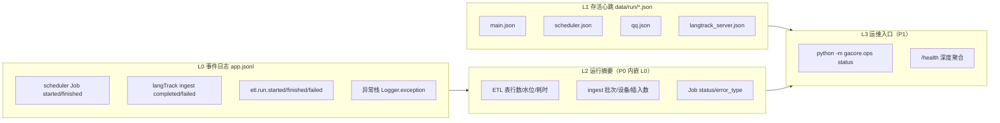
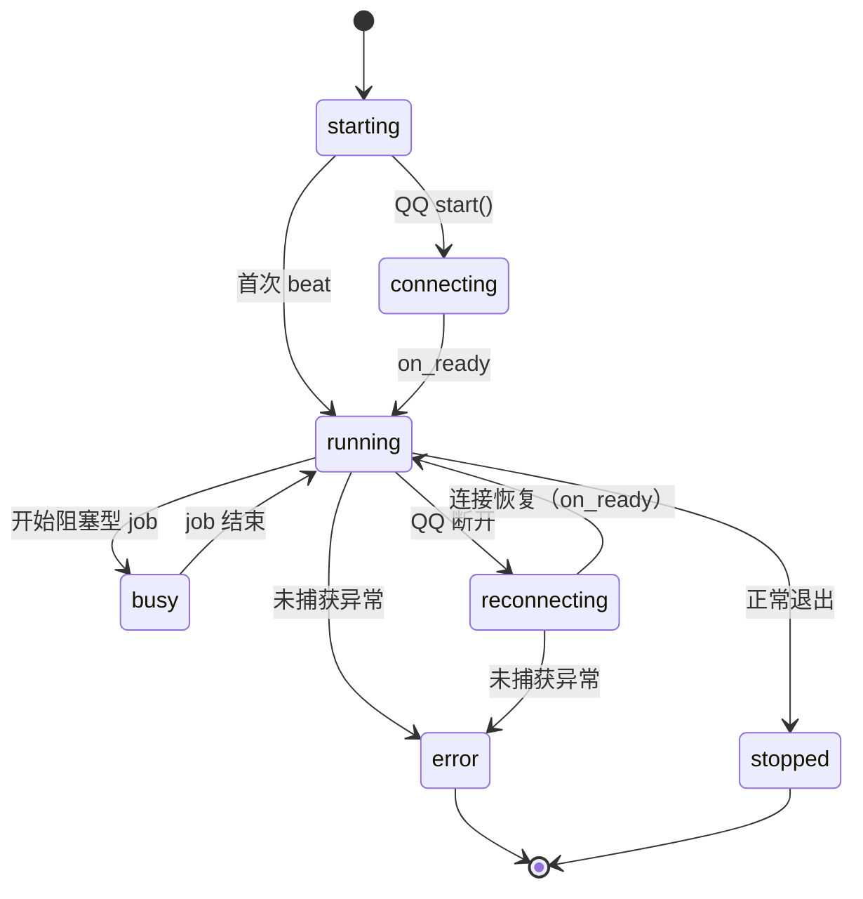

# withlanggraph 可观测性设计（P0：心跳 + 关键链路日志）

> 状态：待评审（设计稿）
> 日期：2026-10-21
> 范围：`apps/withlanggraph`（gacore 主进程、scheduler、langTrack server/ETL）
> 关联事故/证据：`apps/withlanggraph/logs/2026-10-21/app.jsonl`、`apps/withlanggraph/logs/2026-10-20/app.jsonl`、`apps/dev-console/logs/2026-10-05-101917/services/langtrack.log`

## 1. 问题定义

当前日志能证明“某个 ETL 跑过”，但不能回答运维最关心的五个问题：

1. 服务现在活着吗？
2. 哪个组件死了：主进程、scheduler、QQ、langTrack server？
3. 客户端上报还在进来吗？进来多少、有没有重复/失败？
4. 最近一次 ETL 成功了吗？处理了多少数据、水位推进到哪？
5. 出错时能不能直接看到异常栈，而不是只有一行 `str(e)`？

证据：

- `2026-10-21/app.jsonl` 里 `module=langTrack.server` **0 行**（该文件当日 422 行，`langTrack.extract` 296 / `langTrack.etl` 49 / `scheduler` 9 / 其余为工具与上下文模块）；心跳文件 0 个。
- 全量 `app.jsonl` 中，`langTrack.server` 同样是 0 行。server 用的是 stdlib `logging`，没有 JSONL handler；`INFO` 被丢弃，`WARNING+` 只进 stderr/service log。
- `2026-10-21` 的 ETL 行从 00:01 持续到 21:01，但主启动器 21:39 才启动。ETL 行只能证明“某个 ETL 子进程跑过”，不能证明服务在线。
- `2026-08-02..2026-10-21` 有 12 个日期完全没有日志；没有心跳时无法区分“没业务”与“进程没起来”。
- `apps/dev-console/logs/2026-10-05-101917/services/langtrack.log` 里有 `sqlite3.OperationalError: cannot commit - no transaction is active` 的完整 traceback，但 `app.jsonl` 里看不到。
- 2026-10-04/10-18/10-19 的 `app.jsonl` 分别混入 641/339/316 行 `tmp_pytest` 路径（pytest 写进了生产日志目录）；10-20 起为 0。测试日志隔离需要回归守卫（`GACORE_LOG_ROOT` 修复已在 `c4778b0` 落地）。

结论：**不是日志量不够，而是关键业务/存活事件没有进入统一日志，低价值 ETL 行反而占了大头。**

## 2. 目标与非目标

### 2.1 P0 目标

- 长驻组件有可判定的心跳文件：`main`、`scheduler`、`qq`、`langtrack_server`。
- scheduler 循环死亡不再静默：异常栈进 `app.jsonl`，心跳进入 `error`；`start.py` 对后台 task 增加 done callback。
- scheduler 可优雅停机：`start.py` 用 `threading.Event` 通知 `run_loop` 退出，正常退出写 `stopped`；强杀不写，靠 stale 判定。
- `/ingest` 每个批次至少一行完成/失败日志：批次、设备、事件数、插入数、去重、耗时。
- ETL 每次运行有 start/finish/failed 摘要：模式、耗时、表行数、水位、外部编码计数、异常栈。
- `Job finished` 带 `status/error_type/error_message`，不再只有 `exit_reason`。
- 新增 `Logger.exception()`，新代码不再用 `stack_trace=str(e)`。
- 测试日志根目录有回归守卫，生产 `logs/` 不被 pytest 写入。

### 2.2 非目标（本阶段不做）

- 不引入 Prometheus / Grafana / Loki / OpenTelemetry。单机自用工具，收益不抵运维成本。
- 不做完整 `gacore.ops` CLI（下一阶段）。
- 不做 `/health` 深度聚合（下一阶段）。
- 不做日志保留/轮转/压缩（下一阶段，但设计要留出字段）。
- 不做跨 app 日志 schema 统一（dev-console/checkself/mermaid-viewer 后续）。
- 不做全仓 40 处 `stack_trace=str(...)` 的一次性清扫；P0 只改本次触达路径，其余列 P1。
- 不改 ETL 业务逻辑、不改数据库事实表结构、不改上报协议。

## 3. 设计原则

1. **存活信号必须由被观测循环自己推进**。心跳模块不启动后台线程；否则主循环卡死时后台线程仍会写心跳，产生假活。
2. **一个信号一个真源**。P0 不新增 `health.jsonl`；运行摘要写现有 `app.jsonl`，存活写心跳文件，避免三套数据互相矛盾。
3. **日志字段稳定、可机读**。字段名一旦发布，后续只增不改；错误统一 `error_type/error_message/stack_trace/context`。
4. **可观测性失败不能带崩业务**。心跳写失败只告警、不抛异常；日志写失败由 logging 自身吞掉。
5. **测试不碰生产数据**。心跳目录和日志根目录都必须可注入/可覆盖，测试默认落 `tmp_path`。
6. **不记录事件 payload**。设备/批次 ID 可以进本地日志；短信/剪贴板/通知正文绝不进日志。

## 4. 信号分层



| 运维问题 | P0 信号 | 判定方式 |
| --- | --- | --- |
| 主进程活着吗 | `main.json` | 文件存在且未 stale |
| scheduler 活着吗 | `scheduler.json` | `state` + `updated_at_epoch` + `stale_after_sec` |
| QQ 前端活着吗 | `qq.json` | 同上；`reconnecting` 表示在重连 |
| langTrack server 活着吗 | `langtrack_server.json` | 同上 |
| 客户端还在上报吗 | `ingest completed` | 按 `ts` 看最近批次；`event_count/inserted/deduplicated` |
| ETL 最近成功吗 | `etl.run.finished/failed` | 最新一条的 `status/run_id/duration_ms` |
| ETL 处理到哪 | `etl.run.finished.watermarks/max_event_ts` | 与 `events` 最新 ts 对比 |
| 报错根因 | `stack_trace` | 直接看 traceback，不再只有 `str(e)` |
| 调度任务结果 | `Job finished.status` | `ok/error` + `exit_reason/error_type` |

## 5. 心跳文件设计

### 5.1 位置

默认：`apps/withlanggraph/data/run/<component>.json`
覆盖：环境变量 `GACORE_RUN_DIR`（绝对路径，或相对项目根目录）

组件名固定：

- `main`：`start.py` 的统一启动器
- `scheduler`：`run_loop` 轮询线程
- `qq`：`QQApp.start` 的 bot 连接循环
- `langtrack_server`：FastAPI lifespan

ETL 不写心跳文件。ETL 是短生命周期子进程，心跳会在不运行时立刻 stale，产生噪音；它的存活由 `etl.run.started/finished/failed` 表达。

### 5.2 文件契约

```json
{
  "schema_version": 1,
  "component": "scheduler",
  "instance_id": "a1b2c3d4",
  "pid": 12345,
  "state": "busy",
  "seq": 42,
  "started_at": "2026-10-21T22:00:00+08:00",
  "updated_at": "2026-10-21T22:00:30+08:00",
  "updated_at_epoch": 1761055230.123,
  "interval_sec": 30,
  "stale_after_sec": 1800,
  "detail": {
    "job": "daily-report",
    "job_type": "job"
  }
}
```

字段语义：

| 字段 | 类型 | 说明 |
| --- | --- | --- |
| `schema_version` | int | 契约版本，P0 固定 1 |
| `component` | str | 组件名，与文件名一致 |
| `instance_id` | str | 每次进程启动生成；变化即代表重启 |
| `pid` | int | 写入进程 PID |
| `state` | str | `starting/running/busy/connecting/reconnecting/stopped/error` |
| `seq` | int | 本实例内单调递增，用于发现“文件被旧实例覆盖” |
| `started_at` | str | 本实例启动时间，+08:00 |
| `updated_at` | str | 最近一次心跳，+08:00，给人看 |
| `updated_at_epoch` | float | Unix epoch 秒，给机器算 stale |
| `interval_sec` | int | 期望心跳间隔 |
| `stale_after_sec` | int | 超过该秒数未更新即 stale；`busy` 可放宽 |
| `detail` | object | 组件自定义的安全字段，禁止放 payload/密钥 |

写入语义：

- `beat(state=...)` 的 `state` 省略时沿用上一次状态；这样周期心跳不会把 `reconnecting` 冲成 `running`。
- `detail` **每次写入整体替换**，不做 key 合并；周期心跳不传 `detail` 时写空对象。需要保留的线索由调用方每次带上（QQ 用 `QQApp._hb_detail` 这张活字典持有 `launcher`/`connected_at`/`retry_in_sec`，周期 task 每次带上，`connected_at` 才不会被下一拍冲掉）。
- `stale_after_sec` **每次写入默认回到实例默认值**（`max(60, interval_sec * 3)`）；`busy` 只在本次显式放宽，job 结束后下一次 `running` 自动回到默认窗口，避免一次长任务永久拉长死亡检测窗口。
- `start()` 写 `state=starting`；`stop()` 默认写 `state=stopped`，异常路径可显式传 `state=error`。

### 5.3 状态机



`stale` 判定：

```text
if state == "stopped": 不告警（正常退出）
elif state == "error": 立即告警
elif now_epoch - updated_at_epoch > stale_after_sec: 告警
else: 健康
```

### 5.4 原子写入

- 先写同目录临时文件，再 `os.replace(tmp, target)`；读者永远看不到半行 JSON。
- 临时文件名包含 `pid + instance_id + seq`，避免并发覆盖。
- 写失败只按 60s 节流记 `WARNING`，绝不向业务抛异常。
- 不调用 `fsync`：心跳是概率性存活信号，不需要持久化保证；避免每 15s 的磁盘同步开销。

### 5.5 为什么不用后台线程

如果 `Heartbeat` 自己起一个 daemon 线程每 15s 写文件，那么 scheduler 主循环卡死、QQ 事件循环卡死时，心跳仍然新鲜，运维会被假活骗过。因此：

- scheduler：在每次 poll 开始时 `beat()`；阻塞型 job 开始前 `beat(state="busy", stale_after_sec=1800)`，结束后回到 `running`。
- QQ/server：用**绑定在同一个 asyncio event loop 上的 task** 定时 `beat()`；event loop 卡死则 task 也停，心跳自然 stale。
- main：同样用 asyncio task 绑定主 event loop。

## 6. Scheduler 存活与崩溃语义

### 6.1 启动时打印下一次触发

`scheduler` 启动时对每个 job 打一行：

```json
{"message":"scheduler job registered","job":"daily-report","type":"job","schedule":"23:50","next_run":"2026-10-21T23:50:00+08:00"}
```

这样不用翻 `schedule.json` 就能知道“今天还会不会跑、下一次几点”。

### 6.2 循环心跳

```mermaid
sequenceDiagram
    participant Start as start.py
    participant Task as asyncio.to_thread(run_loop)
    participant Loop as run_loop
    participant HB as scheduler.json
    participant Log as app.jsonl
    Start->>Task: create_task
    Start->>Start: add_done_callback
    Task->>Loop: 进入轮询
    Loop->>HB: start(state=starting)
    Loop->>Log: scheduler job registered x N
    loop 每 30s
        Loop->>HB: beat(state=running, iteration, job_count)
        alt 有阻塞型 job
            Loop->>HB: beat(state=busy, job, stale_after_sec=1800)
            Loop->>Log: Job started
            Loop->>Log: Job finished(status, error_type)
            Loop->>HB: beat(state=running, last_job)
        end
    end
    Loop->>HB: stop(state=stopped)
```

### 6.3 崩溃与停机路径

- `run_loop` 最外层 `except BaseException`（**不只 `Exception`**：`SystemExit` 之类会让线程静默死亡，若按正常路径收尾会把心跳写成 `stopped`，崩溃看起来像正常停机，正好错过告警）：`Logger.exception("scheduler loop crashed")`，心跳写 `state=error`，然后重新抛出。
- `run_loop` 接受可选 `stop_event: threading.Event`。生产 `start.py` 传入；`while` 条件检查 `not stop_event.is_set()`，轮询等待用 `stop_event.wait(poll_interval)` 而不是 `time.sleep`。这样正常停机时线程能退出，`finally` 才能写 `stopped`。
- `start.py` 注册 `gacore.scheduler.on_scheduler_done`（放在 `scheduler.py`，避免测试依赖 QQ/botpy）作为 `scheduler_task` 的 done callback：
  - `task.cancelled()` → `INFO Scheduler task cancelled`（只有外部 cancel 才会走这里）
  - `task.exception()` 非空 → `ERROR Scheduler task died` + 真实 traceback
  - 正常返回且 `stop_event` 已置位 → `INFO Scheduler task stopped`
  - 正常返回但 `stop_event` 未置位 → `WARNING Scheduler task exited unexpectedly`
- **不要用 `task.cancel()` 当正常停机手段**：`asyncio.to_thread` 的底层线程一旦开始执行就不可取消，cancel 只停 asyncio 外壳，线程仍会继续轮询和写心跳。正常停机必须 `stop_event.set()` 后 await task；如果当前有阻塞型 job，优雅停机要等它跑完。等不及就只能强杀，强杀路径靠 stale 判定。
- 进程被强杀：没有机会写 `error`，但心跳文件停在最后一次 `running/busy`，`updated_at_epoch` 变旧，仍可判定 stale。这是有意设计。

### 6.4 长任务不误报

日报 job 可能跑几分钟。`run_job` 是阻塞调用，会卡住 scheduler 轮询；因此进入前把 `stale_after_sec` 放宽到 1800s，并写 `state=busy + job`。运维看到 `busy` 不会当成死亡；超过 30 分钟才告警。

### 6.5 QQ 心跳

`QQApp.start` 的重连循环是长驻路径，必须有自己的心跳：

- `QQApp.__init__` 增加 `self._heartbeat: Heartbeat | None = None` 与 `self._hb_detail: dict[str, object] = {"launcher": "qq"}`（活字典：`detail` 每次整体替换，线索由调用方每次带上）。
- `QQApp.start` 创建 `Heartbeat("qq", root=run_dir(Config.default().root))`，赋给 `self._heartbeat`，`start()` 后先 `beat(state="connecting")`。
- bot 的 `on_ready` 回调里 `app._heartbeat.beat(state="running", connected_at=...)`，用真实连接成功作为 `running` 的唯一依据（并清掉 `retry_in_sec`）。
- 连接异常/退避分支在 `await asyncio.sleep(delay)` 前先写 `app._hb_detail["retry_in_sec"] = delay`，再 `beat(state="reconnecting", **app._hb_detail)`（带上 `connected_at`）。
- 周期 task 调 `heartbeat.beat(**detail)`（不传 state，沿用当前状态，只刷新时间），`detail` 就是 `QQApp._hb_detail` 这张活字典——`connected_at` 不会被下一拍冲掉。
- `finally` 里 cancel 周期 task、`heartbeat.stop()`。

这样 `qq.json` 能区分三种情况：`connecting`（正在建立连接）、`running`（on_ready 已触发）、`reconnecting`（断线退避中）；detail 键为 `launcher` / `connected_at` / `retry_in_sec`。

## 7. langTrack server 可观测性

### 7.1 日志出口

- `server.py` 从 stdlib `logging.getLogger("gacore.langTrack.server")` 改为 `gacore.jsonl_logger.get_logger("langTrack.server")`。
- 这样 server 的 INFO/WARNING/ERROR 与 ETL、scheduler 进同一个 `logs/<day>/app.jsonl`，用 `module` 字段区分。
- uvicorn 自身的 access/error log 仍走 stdlib；P0 不接管，避免和 uvicorn 配置打架。

### 7.2 `/ingest` 日志契约

成功（每批一行）：

```json
{
  "level": "INFO",
  "module": "langTrack.server",
  "message": "ingest completed",
  "batch_id": "b-20261021-001",
  "device_id": "canonical-device",
  "client_device_id": "raw-device",
  "event_count": 12,
  "inserted": 12,
  "deduplicated": false,
  "duration_ms": 4.2
}
```

幂等命中：

```json
{"message":"ingest completed","batch_id":"b1","event_count":12,"inserted":0,"deduplicated":true,"duration_ms":1.1}
```

失败：

```json
{
  "level": "ERROR",
  "module": "langTrack.server",
  "message": "ingest failed",
  "batch_id": "b1",
  "device_id": "d1",
  "event_count": 12,
  "error_type": "OperationalError",
  "error_message": "cannot commit - no transaction is active",
  "stack_trace": "Traceback (most recent call last): ..."
}
```

约束：

- 不记录 `Event.data`，不记录短信/剪贴板/通知正文。
- `device_id` 记录归一后的主设备；`client_device_id` **恒写键**，没有别名归一时为 `null`。JSONL 消费方不用区分“省略”和“空值”。失败行同样恒写 `client_device_id` 与 `duration_ms`。
- 每批只打一行完成/失败，不打“收到”+“完成”两行，控制体积。
- **设备别名归一必须落在 try 内**：别名文件（`data/device_aliases.json`，手改）损坏时若在 try 外抛错，整批 500 且零日志。归一化已在 try 内，且 `etl._load_device_aliases` 对「根节点不是对象」降级为“无别名”并告警。
- `/ingest` 的未捕获异常由路由自己记录（带 batch/device 业务上下文）并置 `request.state.ingest_logged`；HTTP 中间件只在**该标记未置位**时才补 `http request crashed`，既避免一个失败批次产生两条 ERROR，又保证任何漏归属的异常不会凭空消失。

### 7.3 HTTP 失败与 422

FastAPI 中间件只记录 `status >= 400` 的请求和未捕获异常：

```json
{"level":"WARNING","message":"http request failed","method":"POST","path":"/ingest","status":422,"duration_ms":2.0}
```

非 `/ingest` 路径的未捕获异常：

```json
{"level":"ERROR","message":"http request crashed","method":"GET","path":"/dashboard","status":500,"error_type":"RuntimeError","stack_trace":"Traceback ..."}
```

`/ingest` 路径的未捕获异常由 7.2 的 `ingest failed` 记录，中间件据此跳过，保证“每批一行失败”；只有路由没来得及归属（`ingest_logged` 未置位）时，中间件才补一行 `http request crashed`，杜绝“零日志批次”。

不记录所有 200 的 dashboard/map 请求，避免把日志淹没。

### 7.4 ETL 子进程归属

`server._run_etl_once()` 改造前只记 `periodic ETL ok`，没有耗时、触发来源、返回码。P0 落地后固定为四条消息：

- 成功 → `periodic ETL finished`（`trigger=periodic|manual` / `returncode` / `duration_ms`）
- 失败 → `periodic ETL failed`（附 `stderr_tail`，最多 2000 字符）
- 超时 → `ETL timeout`（`trigger` / `timeout_sec` / `duration_ms` / `stderr_tail`）——**只有这一条**超时消息，用 `trigger` 区分 periodic 与 manual，不再拆成两个消息名
- 崩溃 → `periodic ETL crashed`（`Logger.exception`）

另：`/etl/status` 增加 `last_trigger/last_duration_ms/last_error`。

ETL 子进程自己的 `etl.run.*` 日志仍是主真源；server 这行只回答“这个子进程什么时候被谁拉起、退出码多少”。

**超时/强杀是唯一例外**：`subprocess.run(timeout=...)` 超时会 kill 子进程，子进程可能只留下 `etl.run.started`，永远没有 finished/failed。此时父进程的 `ETL timeout` 行是唯一真源，必须带 `trigger/timeout_sec/duration_ms/stderr_tail`。

## 8. ETL 运行摘要

### 8.1 结构

把现有 `run()` 拆成薄包装 + `_run_impl()`：

- `run()`：生成 `run_id`、计时、写 `etl.run.started`，调用 `_run_impl`，写 `etl.run.finished` 或 `etl.run.failed`。
- `_run_impl()`：保留现有 ETL 主体，末尾收集摘要并返回 dict。

这样不用给 280 行主体整体缩进，也不改变现有调用方（`etl.run(...)` 返回值仍为 `None`）。

### 8.2 成功日志

```json
{
  "level": "INFO",
  "module": "langTrack.etl",
  "message": "etl.run.finished",
  "run_id": "9f3c1a2b",
  "status": "ok",
  "mode": "incremental",
  "db_path": "D:/.../data/langTrack.db",
  "duration_ms": 18342.5,
  "events": 120345,
  "sessions": 8342,
  "daily_stats": 41,
  "anomalies": 7,
  "route_changes": 2,
  "contract_coverage": 14,
  "geocode": 3,
  "route": 1,
  "poi": 0,
  "incremental_active": true,
  "affected_days": 3,
  "v2_location": true,
  "alias_merged": 0,
  "table_counts": {
    "events": 120345,
    "sessions": 8342,
    "daily_stats": 41,
    "places": 28,
    "stays": 190,
    "trips": 12,
    "anomalies": 7,
    "contract_coverage": 14
  },
  "watermarks": {"device-1": 1761050000000},
  "max_event_ts": 1761050000000,
  "db_size_bytes": 123456789
}
```

### 8.3 失败日志

```json
{
  "level": "ERROR",
  "module": "langTrack.etl",
  "message": "etl.run.failed",
  "run_id": "9f3c1a2b",
  "mode": "full",
  "db_path": "D:/.../data/langTrack.db",
  "duration_ms": 3210.0,
  "error_type": "OperationalError",
  "error_message": "cannot commit - no transaction is active",
  "stack_trace": "Traceback (most recent call last): ..."
}
```

`KeyboardInterrupt` 走 `etl.run.interrupted`（WARNING），不冒充 ERROR。

**超时/被父进程强杀**：子进程可能只留下 `etl.run.started`，永远没有 finished/failed。此时以 server 的 `ETL timeout` 行为准（见 7.4），不要拿“没有 finished”推断“还在跑”。

### 8.4 统计口径

- `events/sessions/daily_stats` 用本次构建的 list 长度，代表“本次处理量”。
- `table_counts` 在 ETL 最后 `_update_etl_state` 之后新开连接统计，代表“落库后的总量”。
- `watermarks` 来自 `etl_state.last_event_ts`，代表 ETL 已处理到的最大事件时间。
- `max_event_ts` 来自 `events.MAX(ts)`，与 watermark 对比可判断是否积压。
- `geocode/route/poi` 为 `None` 表示本次跳过（flag=False），`0` 表示执行了但没有新增。
- `db_size_bytes` 用 `Path.stat()`；日志记录 `str(db_path)`，不是 `Path` 对象。

## 9. 错误日志契约

新增：

```python
logger.exception("Job failed", exc=e, job=name, context={"stage": "graph"})
```

输出必带：

- `error_type`：纯异常类名（如 `OperationalError`），或业务失败原因码（如 `INCOMPLETE_REPLY`）；不带 `module.` 前缀
- `error_message`：`str(exc)`，纯消息，不带类名
- `stack_trace`：`traceback.format_exception(...)` 的完整栈
- `context`：可选的结构化上下文

兼容说明：`scheduler.run_job` 原有 `error` 字段是 `"RuntimeError: boom"` 这种复合字符串，继续保留，避免破坏已有消费方；新增的 `error_type/error_message` 是拆分后的纯值，新代码用后者判断。

禁止新代码继续写 `stack_trace=str(e)`。P0 只改本次触达的 scheduler/server/ETL 路径；其余 43 处列 P1 清扫。

## 10. 测试隔离

- `tests/conftest.py` 在导入时设置 `GACORE_LOG_ROOT` 到 `tempfile.mkdtemp()`。
- 新增回归测试：
  - `GACORE_LOG_ROOT` 不在项目 `logs/` 下；
  - `jsonl_logger._get_sink()` 的 `_log_root` 与 `GACORE_LOG_ROOT` 一致。
- 心跳测试全部传 `tmp_path`，不写真实 `data/run`。
- `create_app(storage, heartbeat_dir=tmp_path/"run")` 显式注入，避免 TestClient lifespan 写生产心跳。
- `create_app` 内的 lifespan 用工厂 `_make_lifespan(hb_dir)` 生成，不能用模块级函数 + 闭包捕获（捕获不到 `create_app` 参数）。
- `run_loop` 用 `Config.for_tests(tmp_path)`，心跳自然落 `tmp_path/data/run`。
- conftest 除 `GACORE_LOG_ROOT` 外还要清掉开发者环境可能带入的 `GACORE_RUN_DIR`，避免心跳写到真实目录。

## 11. 失败模式与取舍

| 失败模式 | 影响 | 处理 |
| --- | --- | --- |
| 心跳写失败（磁盘满/权限） | 运维看不到存活 | 60s 节流 WARNING，不阻断业务 |
| 心跳太频繁 | 磁盘写放大 | 15/30s 一次，单文件 <1KB |
| 长 job 卡住 | 心跳 stale 误报 | `busy + stale_after_sec=1800` |
| 后台线程假活 | 误判健康 | 不用后台线程，心跳由主循环推进 |
| 系统时钟跳变 | stale 计算错误 | 记录 epoch，文档说明依赖系统时钟；P1 可加 NTP 检查 |
| 两个同组件实例 | 文件互相覆盖 | 文件含 `pid/instance_id`；启动器已有单实例锁；P1 ops CLI 检测 seq 回退 |
| 日志体积增长 | 磁盘占用 | P0 只加关键行；P1 做保留/轮转 |
| 子进程日志 session 不同 | 无法按 session 串 | 用 `run_id` 串 ETL 起止；server 行用 `trigger` 关联 |
| 心跳目录不存在 | 首次写失败 | `mkdir(parents=True, exist_ok=True)` |
| Windows 文件占用 | replace 失败 | 临时文件 + `os.replace`；失败节流告警 |

## 12. 验收标准

### 12.1 自动化

```powershell
uv run pytest apps/withlanggraph/tests/test_heartbeat.py apps/withlanggraph/tests/test_scheduler.py apps/withlanggraph/tests/test_scheduler_heartbeat.py apps/withlanggraph/tests/test_scheduler_done_callback.py apps/withlanggraph/tests/test_qq_heartbeat.py apps/withlanggraph/tests/test_langTrack_server.py apps/withlanggraph/tests/test_langTrack_etl_summary.py apps/withlanggraph/tests/test_jsonl_logger_exception.py apps/withlanggraph/tests/test_log_isolation.py -q
uv run ruff check apps/withlanggraph/src apps/withlanggraph/tests
```

### 12.2 手工冒烟

```powershell
# 1) 看心跳（<date> 用当天日期，如 2026-10-21）
Get-Content apps\withlanggraph\data\run\scheduler.json -Raw | ConvertFrom-Json
Get-Content apps\withlanggraph\data\run\langtrack_server.json -Raw | ConvertFrom-Json

# 2) stale 判定：年龄是否超过文件自己声明的阈值
$hb = Get-Content apps\withlanggraph\data\run\scheduler.json -Raw | ConvertFrom-Json
$age = [DateTimeOffset]::UtcNow.ToUnixTimeMilliseconds() / 1000 - $hb.updated_at_epoch
"state=$($hb.state) age=$age stale_after=$($hb.stale_after_sec) stale=$($hb.state -ne 'stopped' -and $hb.state -ne 'error' -and $age -gt $hb.stale_after_sec)"

# 3) 看 ETL 最近一次
Select-String -Path apps\withlanggraph\logs\<date>\app.jsonl -Pattern '"message":"etl.run.finished"|"message":"etl.run.failed"' | Select-Object -Last 2

# 4) 看上报
Select-String -Path apps\withlanggraph\logs\<date>\app.jsonl -Pattern '"message":"ingest completed"|"message":"ingest failed"' | Select-Object -Last 5

# 5) 看调度
Select-String -Path apps\withlanggraph\logs\<date>\app.jsonl -Pattern '"message":"Job finished"' | Select-Object -Last 5
```

### 12.3 判定

- 启动 `start.py` 后，`main.json`、`scheduler.json`、`qq.json` 存在；按 12.2 的 stale 公式计算为健康（`age <= stale_after_sec`）。
- 停掉进程后，心跳不再更新；等 `age > stale_after_sec` 后能判定 stale。正常停机的文件 `state=stopped` 不触发告警，异常死亡的文件停在 `running/busy` 触发告警。
- 发一个 `/ingest` 批次，`app.jsonl` 出现且仅出现一行 `ingest completed`，字段齐全（`client_device_id` 无别名时为 `null`）。
- 发一个非法 `/ingest`，出现 `http request failed`（422），**不**出现 `ingest failed` / `http request crashed`。
- 跑一次 ETL，出现 `etl.run.started` 和 `etl.run.finished`，`duration_ms > 0`，`table_counts` 非空。
- 人为让 `run_loop` 抛异常：测试 `test_run_loop_crash_sets_error_heartbeat` 覆盖 `scheduler loop crashed` + `stack_trace` + 心跳 `state=error`；`start.py` 的 `Scheduler task died` 由 `gacore.scheduler.on_scheduler_done` 单元测试覆盖（`tests/test_scheduler_done_callback.py`）。
- 正常 `stop_event.set()` 停机：`run_loop` 退出，心跳写 `stopped`，不出现 `Scheduler task cancelled`（cancel 只留给异常兜底）。

## 13. 分阶段路线

| 阶段 | 内容 | 验收 |
| --- | --- | --- |
| P0（本设计） | 心跳 + scheduler 崩溃回调/优雅停机 + ingest 日志 + ETL 摘要 + exception helper + 测试隔离 | 上述验收 |
| P1 | `python -m gacore.ops status` 聚合心跳/最新 ETL/最新 ingest；`/health` 深度检查 DB/磁盘/水位；`stack_trace=str(e)` 全仓清扫；敏感字段脱敏（`to` 邮箱等）；proactive/extract 池内异常可观测；scheduler 连续死亡时的自愈/告警 | 一条命令回答“现在怎么样”，且日志无 PII 泄露 |
| P2 | 日志保留/轮转；启动时清理 stale 心跳；dev-console/checkself/mermaid-viewer 统一 schema | 磁盘可控、跨 app 可观测 |

## 14. 附录：字段字典

### 14.1 通用

- `ts`：日志时间，ISO8601（`jsonl_logger` 用 `datetime.fromtimestamp(record.created).astimezone()`，跟随机器本地时区；国内机器即 +08:00；只有日志**目录日期**强制按 +08:00 归档）
- `level`：DEBUG/INFO/WARNING/ERROR
- `module`：`langTrack.server` / `langTrack.etl` / `scheduler` / `qq` / `heartbeat`
- `message`：稳定的事件名，不作为展示文案
- `session`：进程级 8 位 ID
- `pid`：进程 ID

### 14.2 心跳

见 5.2。`detail` 允许的键按组件约定：

- `main`：`launcher`
- `scheduler`：`poll_interval`、`max_iterations`、`iteration`、`job_count`、`job`、`job_type`、`last_job`、`last_status`、`iterations`、`jobs_run`
- `qq`：`launcher`、`retry_in_sec`、`connected_at`
- `langtrack_server`：`etl_interval_sec`

### 14.3 ETL

`run_id`、`status`、`mode`、`duration_ms`、`events`、`sessions`、`daily_stats`、`anomalies`、`route_changes`、`contract_coverage`、`geocode`、`route`、`poi`、`incremental_active`、`affected_days`、`v2_location`、`alias_merged`、`stays_v2`、`table_counts`、`watermarks`、`max_event_ts`、`db_size_bytes`。

### 14.4 Ingest

`batch_id`、`device_id`、`client_device_id`、`event_count`、`inserted`、`deduplicated`、`duration_ms`。

### 14.5 server ETL 子进程

`trigger`、`returncode`、`duration_ms`、`stderr_tail`、`timeout_sec`；`/etl/status` 额外返回 `last_trigger`、`last_duration_ms`、`last_error`。
