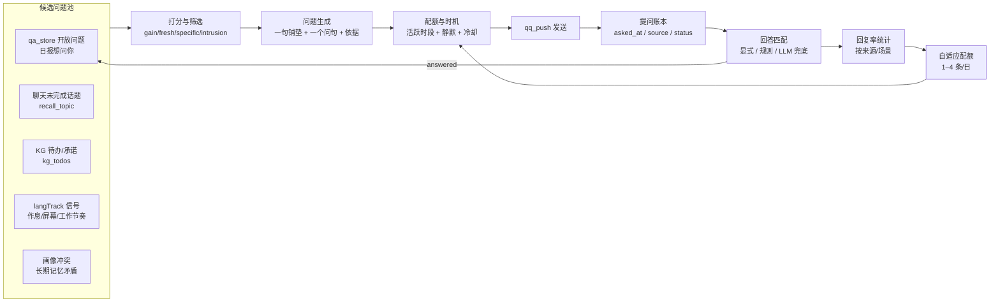

# 主动询问 2.0 设计：问得更多、更准、不打扰

## 1. 目标与边界

目标是把主动提问从"每天 08:30 转述昨日日报问题"扩展成一套可持续的提问回路：候选问题更多、发送时机更贴近用户作息、用户随口回答也能被正确归因，并且提问量随回复率自动升降。

三个可验收的结果：

- 同时有 3 个开放问题时，用户用自然语言回答其中一条，系统能以 ≥0.8 置信度归因到正确问题，且不打断正常聊天。
- 主动提问量可在 1–4 条/日之间自适应，回复率低的来源自动降频，连续被忽略的问题不再追问。
- 每条问题都能回溯到具体来源（日报、聊天未完成话题、KG 待办、langTrack 信号），不允许无依据提问。

不做的事：不新增 QQ 发送通道；不改变现有 `qq_push` 的 C2C 推送方式；不把主动提问内容当作主人陈述写进长期记忆。

## 2. 现状审计

| 环节 | 现有实现 | 事实约束 |
| --- | --- | --- |
| 问题种子 | `qa_store.seed_questions` 从日报正文「想问你」锚点种入 `data/qa/{date}.jsonl` | 日报允许 0–5 条问题 |
| 重问预算 | `qa_store.mark_pushed` 发送后 `asks+1`；`archive_stale` 在 `asks > 2` 时归档为"用户不关心" | 同一问题最多出现 3 次 |
| 回答捕获 | `qa_store.try_answer`：`[Qn]` / `[想问你-N]` 显式命中；裸短答仅在 `len(open_) == 1` 且 ≤30 字、非问句时生效 | 多问题并存时裸答完全失效 |
| 调度 | `config/schedule.json` 仅启用 `daily-questions`（08:30，窗口 08:00–09:30，cooldown 720min） | 目前只有一条主动询问任务 |
| 护栏 | `proactive.py`：`max_per_day=2`、`hot_chat_minutes=30`、`jitter_minutes=30`；`idle_hours=24` 仅对 idle 场景生效 | 08:30 固定触发，不参考用户活跃时段 |
| 发送后状态 | `_mark_sent` 写 `last_sent`/`daily_count`；`_mark_topic_answered` 在**发送成功时**调用 | 把"已问"记成"已答"，无法据此判断是否被忽略 |
| 回复反馈 | `try_answer` 命中后写 `answered` 与 `candidates.jsonl`；未命中不记录 | 没有"问了但没回"的显式账本 |
| 活跃数据 | `record_last_active` 只存最后一次时间戳 | 没有 24 小时活跃分布，无法选时机 |

两个直接结论：提问量受限于"一次只能有一个开放问题"的裸答匹配；提问时机受限于固定 cron。这也是"问得多"和"问得准"目前互相冲突的根因。

## 3. 总体结构



五个部件：候选池负责"可以问什么"，打分负责"值不值得问"，生成器负责"问得像人"，护栏负责"什么时候问、问几条"，账本负责"问完有没有回"。

## 4. 候选问题池

候选统一成一个结构，来源不同但字段一致：

```text
source        qa_open | chat_loop | kg_todo | langtrack | memory_conflict
ref           来源定位（question_key / thread_id + message_id / todo_id / 指标名）
topic         主题词（复用 audit topic 词表）
anchor        一句具体依据（日期、数字、事件）
question_hint 生成器的语义提示，不是最终文案
freshness     信号发生时间
gain          预期信息增益（0–1）
```

各来源的提取规则：

- `qa_open`：`qa_store.open_questions` 已开放且未超重问预算的问题，直接进入候选。
- `chat_loop`：`proactive.recall_topic` 已能识别主线程最后一条 HumanMessage 是否为未完成问题；扩展它同时识别"回头再说 / 明天再弄 / 等忙完"这类承诺句，记录 `thread_id + message_id`。
- `kg_todo`：抽取层 `kg_edges` 中 `src='todos'`、`valid_to IS NULL`（未闭合）且 `valid_from` 在近 14 天内的承诺；实际 schema 没有 `due_at` 列，到期日暂不可用，先按"最近提出且仍未完成"取。
- `langtrack`：只取可解释的异常，例如连续 3 天入睡晚于 02:00、屏幕时间相对 30 日均值上浮 50%、周末工作时段显著增加；不取单日噪声。
- `memory_conflict`：长期画像与近 7 日事实矛盾（例如画像写"早睡"但连续熬夜），由日报的「画像候选」链路提供，不新增 LLM 扫描；实现上取 `data/qa/candidates.jsonl` 里仍 `pending` 的画像条目（画像缺口），以确认式问题回问。

去重沿用 `qa_store.question_key`（topic + 意图指纹）；同一 `topic` 在 7 天内最多出现一次，已回答的 key 永不再入池。

## 5. 打分、批量与配额

打分保持可解释，不做黑盒模型：

```text
score = 0.30 * gain
      + 0.25 * freshness
      + 0.20 * specificity
      + 0.15 * answer_likelihood
      + 0.10 * novelty
      - 0.30 * intrusion
```

- `gain`：画像缺口、待办到期、矛盾未消解为高；纯好奇为低。
- `freshness`：24 小时内为 1，7 天线性衰减到 0。
- `specificity`：带日期/数字/具体事件为高；"最近怎么样"这类为 0。
- `answer_likelihood`：该来源近 30 天回复率，冷启动用 0.5。
- `intrusion`：当前小时是否在静默时段、30 分钟内是否热聊、该来源连续忽略次数。
- 低于 0.55 不入发送队列；每个时段最多取前 2 条，回复率 >50% 时可放到 3 条。

批量规则：一条消息内最多 3 个问题，按 `[Q1] [Q2] [Q3]` 编号；问题之间必须同源或同主题，避免变成问卷。超过 3 条的候选留在池里等下一个时段，不一次性倾倒。实现上 `select` 只取总分最高的一类来源，日报 `想问你` 非空时不再混入候选池（同源约束优先）。

自适应配额按近 7 天回复率调整：

| 7 日回复率 | 每日上限 | 单条消息问题数 |
| --- | --- | --- |
| < 15% | 1 | 1 |
| 15%–40% | 2 | 2 |
| 40%–60% | 3 | 2 |
| > 60% | 4 | 3 |

配额只降不升的例外：新来源冷启动给 3 天观察期，按 2 条/日试投；观察期内回复率 <10% 直接停用该来源 14 天。

## 6. 回答匹配

这是"问得多"能否成立的关键。现有 `try_answer` 只有单问题裸答，改成三层，且**只有显式锚点才拦截聊天**：

1. 显式锚点：`[Qn]` / `[想问你-N]`，沿用 `_resolve_explicit`，命中即记 `answered` 并返回确认，不进 agent 轮。
2. 规则匹配：对 2 个以上开放问题，用主题词 + 问题 2-gram 重合度打分；唯一最高分 ≥0.7 时记 `answered`，`match_method=rule`。此层**不拦截**消息，正常聊天继续，只在后台落账。
3. LLM 兜底：规则分在 0.45–0.7 且消息长度 >8 字时，调用一次轻量分类（输入开放问题列表 + 用户消息，输出 `question_key` 或 `null` + 置信度）；≥0.75 才落账，`match_method=llm`。分类失败或超时一律按未命中处理，不影响聊天。

不落账的情况：消息以问号结尾、命中命令前缀、属于周报交互（`评分/候选`）、或同时命中两个问题且分差 <0.1。歧义时不猜，避免"静默答错"。

落账字段新增：`answered_at`、`match_method`、`match_confidence`；回答原文沿用既有 `answer` 字段（不另设 `answer_text`，避免双份真源）。人工可回滚：`qa_store` 增加 `unanswer(question_key)`，把状态改回 open 并清空匹配字段。

同时修正现有语义：`proactive.py` 发送成功后不再调用 `_mark_topic_answered`，改为 `_mark_topic_asked`（只写 `asked_at`）；`answered` 只由匹配层写入。

## 7. 时机与护栏

活跃时段：`record_last_active` 之外新增 `active_hours[24]` 直方图，按 QQ 消息时间戳累加，30 天半衰期。调度时段取直方图最高的 2 个小时，前后各 30 分钟抖动；默认静默 23:30–07:30。

发送闸门按顺序判断：

1. 全局开关 `enabled=false` 直接退出。
2. 静默时段、当日配额、连续忽略静音期。
3. 热聊冷却：最近 30 分钟有用户消息则跳过；此时若候选仍高分，转为在当前对话里自然追问，不发独立推送。
4. 同主题 7 天冷却、同来源 14 天静音。
5. 与上一条主动消息至少间隔 3 小时。

连续忽略定义：发出后 24 小时内无任何用户消息，或用户消息与问题无关且未触发匹配，记 `ignored_count+1`；连续 2 次忽略 → 该来源静音 14 天，问题归档。用户回复"别问了 / 不想回答" → 全局静音 7 天，并记一条 `proactive.muted` 日志。

## 8. 状态与日志

`data/qa/{date}.jsonl` 行新增字段（旧行缺字段按默认值读取，兼容）：

| 字段 | 含义 | 落地 |
| --- | --- | --- |
| `source` | 候选来源 | P0 |
| `asked_at` | 首次发送时间 | P0 |
| `delivered_at` | 最近发送时间 | P0 |
| `ignored_count` | 连续未回次数 | P0 |
| `answered_at` | 回答落账时间（同时决定 `answer_day`） | P1 |
| `match_method` / `match_confidence` | 回答归因方式（explicit/rule/llm）与置信度 | P1 |
| `cooldown_until` | 同主题冷却截止 | P3 |

`data/proactive_state.json` 新增：

| 字段 | 含义 |
| --- | --- |
| `active_hours` | 24 维活跃计数，按 30 天半衰期衰减 |
| `reply_stats` | 按 scene/source 的 asked/answered/ignored 计数 |
| `muted_until` | 全局或来源级静音截止 |
| `last_proactive_at` | 上一条主动消息时间，用于 3 小时间隔 |

日志事件：`proactive.candidate`（来源、分数、是否入选）、`proactive.asked`（question_key、source、slot）、`proactive.match`（方法、置信度、耗时）、`proactive.muted`。这些事件走既有 `app.jsonl`，并在 `python -m gacore.ops status` 增加一段 `proactive` 摘要（今日提问数、7 日回复率、静音来源）。

## 9. 分期落地

P0（语义与账本，不改行为）：修正"发送即已答"，补 `asked_at`/`ignored_count`/`reply_stats`，让现有 08:30 任务先产出真实回复率。验收：日报问题发出后，未回不会被标 answered；`ops status` 能看到 7 日回复率。

P1（多问题匹配，已完成 2026-10-26）：实现规则 + LLM 兜底匹配，放开单条消息 2–3 个问题（`_MAX_QUESTIONS_PER_PUSH=3`），显式锚点仍拦截。验收：3 个开放问题时自然语言回答 Q2 能被正确归因，正常聊天不被吞。

P2（候选池与生成器，已完成 2026-10-26）：新增 `proactive_candidates.py`，接入 `chat_loop`、`kg_todo`、`langtrack`、`memory_conflict` 四类来源 + 可解释打分（权重与阈值同 §5）+ 依据校验。候选问题由模板从真实来源行生成，日期/数字入池即已可追溯；`verify_evidence` 再对模型转述做发送后审计（`proactive.evidence` 日志）。入选候选经 `qa_store.seed_candidates` 落成 `kind=candidate` 的待答问题，复用既有 `mark_pushed`/`mark_ignored`/`reply_stats`/P1 匹配层。验收：候选来源可追溯（`ref` 指回 `kg_edges`/`daily_stats`/`candidates.jsonl`/`thread_id`），低于阈值不发。

P3（时机与自适应）：活跃时段调度、动态配额、来源静音、`别问了` 命令。验收：连续忽略后自动降频，静默时段零发送。

## 10. 风险与回滚

| 风险 | 处理 |
| --- | --- |
| 回答归因错误 | 规则分差 <0.1 不猜；LLM 置信度 <0.75 不落账；提供 `unanswer` 回滚 |
| 提问过多引起反感 | 配额只按回复率上升；连续忽略静音；静默时段；单条最多 3 问 |
| 引用过于具体显得被监视 | 只用本地已有数据；问题必须带"我看到了什么"的轻铺垫，不罗列细维度 |
| QQ 主动推送平台限制 | 保持 ≤4 条/日；推送失败按现有 `_MAX_FAIL_RETRIES=3` 停止；不新增通道 |
| LLM 成本 | 每时段只对入选的 ≤3 条生成文案；匹配优先规则，LLM 仅兜底 |
| 状态文件膨胀 | `answered_topics` 已有 LRU 上限；`reply_stats` 只保留 scene/source 维度，不做逐条历史 |

回滚方式：`config/proactive.json` 设 `enabled=false` 即停；新字段全部可缺省，旧代码读取不受影响；P1 匹配层可单独关闭 `match.llm_enabled=false`，退回显式锚点。

## 11. 测试计划

单元测试：

- 匹配层：显式锚点、单问题裸答、多问题规则命中、分差过小不猜、问句/命令不落账、LLM 超时降级。
- 打分：各维度边界、阈值、同主题 7 天冷却、来源静音。
- 配额：四档回复率对应上限、冷启动观察期、连续忽略升级。
- 活跃时段：直方图衰减、静默时段、3 小时间隔。

集成测试（mock `qq_push`）：

- 08:30 槽位：候选 → 打分 → 生成 → 发送 → `asked_at` 落账。
- 用户自然语言回答 Q2 → 匹配 → `answered` → 下一期不再注入。
- 连续两轮无回复 → 来源静音 → 第三轮不再选该来源。

回归：`test_proactive.py`、`test_proactive_p1.py`、`test_qa_store.py`、`test_qq.py` 全绿；新增字段不得改变旧行解析结果。

## 12. 需要确认的两个取舍

- 提问上限：当前设计最高 4 条/日、单条 3 问。如果觉得还是保守，可以把上限提到 6 条/日，但需要接受回复率阈值更严格（<25% 即降到 1 条）。
- 匹配兜底：LLM 分类会给每条候选消息增加一次轻量调用。若更在意响应速度，可以只保留规则匹配，代价是多问题场景的归因率会下降。
