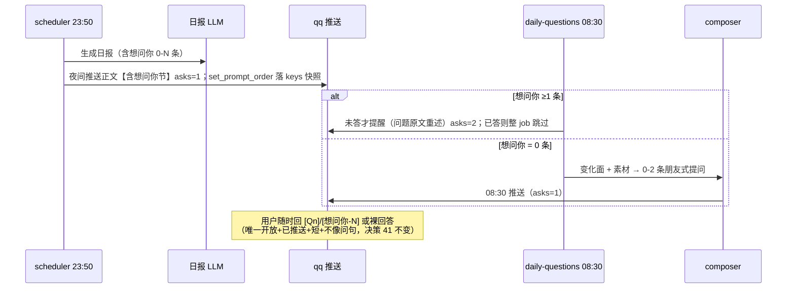

# 主动询问 3.0：朋友式归因提问 + 日报随报问（设计稿 v1 for review）

> 状态：Draft v1 for review（2026-10-27）
> 范围：`apps/withlanggraph` 日报「想问你」触达口径修订 + 主动询问（daily-questions job）的出题人升级
> 相关：`proactive-inquiry-2.0.md`（P0 账本 / P1 匹配 / P2 候选池）、`langTrack-tech.md` §9.36–9.41、日报评测设计（决策 25/29/35/40/41）
> 修订说明：2.0 解决了「怎么问、怎么答、怎么不重复」；3.0 解决「问什么、问多深」——用户拍板两个变更：①日报的问题随日报直接问（修订决策 40）；②主动询问升级为 LLM 归因式出题，像朋友一样深挖行为背后的原因，候选池降级为素材源与兜底。

## 0. 摘要

现狀两个别扭：

1. **日报的问题被拆成两条消息**。决策 40 让夜间 QQ 正文剥掉「想问你」节、次日 08:30 单独推——本意防重复打扰，但用户实际习惯是看到日报顺手就回（10-25 马鞍山一问即次日中午裸回答闭环）。拆分反而把一个自然交互变成两条等待。
2. **主动询问不像朋友**。2.0 P2 候选池的四条规则通道（承诺句/KG 待办/作息异常/画像缺口）选出来的问题全是"任务确认"口径——「你答应的 Moonlight 弄了吗」是秘书，不是朋友。

3.0 的核心判断：**问题不问行为，问行为背后的原因**。把「连着两晚 23 点后高活跃」和「工作日记里决定直接领领导的活」两个信号放在一起，形成因果假设（工作压着），用「是不是……」的试探句式递过来——这是 L3 级提问，是朋友。程序负责算出「哪里不对劲 + 同期发生了什么」（变化面），LLM 负责归因和措辞，既有 qa 账本/匹配/冷却/归档链路（2.0 投资）全部保留。

## 1. 用户拍板（本设计的决策来源）

| 编号 | 决策 | 内容 |
|---|---|---|
| D-A | 日报随报问 | 日报的问题随日报直接问，看到了就回；不再夜间剥节、次日单独推 |
| D-B | 朋友式归因提问 | 主动询问应是 LLM 基于历史/最近数据提的、像朋友拉近距离互相了解的问题；深挖底层原因（例：为什么这么晚睡 + 结合工作日记 → 问是不是工作上遇到什么事）；候选池方向认可但降级为素材 |

用户锚定示例（3.0 出题人的验收基准）：

> 「连着两晚都折腾到挺晚，又看到你之前说要直接把领导的活都接下来——最近工作上是有点压着吗？」

## 2. 外部调研：业界与学术怎么设计

### 2.1 产品谱系：主动消息的三个流派

| 产品 | 定位 | 主动消息策略 | 对本设计的启示 |
|---|---|---|---|
| 豆包 | 通用助手 | 严格场景化（长任务完成后提醒），「有服务价值才发」，用户同意/频控/拒绝生效三原则 | 工具型克制：主动≠刷存在感 |
| 星野 | ACG 情感陪伴 | 数小时/数天后「记起」用户，发想念/关心/日常分享 | 情感连接靠"被记得" |
| 猫箱 | 沉浸式剧情 | 拟亲密抱怨（「怎么不理我了」）、早安剧情续接 | 最激进；监控感/腻味风险也最大 |
| Replika | 泛陪伴 | 付费主动触达，CEO 口径：**"knows you and follows up"（记得你并跟进）才是关心而非打扰** | 有记忆的跟进 = 关心的本质 |
| Character.AI / Meta AI | 泛角色/助手 | 2025 起测试 daily-relevant messages（自然、相关、及时、用户可控） | 用户口碑两极（贴心/creepy）→ 频控与退出机制是生命线 |
| Woebot / Wysa | 心理健康 | 有界共情、5-10 分钟低摩擦 check-in、「我注意到你几天没来了」式开场 | 短、轻、不越界；透明感 |

**定位结论**：本系统是"有真实数据底座的个人日报助手"，想要的位格在豆包与星野之间——**有据可依的关心**：不撒娇不抱怨（猫箱），也不止于服务提醒（豆包）；每次主动开口都有真实信号背书（Replika 的 knows-and-follows-up，且我们的"记忆"是真数据不是对话印象）。

### 2.2 学术参考

- **CHI 2025《How Proactive AI Influences User Experience》（arXiv:2502.09271）**：主动 AI 的 UX 模型 **Triggers → Intent → Capability → Application**；风险三件套：打扰感、数据过度收集、信任-效用-风险权衡。→ 本设计的触发器（变化面）必须可解释，"你怎么知道的"永远要有答案。
- **ACM CUI 2024《Can a Chatbot Be Proactive?》（arXiv:2305.15926）**：简单场景用户偏好主动、复杂场景偏好被动；**用户对主动性的整体印象由第一次主动行为决定**。→ 3.0 上线初期深挖要克制（宁浅勿深），第一印象不能翻车。
- **ESConv / TELLER（ACL 2023）问题策略研究**：情感支持对话中提问有阶梯——**先开放问题把握情况，后用收窄/深入问题探询心理状态**；深入追问对应「Reflection of Feelings」策略。→ 用户拍板的 L1→L3 阶梯有现成学术对应：L1≈开放跟进，L3≈Reflection of Feelings（对感受/原因的反映式探询）。
- **LangChain《Proactive Agents》**：主动 agent = 触发器 + **对用户世界的记忆/知识**。→ 候选池与变化面就是"对用户世界的知识"，保留。

### 2.3 提炼：六条设计原则

1. **有据才开口**：每次提问内部挂证据（真实信号），无据不问（防编造、防监控感——"你怎么知道的"永远答得上来）。
2. **问因不问行**：深挖指向原因/感受/处境（L3），不指回数据本身（L0/L2 是念账）。
3. **深挖是例外**：模式显著异常才 L3；平时 L1 闲聊甚至不出题。天天关心=监控。
4. **低摩擦**：一条消息一个来源，问题可一句话答（裸回答链路保留），也容许展开。
5. **频控与退出**：每天最多 1-2 问；「别问了」命令静音；夜间 23:30–07:30 不因提问打扰。
6. **首因克制**：上线初期宁浅勿深， trust 建立后 L3 占比自然抬升（呼应 ACM 2024）。

## 3. 核心设计

### 3.1 问题深度阶梯

| 级别 | 名称 | 定义 | 示例（同一证据底座） | 使用时机 |
|---|---|---|---|---|
| L0 | 数据复读 | 把观察到的事实念给用户 | 「你昨晚 1 点才睡」 | **禁止作为问题**（只是陈述） |
| L1 | 兴趣/任务跟进 | 就近期话题接一句 | 「破门而入后来自己上手了吗？」「客厅串流推进了吗？」 | 默认档；无异常时的闲聊 |
| L2 | 模式指出 | 指出跨日模式但仍落回行为 | 「连着两天都折腾到挺晚啊」 | 仅作 L3 的铺垫句 |
| L3 | 归因关心 | 跨信号归因成因果假设，试探原因/感受/处境 | 「连着两晚都折腾到挺晚，又看到你之前说要直接把领导的活都接下来——最近工作上是有点压着吗？」 | 变化面出现显著异常时 |

判定规则：L3 必须 ≥2 路独立信号交汇（行为异常 + 语境事件），句式用「是不是/会不会/是……吗」试探口径；**禁止**「你为什么」「怎么又」的质问口径。敏感线（家庭/健康等）沿用日报既定的温和规则，且敏感线话题只允许 L1–L2，不允许 L3 猜测（防止"AI 猜我家里出事了"的越界感）。

### 3.2 变化面（deviation surface）：程序先行，为归因而组织素材

新模块 `question_surface.py`（纯读，封闭测试）。每天出题前计算，输出给 composer 的不是日志罗列，而是「**哪里不对劲 + 同期发生了什么**」：

```
〔变化面·2026-10-27〕
- 异常1：活跃时段——近 3 天 23 点后高活跃，此前 30 天基线为 22:30 前收尾（偏离 +1.5h）
  同期事件：10-22 深夜决策「领导派活直接领」；10-23 提交 18 笔；tsp 接手期第 2 周
- 异常2：无（其余信号在基线内）
- 近 14 天已问过：深空当铺入正节奏（10-26·L1·未答）、马鞍山复诊（10-24·已答）
- 候选池原料：KG 待办「排查手机断流」挂起 6 天（task 类，仅作素材）
```

信号路（全部复用既有数据，零新采集）：

| 路 | 来源 | 算什么 |
|---|---|---|
| 睡眠/作息 | `daily_stats`（sleep_start/screen/switch） | 近 3 天 vs 前 30 天基线的偏移；连续偏离天数 |
| 屏幕与应用 | `daily_stats`（total_screen_ms/app_ranking） | 屏幕时长倍增/骤降；新 App 进入 Top5 |
| 活跃时段 | `daily_stats` 事件表时段分布 | 深夜活跃/白天静默等时段漂移 |
| 工作 | git 提交（既有 git 数源）+ daily notes 工作线 | 提交节奏突变；项目关键词共现 |
| 情绪/生活 | `kg_emotions`（valence 走势）+ daily notes 近 7 天 | 效价连跌/连升；生活事件（家庭/健康/消费） |

每路异常附带 `evidence`（数据键 + 数值），供 composer 引用与事后审计；**证据原文不进用户消息**。无异常输出「本期无显著偏离」，composer 据此退 L1 或不出题。

### 3.3 出题人 composer：LLM 归因出题

新模块 `question_composer.py`。输入包 = 变化面 + 长期画像摘编（复用 `_compact_long_term` 口径）+ 近 14 天问答史（`qa_brief` 已有 as-of 栅栏）+ 候选池原料（2.0 P2 `collect_all` 输出降级为素材行）。

Prompt 要点（骨架，实现时打磨）：

```text
你是用户的长期助理，语气像熟识的朋友。用户授权你基于他的本地数据主动提问。
素材里的「变化面」列出最近值得注意的偏离（如有）。

出题步骤（内心完成，不写进消息）：
1. 判断变化面是否有值得注意的模式；没有 → 出 0-1 条 L1 闲聊或不出题
2. 有 → 为该模式找 1-2 个可能的解释（从同期事件里找，不许编造）
3. 选最可能/最重要的一个，用试探句式问原因或感受

铁律：
- 问题指向原因/感受（最近是不是……/会不会是……），禁止质问（你为什么/怎么又）
- 每个事实必须有素材出处；素材里没有的事不许提
- 与「近 14 天已问过」重复的话题一律不再问
- 最多 2 条；每条一句话铺垫（我注意到了什么，L2）+ 一个问句（L1 或 L3）
- 家庭/健康相关保持温和，不做因果猜测
- 输出 JSON：[{question, depth: L1|L3, topic, evidence_keys}]（evidence_keys 仅内部审计用，不进消息）
```

随机性实现：变化面多路异常时按「显著度 × 距上次问该 topic 的天数」加权采样一条主线（不是固定取第一路）；LLM temperature 0.7。产出仍走 2.0 的 `seed_candidates`→qa 账本（`kind=candidate` 扩为 `kind=composed`），去重/冷却/已答不重问全部复用。

**降级链**：composer（LLM 失败/超时/`composer.enabled=false`）→ 候选池规则选题（2.0 P2 原逻辑）→ 不出题。每级落结构化日志。

### 3.4 调度与问答流（决策 40 修订后的完整时序）



- **裸回答口径**：夜间推送即 `mark_pushed`，当晚裸回答即刻生效（比 2.0 还早了 8.5 小时）。
- **`cap_questions`**：上限 5 条不变（日报正文压缩用）；`_push_daily_to_qq` 删除剥节逻辑，回复指引回到「回 [Q1] 你的答案；要订正正文回『订正 …』」两态。
- **全局决策 40 标记废弃、25 改语义**：08:30 从「单独首推」改为「未答提醒 + 日报缺位时的主动询问」，spec 同步批注。
- archive_stale（max_asks=2 后归档）不变：夜间+晨间正好两次触达。

### 3.5 回答回流

回答捕获链路不变（`try_answer` → `record_answer` → `candidates.jsonl` pending → 周报「画像候选」确认）。3.0 特有点：**L3 的回答往往自带新事实**（「是，项目要上线了天天赶」）——`record_answer` 已把回答原文落账本并进 `_QA` 源与周报素材，够用；不新增解析，避免把自由文本硬拆碎。

### 3.6 护栏

| 风险 | 护栏 |
|---|---|
| 监控感（「你怎么知道我几点睡的」） | 每次深挖的证据真实且可回溯；消息不引用敏感原文；「别问了」命令即时静音 48h 并落账本 |
| 深挖过频 | 变化面无显著异常 → 退 L1/不出题；L3 每 topic 7 天冷却（复用）；L3 全局上限 2 次/周 |
| LLM 瞎编 | evidence_keys 强制校验：问题中提到的数值/事件必须能在变化面素材中定位，否则丢弃该条（封闭测试覆盖） |
| LLM 不可用 | 降级链 composer→候选池→不出题；日报想问你链路完全不依赖 composer |
| 首因翻车（ACM 2024） | 上线首两周 `composer.max_depth=L1` 配置项，观察后放开 L3 |

## 4. 与 proactive 2.0 的关系

| 2.0 组件 | 3.0 处置 |
|---|---|
| P0 问答账本（asked/answered/keys 快照/as-of 栅栏） | **原样保留**，新增 `kind=composed` |
| P1 回答匹配（显式锚点+规则+LLM 兜底） | 原样保留 |
| P2 候选池（四源采集+打分） | **降级为素材源**（`collect_all` 输出进 composer 输入包）+ composer 关闭时的兜底选题；`intrusion`/静默判断沿用 |
| daily-questions job | 触达语义变更（未答提醒 / 主动询问），调度时刻不变 |

## 5. 分阶段落地与测试

| 阶段 | 内容 | 验收 |
|---|---|---|
| P3a | 决策 40 回滚：删剥节 + 指引两态 + 夜间 mark_pushed + spec 批注 | 夜间消息含想问你节；当晚裸回答生效；晨间仅未答才推 |
| P3b | `question_surface.py` 变化面（五路信号/基线/异常判定/14 天问答史） | T-S1 五路各自构造异常→能产出对应异常行；T-S2 全基线内→「无显著偏离」；T-S3 as-of 兼容（重跑不读未来） |
| P3c | `question_composer.py` + prompt + 接线 + 降级链 + `别问了` 命令 | T-C1 有异常→出 L3 且句式合规（「是不是/会不会」、无质问词）；T-C2 无异常→L1 或不出题；T-C3 编造事实被 evidence 校验拦截；T-C4 重复 topic 被冷却拦截；T-C5 降级链逐级生效；T-C6 别问了静音 |

全部封闭测试（临时目录/假 LLM），不触真实库不触网；真实验证走 rerun --day + 真机 QQ。

## 6. 拍板结果（2026-10-27，全部已定）

| 编号 | 决策点 | 拍板 | 连带设计 |
|---|---|---|---|
| 1 | L3 上线节奏 | **直接放开 L3**（不设 L1 观察期），信任 evidence 校验 + L3 全局 2 次/周上限 | `composer.max_depth` 配置保留但默认 L3 |
| 2 | 08:30 消息形态 | **无编号轻量单问**——像朋友发来的消息（单句问候/铺垫 + 一问，无 [Qn] 编号） | composer 每条消息**只出 1 条**；裸回答归属规则 = **归给最近推送的那条开放问题**（open_question 指针，2.0 P0 已有落盘结构）；日报问题的 [想问你-N] 锚点不受影响，显式引用仍可用 |
| 3 | 日报想问你风格 | **复用同款铁律**——日报 prompt 的想问你节注入 L1-L3 阶梯 + 试探句式，日报与主动询问风格统一 | 阶梯铁律抽成一份共享文本，日报 prompt 与 composer prompt 两处引用 |
| 4 | 「别问了」作用域 | **只静音主动出题**（composer/候选池 48h），晨间未答提醒照发 | 静音落 qa 账本（`mute_until`），`_candidates_enabled`/composer 入口检查 |

首因风险（ACM 2024）由「L3 全局 2 次/周 + evidence 硬校验 + 敏感线禁 L3」三重护栏兜底，不另设观察期。

## 7. 外部参考

- [TechCrunch: Will people pay for chatbots that message them out of the blue?](https://techcrunch.com/2025/08/22/will-people-pay-for-chatbots-that-message-them-out-of-the-blue/) — Character.AI/Meta/Replika 主动消息动态与用户两极反馈
- [CHI 2025: How Proactive AI Influences User Experience (arXiv:2502.09271)](https://arxiv.org/html/2502.09271v1) — Triggers→Intent→Capability→Application 框架
- [ACM CUI 2024: Can a Chatbot Be Proactive? (arXiv:2305.15926)](https://arxiv.org/abs/2305.15926) — 主动性首因效应、场景复杂度与偏好翻转
- [TELLER (ACL 2023)](https://github.com/thu-coai/Emotional-Support-Conversation) 与 ESConv 语料 — 提问策略阶梯（开放→深入）、Reflection of Feelings
- [LangChain Blog: Proactive Agents](https://blog.langchain.com/proactive-agents) — 触发器 + 用户世界记忆
- 豆包/星野/猫箱主动消息策略对比（工具克制 vs 情感问候 vs 拟亲密），2026 中文产品观察
