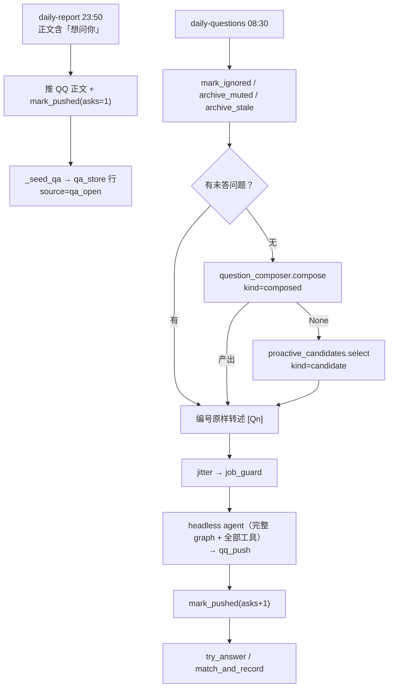
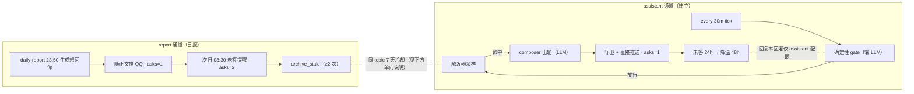
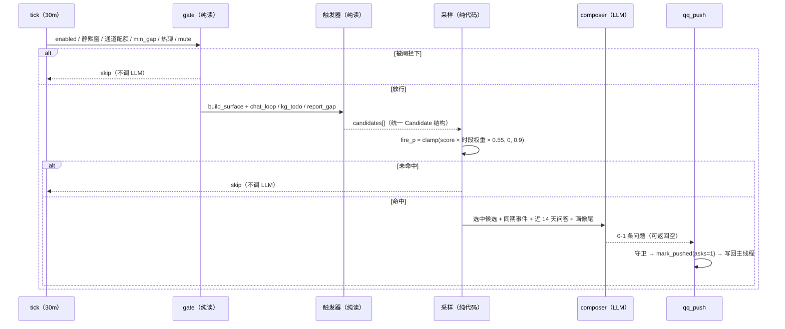

# 主动询问 4.0：双通道分家 + tick 驱动出题（设计稿 v1.1 for review）

> 状态：Draft v1.1（2026-10-28，一轮 builder check 后修订）
> 范围：`apps/withlanggraph` 主动提问链路（调度 / 出题 / 账本 / 回答捕获）
> 相关：`proactive-inquiry-2.0.md`（P0 账本 / P1 匹配 / P2 候选池 / P3 时机）、`proactive-inquiry-3.0-design.md`（随报问 / 变化面 / 出题人）
> 前置事实：3.0 代码已全部落地，但**线上 0 条 composed 问题**，且 10-28 08:30 整轮失败。4.0 修的是"能跑起来"和"像人"。

---

## 0. 一句话

3.0 回答"问什么、问多深"；4.0 回答"**谁问、什么时候开口、值不值这笔钱**"。

| 编号 | 变更 | 解决什么 |
|---|---|---|
| C1 | 日报提问与韩立提问**通道分家**（同一 jsonl、两个 `channel`） | 韩立现在给日报当替补，结构性饿死；两套静音/配额互相污染 |
| C2 | 出题从"08:30 定时"改为"**每 30 分钟 tick + 确定性 gate + 采样命中才叫 LLM**" | 定时出题不像人；每 tick 跑 agent 太贵 |
| C3 | questions 场景**推送去 agent 化**（compose 文本已定稿，直接 qq_push） | 现在为转述一句固定文本要跑完整 agent + memory judge |
| M1 | `ops status` 输出 7 天 token / cache 命中聚合，并**在 DeepSeek 上实测**（现有样本是智谱，不能推断） | 现在无法回答"这套东西一天烧多少钱" |

---

## 1. 现状审计（代码 + 线上证据）

### 1.1 链路



### 1.2 事实与缺陷

| # | 现象 | 代码位置 | 线上证据 |
|---|---|---|---|
| 1 | 韩立通道只在"日报没有想问你"时才能出题 | `proactive.py:1650`（`if not open_qa and _composer_enabled`） | 账本 4 天 3 条日报题，**composed 0 条** |
| 2 | 出题在 guard/jitter **之前**执行，被拦下也白花一次 LLM，题还留在账本里等次日推 | 出题 `:1650`，jitter `:1701`，guard `:1731` | — |
| 3 | 静音按 `source` 聚合，连续 2 条未答 → 整通道 14 天并归档 | `qa_store.py:765` / `:807` | — |
| 4 | `open_state` 是**单指针**；`[Q1]` 用 `keys` 快照，裸答只在"全局唯一开放"时生效 | `qa_store.py:338/349/887` | `keys=["6906f0…"]`（UU，已归档），实际开放是深空当铺 → `[Q1]` 静默失效 |
| 5 | composed 行的 anchor 是 `composed-<day>-N`，`_resolve_explicit` 取数字得 `202610281`，**永远匹配不上 `[想问你-N]`** | `qa_store.py:475` / `:849-855` | — |
| 6 | 日报种入 `seed_questions` **没有 topic 去重**；只有 `seed_candidates` 查近 7 天 topic | `qa_store.py:370` vs `:446` | — |
| 7 | 每次 proactive 都是新 graph + 随机 thread_id，**headless 没有对话历史** | `proactive.py:1400-1402` | — |
| 8 | compose 文本已定稿（verbatim_single），仍要跑完整 agent 才发出去 | `proactive.py:1804-1808` | 08:30 每轮都附带一次 memory judge 调用 |
| 9 | 占位 openid 未过滤，每次 3 个 target 有 2 个必然失败 | `proactive.py:843`（对比 `scheduler.py:1064` 有过滤） | `data/qq_known_users.json` 含 `user-1`/`admin-1`；10-27 日志里 `openid：u1` |
| 10 | 主动消息失败时不记真实原因 | `proactive.py:1810-1817`（丢弃 `reply`），`middleware.py:455 format_agent_error` 已把异常脱敏成一句中文 | 08:30 三轮全 AGENT_ERROR，能看到只有 `exit_reason` |
| 11 | 夜间重跑无静默保护，深夜推送被记成 ignored，反向压低回复率 | rerun 通道 / `job_guard` | 10-26 01:29 推送 → 10-28 记 ignored=1 |
| 12 | `memory_maintain gate failed: TypeError（dict + str）` 每次主动消息必报 | `graph.py:224` | 10-28 08:30 三次 |
| 13 | `daily_count` 是 **per-user 跨 job 共享**，只有 `last_sent[scene]`/`reply_stats[scene]` 分场景 | `proactive.py:751-766` | 08:30 提醒会吃掉当天额度，assistant 当天再无配额 |
| 14 | `guard` 是全局单份（`jitter_minutes`/`min_gap_hours`/`quiet_hours`），所有 proactive job 共用 | `proactive.py:868` `load_guard_config` | — |

数据面（4 天）：10-24 已答（马鞍山就诊）/ 10-25 归档（UU，asks=3，旧口径遗留）/ 10-26 开放（深空当铺，asks=1，ignored=1）/ composed 0 / candidate 0。回答率 1/4。

---

## 2. 决策记录

### 2.1 已定（用户拍板）

| 编号 | 决策 | 内容 |
|---|---|---|
| D-1 | 随报问（沿用 3.0） | 日报的问题随日报正文推，当晚可裸答；次日只提醒未答者 |
| D-2 | 朋友式归因提问（沿用 3.0） | L1 闲聊 / L3 归因关心，试探句式，证据可回溯 |
| D-3 | **通道分家（本次）** | 日报的提问归日报，韩立的提问归韩立；内部实现可共用 |
| D-4 | **tick 驱动（本次）** | 不要固定时刻出题；每 30 分钟触发，结合周报、长期记忆、上条消息是否被回复决定要不要问 |
| D-5 | 额度已解决 | 本次不把"额度不足"当常态设计前提（**但见 §5 P0 的验收判据问题**） |

### 2.2 本文档代拍（可在 review 时推翻）

| 编号 | 取舍 | 选择 | 理由 |
|---|---|---|---|
| A-1 | 分家粒度 | 同一份 `qa_store` 行加 `channel`；不拆文件、不拆表 | 去重/冷却/匹配/统计全部可复用；拆表会让"跨通道同 topic 不重复问"变难 |
| A-2 | tick 内是否再叠 `jitter_allows` | **不叠**，随机性由触发器采样承担；同时给 guard 加 job 级覆盖，把 08:30 的 jitter 与 assistant 的 jitter 拆开 | 两层随机相乘不可解释、无法验收 |
| A-3 | tick 是否允许 LLM 否决 | 允许，但**只在已有候选时**调用；返回空即否决 | 保留"今天没什么好问"的手感，成本只发生在有候选的几次 |
| A-4 | 日报题寿命 | 保持 2 次触达，不延长 | D-1 刚落，先别动 |
| A-5 | assistant 每日上限 | **不复用 `quota_cap` 的 1–4 档**，独立两档：默认 1，7 日回复率 ≥40% 抬到 2 | 现有档位是给"消息条数"设计的，与"每天最多问几个问题"不是一个量 |
| A-6 | assistant 消息形态 | **不带编号**（沿用 3.0 拍板 2）；`[Qn]/[想问你-N]` 只解析 report 通道；assistant 只走裸答指针 | 彻底消除"两个通道都有开放题时 `[Q1]` 指谁"的歧义 |
| A-7 | 裸答归因 | 命中**不吞消息**：后台记账，消息继续走正常聊天；显式锚点才拦截并回执 | 现在 `try_answer` 命中即 return（`qq.py:1171`），"好/嗯/在忙"会被当答案吃掉并推高回复率 |

### 2.3 仍待你拍板

见 §8（rerun 重推、日报 topic 去重方向、P0 验收判据）。

---

## 3. 设计

### 3.1 双通道模型



**channel 字段（`qa_store` 行）**

| channel | kind | 谁推 | 条数上限 | 配额 | 静音 |
|---|---|---|---|---|---|
| `report` | `qa_open` | daily-report / 08:30 提醒 | 正文节 ≤5（`audit.cap_questions`）；QQ 推几条由 `questions_per_push`（冷启动 2、`_MAX_QUESTIONS_PER_PUSH=3`） | 沿用 `quota_cap` 四档 | 单题归档；连续 3 期全未答 → 日报问题降频 7 天 |
| `assistant` | `composed` / `candidate` | assistant tick | 每条消息 1 问 | **独立两档**（A-5） | 单题归档；同一 topic 连续 2 次未答 → 该 topic 静音 14 天（不做整通道静音） |

**配额记账必须新开字段**：现有 `u_<uid>.daily_count` 是跨 job 共享（`:751-766`）。新增 `u_<uid>.daily_by_channel = {"report": {"date": "...", "count": n}, "assistant": {...}}`，`job_guard_allows` 按 channel 取。旧字段保留只读，不再作为闸门依据。

**topic 冷却目前是单向的**（`seed_candidates` 查近 7 天 topic，`seed_questions` 不查）。所以"日报问过 → 韩立不问"成立，"韩立问过 → 日报照问"不成立。因为日报正文在 23:50 已发出、事后删 bullet 会让 `[想问你-N]` 与账本错位，本设计的做法是**前置注入**：日报 prompt 的信息包里加一行「近 7 天已问 topic（勿再问）」，由日报 LLM 自己避开；不做事后删除。若你要"允许重复"，把这一行删掉即可（见 §8）。

**`open_state.json` 拆双指针，并保留旧字段兼容**：

```json
{
  "version": 2,
  "day": "2026-10-28",
  "question_key": "…",
  "keys": ["…"],
  "report":    {"day": "2026-10-28", "question_key": "…", "keys": ["…"]},
  "assistant": {"day": "2026-10-28", "question_key": "…", "keys": []}
}
```

顶层 `day/question_key/keys` **继续写**，内容恒等于 `report` 通道——这样旧代码（只读顶层）行为不变，回滚不会静默失效。`assistant` 只在 v2 段里。

### 3.2 tick 驱动：先算，再问

核心原则：**"要不要问"用代码算，"怎么问"才用 LLM。**



**成本目标（可验收的部分）**：无候选的 tick **不产生任何 LLM 调用**（用 fake LLM 断言调用次数为 0）；有候选只调 1 次 compose。绝对耗时按 IO 估（`select()` 前要读全量 qa 行、30 日报道、一次 checkpoint 读），不写"<50ms"这种没有依据的数字。

**打分公式（与现有代码一致，不要另写一套）**：`proactive_candidates.py:47-52`

```
score = 0.30*gain + 0.25*freshness + 0.20*specificity + 0.15*answer_likelihood + 0.10*novelty − 0.30*intrusion
```

**surface 必须适配成 Candidate 才能参与采样**：`build_surface` 现在只产出 `anomalies`（`question_surface.py:219`），没有 gain/freshness/specificity；`compose()` 又自己重建 surface（`question_composer.py:126`），不接受外部候选。设计上补两处：

1. 新增 `surface_candidates(surface) -> list[Candidate]`：`gain` 由异常显著度（偏离幅度归一）、`freshness=1`、`specificity` 由证据是否带日期/数值决定、`answer_likelihood` 取 `source_health("composed")` 的历史回复率（冷启动 0.5）、`intrusion` 由静默窗/热聊给出。
2. `compose(cfg, day, *, candidate=None, surface=None)`：有候选时只对**被选中的那一条**归因（把该异常的 `description` + `days` + 同期事件放进 prompt），不再让模型从全部异常里自己挑。

### 3.3 触发器

| 触发器 | 数据源 | 判定 | 现状 |
|---|---|---|---|
| `surface` | `question_surface.build_surface` | 入睡漂移 / 屏幕突变 / 提交激增 / 情绪下探 | 已有，需按 §3.2 适配成 Candidate |
| `chat_loop` | 主线程末条 HumanMessage | 未完成问题、承诺句（"回头再说/等忙完"） | `proactive_candidates` 已实现采集；2.0 设计过但只用于问候 |
| `kg_todo` | `kg_edges` `src='todos'` `valid_to IS NULL` | 近 14 天未闭合 | 已实现 |
| `report_gap` | report 通道 24h 未答 | **只作负信号**（今天别问同类），不单独出题 | 新增，P1 落 |

### 3.4 注入"最近一次主动消息"（补 headless 无历史）

`proactive_state.json` 增加 `u_<uid>.last_outreach`：

```json
{"ts": "2026-10-27T08:30:00+08:00", "channel": "assistant", "topic": "深空当铺",
 "question_key": "9b9d…", "answered": false, "ignored_count": 1}
```

composer 输入追加（截断 200 字）：

```
〔最近一次主动消息〕10-27 08:30 · 韩立 ·「深空当铺…」· 未回（已 1 天）
〔近 3 天对话末 6 条〕…
```

规则：同 topic 已问未回 → 今天不再问；未回 <24h → 不开口；未回 ≥2 天 → 该 topic `cool_until` +48h。

### 3.5 推送去 agent 化（注意写回冲突）

| 场景 | 现状 | 4.0 |
|---|---|---|
| composed / candidate 单问 | 跑完整 agent（graph + 工具 + memory judge）只为调 `qq_push` | **直接调用 `qq_push` 工具函数** |
| report 未答提醒 | 同上 | 直接发，`[Qn]` 由程序拼 |
| greeting / 关心类 | agent 自由发挥 | 不变 |

**冲突必须写清**：`_write_back_proactive`（`proactive.py:1441`，内部 `:1490 build_graph`）在每次送达后都会建图写回主线程。所以"推送不建图"只对**生成路径**成立，写回路径仍会建图。T-8 的断言口径改为：「生成阶段未调用 `build_graph`」；写回阶段允许建图。如果以后连写回也不想建图，需要单独把 checkpoint 写入抽成轻量函数（不在本次范围）。

### 3.6 回答捕获

| 输入 | 归属 |
|---|---|
| `[Q1] 答案` / `[想问你-1] 答案` | 只解析 **report** 通道的 `keys` 快照 / anchor；槽位已归档 → 返回 None（不猜） |
| 裸短答 | 归给 `last_outreach` 那条（`match_method="pointer"`），**不要求全局唯一开放** |
| 其它自然语言 | 后台 `match_and_record`（规则 ≥0.7 / LLM ≥0.75），不拦截聊天 |

**裸答护栏（防污染闭环）**：指针归因现在会喂给 `reply_stats.answer_rate`，而后者同时驱动配额与候选打分——误判会自我放大。所以指针归因必须同时满足：

- 距最近一次推送 ≤ 12h；
- 长度 ≥2 且不在语气词黑名单（嗯/哦/好/在忙/晚安/ok/收到…）；
- 不是问句、不是命令；
- 命中后**不拦截消息**（A-7），只在后台落账；内容仍进聊天。

**`keys` 归档置空**：归档时必须把该槽位置空（保序、不压缩），否则 `[Q1]` 会静默指向已死问题（当前线上就是）。

### 3.7 成本与缓存

**DeepSeek 缓存的事实**（官方文档，本设计前提）：

- 上下文缓存默认开启，按**从 0 号 token 开始的前缀**匹配，与 session/thread 无关；
- 储存单元 64 token；闲置数小时到数天后自动清除；best-effort，不保证命中；
- 计费字段 `usage.prompt_cache_hit_tokens` / `prompt_cache_miss_tokens`（OpenAI 兼容写法是 `prompt_tokens_details.cached_tokens`，**客户端容易读成 0**）。

**关于"每次新 session 会不会清缓存"**：不会。session 不是缓存键。真正杀缓存的是"前缀中间某处变了"。我们的 prompt 顺序是：`基础规则 → 时间铁律 → 分层铁律 → 人设卡 → 每日笔记 → 向量召回 → 生活事实卡 → 记忆铁律 → 【当前真实时间】`（`context.py:207-310`）。**生活事实卡每轮都在变，而它排在时间锚之前**——从它开始往后全部 miss。这比"每天笔记改一次"更致命。

**建议的 prompt 顺序（P1 顺带做，改动小、收益直接）**：把「每轮必变」的块（生活事实卡、向量召回）挪到最稳定块之后、「当前真实时间」之前，让"每日笔记"之前的部分尽可能长地命中；并在 `ops status` 里打出 `cache_read / input_tokens` 比值作为验收指标。

**现有日志的可用性（修正）**：`llm_request_log.py:211` 已经透传 `usage_metadata`，其中包含 `input_token_details.cache_read`（10-27 日志里能看到 `"cache_read": 0`）。但**那条样本是智谱（GLM）请求**，不能用来推断 DeepSeek。M1 因此缩水为两件事：

1. `ops status` 聚合近 7 天 `input/output/cache_read`；
2. 切到 DeepSeek 后抓两条连续请求确认字段映射（DeepSeek 原生是 `prompt_cache_hit_tokens`，LangChain 读的是 OpenAI 字段，可能读成 0）。

**预算护栏**：assistant 通道每日 LLM 调用上限 6 次（配置项），超出记 `assistant.budget_exhausted` 并停止当日出题。

---

## 4. 数据与兼容

| 变更 | 旧数据 | 迁移 |
|---|---|---|
| 行加 `channel` | 无该字段 | 读取时缺省推导：`kind ∈ {candidate, composed}` → `assistant`，否则 `report`；新行显式落值 |
| `open_state.json` v2 | 顶层三个键 | **双写**：顶层键恒等于 report 通道（旧代码可读）；`assistant` 只在 v2 段 |
| `proactive_state.json` 加 `daily_by_channel` / `last_outreach` / `cool_until` | 无 | 缺省 `{}`；首次写入时用旧 `daily_count` 回填当日 |
| 静音语义 | `muted_sources` 按 source | 改为 `muted_topics`（topic 级）；旧 source 静音键读时忽略并记一次迁移日志 |

不改表、不改 jsonl 路径、不新增依赖。**回滚前提**：旧代码只读 `open_state` 顶层三键，因此双写是回滚安全的必要条件；若只写 v2 段，旧代码 `_resolve_explicit` 取 `.get("keys")` 得 `None`，`[Q1]` 会静默失效（不崩但坏），且旧版 `_refresh_open_state` 只写三键，回滚运行一次就会抹掉 assistant 指针。

---

## 5. 分期与验收

| 阶段 | 内容 | 验收 |
|---|---|---|
| P0（先修血） | 占位 openid 过滤；失败时记 `_snippet(reply)`；`memory_maintain` TypeError；`keys` 归档置空；rerun 静默窗；M1 聚合 | ① `_target_users` 不再返回占位 id；② 失败日志含 `agent_error` 字段；③ 归档后 `[Q1]` 解析为 None 且 keys 长度不变；④ rerun 在静默窗内不推；⑤ `ops status` 能打出 cache/token 聚合 |
| P1（分家 + 记账） | `channel` 字段；双指针 `open_state`（双写）；`daily_by_channel`；两套静音/配额；裸答指针；日报 prompt 注入"近 7 天已问 topic"；`report_gap` 负信号 | 通道隔离单测全绿；两通道同 topic 7 天冷却；裸答归最近推送且不吞消息 |
| P2（tick） | `assistant-questions` job（`every 30m`）+ 确定性 gate + `surface_candidates` 适配 + 采样 + compose 接候选 + 直发 | 无候选 tick 零 LLM；有候选只调 1 次；一天实际出题 ≤2；L3 全局 2 次/周硬计数生效 |
| P3（观测与调优） | 首周数据：出题数 / 回答率 / 忽略率 / "别问了"次数 / cache 命中率；据此调 `fire_p` 与配额 | 一周后能回答"每天问几条、答几条、哪条像人" |

**P0 的验收判据要改**：原稿写"连续 3 天不再全 AGENT_ERROR"没有判别力——余额恢复也能让它通过，余额再耗尽又会失败，和代码改没改对无关。改为上面五条**代码路径判据**，外加一条环境判据（`ops` 能看到主调用成功/失败计数，而不是靠人肉看日志）。

**L3 全局 2 次/周**：归 P2（需要 gate 与账本的 channel 维度一起改），验收用固定 7 天窗口计数。

---

## 6. 测试清单

| 编号 | 用例 | 断言 |
|---|---|---|
| T-1 | 占位 openid | `_target_users` 不含 `user-1`/`admin-1`，与 `_qq_targets` 同源 |
| T-2 | 失败留痕 | 日志含 `agent_error` 字段；内容来自 `format_agent_error` 的脱敏文案（拿不到原始 429 body，这是设计如此） |
| T-3 | keys 归档置空 | 归档后 `[Q1]` 解析为 None；`keys` 长度不变（空槽） |
| T-4 | 通道隔离 | `mute(assistant)` 不影响 report 提醒；两通道配额独立计数 |
| T-5 | 双指针裸答 | 两通道各有开放题时，裸答归 `last_outreach`，`match_method="pointer"`，**消息未被拦截** |
| T-6 | 无候选零 LLM | fake `_call_llm` 调用次数 0，job 记 `skipped:no_candidate` |
| T-7 | 采样可复现 | 固定 `rng` 序列下 fire/skip 分布符合 `fire_p`（±5%） |
| T-8 | 直发路径 | 生成阶段未调用 `build_graph`（写回阶段允许）；`asks=1`、assistant 指针更新 |
| T-9 | 未回收敛 | 未回 <24h 同 topic 不出题；≥2 天 `cool_until` 生效 |
| T-10 | rerun 静默 | 01:29 重跑不推 QQ，且不记 ignored |
| T-11 | 裸答护栏 | "嗯/好/在忙/晚安"不入账；>12h 不入账；问句不入账 |
| T-12 | report_gap 负信号 | report 题 24h 未答 → assistant 同日不问同 topic |
| T-13 | L3 周上限 | 7 天内第 3 条 L3 被拒并记日志 |
| T-14 | 配额分通道 | 08:30 提醒后 assistant 的日配额仍为 1（当前会被共享 `daily_count` 吃掉） |

---

## 7. 风险与回滚

| 风险 | 处理 |
|---|---|
| 频率上升 → 打扰感 / 首因翻车 | assistant 默认 1 条/天；L3 全局 2 次/周；静默 23:30–07:30；30 分钟内有用户消息不问 |
| 裸答误判自我放大 | 12h 窗口 + 语气词黑名单 + 不吞消息 + `match_method` 可追溯 |
| 缓存假设落空 | 预算按 miss 价估；M1 先测再调频率；不把"缓存命中"写进功能依赖 |
| 分家迁移写错导致旧题失踪 | 只加字段、旧字段保留；`open_state` 双写；回滚安全见 §4 |
| 直发丢了人设味 | composer 已按人设定稿；配置项 `questions.push_via_agent` 可一键切回 |
| 触发器噪声（每 tick 都有候选） | 每天最多 6 次 LLM 预算硬顶；候选按当日 Top-N 采样 |
| rerun 重发与 asks 预算冲突 | 见 §8：默认不发 QQ，显式开关才发且不记 asks |

---

## 8. 待拍板

1. **tick 频率**：全天固定 30 分钟，还是按 `active_hours` 自适应（白天 30 分钟、深夜 2 小时）？我倾向前者先跑一周——自适应需要一个能解释的直方图，现在冷启动阈值为 0（`_ACTIVE_MIN_SAMPLES=10`），先固定更好校准。
2. **rerun 要不要重推 QQ**：永不推 / 仅静默窗内不推 / 加 `--push-qq` 显式开关？我倾向第三种，且重推不 `mark_pushed`（避免把问题推到归档）。
3. **日报是否接受与韩立重复 topic**：接受（删掉信息包注入）还是让日报 LLM 避开（推荐）？这决定用户在一天里会不会被问两次同一个话题。
4. **assistant 消息形态确认**：沿用 3.0 拍板 2 的"无编号单问"（A-6）——意味着它只能靠裸答指针回收，你接受吗？
5. **P0 验收判据**：同意改成"代码路径判据 + 环境计数"，而不是"看三天日志是否报错"？

---

## 9. 附录：代码索引

| 关注点 | 位置 |
|---|---|
| questions 场景编排 | `src/gacore/proactive.py:1564-1860` |
| 出题人 | `src/gacore/question_composer.py:115 compose` |
| 变化面 | `src/gacore/question_surface.py:219 build_surface` |
| 账本 / 匹配 / 静音 | `src/gacore/qa_store.py:327/616/642/765/858` |
| 候选池打分 | `src/gacore/proactive_candidates.py:47-52` |
| 日报推送与种入 | `src/gacore/scheduler.py:1093 _push_daily_to_qq`、`:1021 _seed_qa` |
| system prompt 组装（缓存相关） | `src/gacore/context.py:207-310` |
| 调度解析（`every Nm`） | `src/gacore/scheduler.py:11,63,336-350` |
| 回答捕获入口 | `src/gacore/frontends/qq.py:1165-1181` |
| 写回主线程 | `src/gacore/proactive.py:1441-1510` |
| 运维摘要 | `src/gacore/ops.py:192 _proactive_summary` |

线上证据：`data/qa/*.jsonl`、`logs/2026-10-28/app.jsonl:68-85`、`logs/2026-10-27/llm_requests.jsonl`、`data/qq_known_users.json`。
