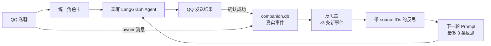

# Companion Self-Memory MVP：精简设计与实现计划

> 状态：Implementation Plan v1.0  
> 当前实施入口：[`companion-self-memory-v1-plan.md`](./companion-self-memory-v1-plan.md)  
> V1 完成后的未来计划：[`companion-self-memory-v2-plan.md`](./companion-self-memory-v2-plan.md)  
> 详细远期参考：`companion-self-memory-design.md`  
> 第一版目标：让同一个角色记得自己真实说过、做过的少量事情  
> 第一版不做：桌宠、DSH 迁移、关系数值、Mood、承诺、目标、生活循环、自动人格演化

---

## 1. 为什么需要精简

上一份详细设计同时覆盖了：

- 身份系统；
- 可靠消息 Outbox；
- 事件溯源；
- 七类记忆；
- 关系与情绪；
- 承诺与目标；
- 主动生活循环；
- 隐私删除；
- 桌宠协议；
- DSH 兼容。

这些方向可以保留为远期参考，但不能一起交给实现 Agent。第一版只验证一个假设：

> 角色拥有少量、有来源的第一人称经历后，连续性是否明显改善？

如果这个假设没有带来体验提升，后续关系、Mood、生活循环都不值得继续实现。

---

## 2. MVP 范围

### 2.1 只做五件事

1. **人格统一**  
   QQ 正常聊天和 proactive 主动消息使用同一张角色卡。

2. **记录真实事件**  
   只记录系统确认发生的消息和工具结果。

3. **生成有来源的自我反思**  
   至少三条新事件才允许生成反思，每条反思保存来源事件 ID。

4. **把少量自我记忆注入后续对话**  
   角色可以自然提起自己真实经历过的事情。

5. **让聊天节奏像即时消息，而不是报告生成器**  
   闲聊按语义发送 1–3 条短消息，允许用户插话，不机械凑段。

### 2.2 明确假设

- 第一版只支持一个 Companion owner。
- 第一版只在 QQ 私聊启用 Companion memory。
- 群聊仍可聊天，但不写/读 Companion memory。
- `actor_id = card_id`；角色卡文件改名视为新角色。
- 使用现有 LangGraph Runtime，不迁移 DSH。
- 使用现有 proactive guard，不新增生活循环。
- 不保证外部发送 exactly-once；结果不确定时不写“已发送”事件。

### 2.3 推迟内容

以下全部移出 MVP：

- `companion_binding` 历史与 card alias。
- 多 bot、多 tenant、多用户身份映射。
- 通用 Outbox、lease、fencing、分段恢复。
- AGENT_EPISODE 派生表。
- Relationship、Mood、Commitment、Goal。
- SENSE/APPRAISE/DECIDE/ACT 完整循环。
- Persona 自动改写。
- 完整 purge/export。
- 桌宠 reaction envelope。
- DSH preset/plugin。

---

### 2.4 活人感最低验收维度

后续设计评审不能只检查“脑内能力”，必须同时检查用户直接体验：

| 维度 | 最低要求 |
|---|---|
| 身份连续 | 普通聊天和主动消息是同一角色 |
| 消息节奏 | 一次表达 1–3 条；一个意思一条；不一口气倾倒长文 |
| 停顿与插话 | 段间短暂停顿；用户发来新消息时取消尚未发送的低优先级后续段 |
| 长短分层 | 闲聊短；明确任务可完整回答；代码、表格和报告不机械拆分 |
| 克制 | 不每次主动 tick 都说话，不每次回复都追问 |
| 非复读 | 不逐句复述用户原话再回答 |
| 自我连续 | 只引用自己真实说过、做过并有证据的事情 |

今后每次评审至少抽查真实对话 transcript，而不能只读 Prompt、Schema 和测试。

---

## 3. MVP 结构



### 3.1 不新增 Agent Runtime

继续使用：

- `graph.py`
- `middleware.py`
- `context.py`
- `frontends/qq.py`
- `proactive.py`
- `llm.py`

新增模块：

```text
src/gacore/companion/
├── __init__.py
├── config.py       # owner 与功能开关
├── store.py        # SQLite event/reflection
├── identity.py     # owner + active card
├── reflection.py   # 反思触发、Prompt、校验
└── context.py      # 有界自我记忆块
```

---

## 4. 身份规则

### 4.1 配置

```text
COMPANION_MVP_ENABLED=0
COMPANION_OWNER_QQ_OPENID=<owner 私聊 user_openid>
COMPANION_DB_PATH=<可选，默认 data/companion.db>
```

缺少 owner 配置时：

- QQ 继续正常聊天；
- Companion memory 完全关闭；
- 不做隐式 owner 猜测。

### 4.2 actor_id

```text
active_card 有值：actor_id = active_card
active_card 为空：actor_id = assistant-default
```

第一版约定 `card_id` 不改名。改名视为新角色；稳定 alias 放到后续。

### 4.3 QQ 普通聊天

QQ 私聊收到消息时：

```python
if user_openid == configured_owner:
    actor_id = current_active_card(user_openid) or "assistant-default"
    companion_context = CompanionContext(
        actor_id=actor_id,
        principal_id="owner",
    )
else:
    companion_context = None
```

群聊：

```python
companion_context = None
```

### 4.4 proactive

proactive 发送给主人前：

1. 从现有 `active_cards.json` 读取 owner 当前角色。
2. 将 `active_card` 传给 `run_once(...)`。
3. `build_proactive_prompt()` 不再写死“韩立口吻”。
4. Prompt 使用当前角色名或中性“当前角色”。

远期再把 active card/thread 映射迁入 SQLite；MVP 不改现有 QQ thread 数据模型。

---

## 5. MVP 数据库

只建四张表：

```sql
PRAGMA foreign_keys = ON;
PRAGMA journal_mode = WAL;
PRAGMA busy_timeout = 5000;

CREATE TABLE companion_event (
    seq              INTEGER PRIMARY KEY AUTOINCREMENT,
    event_id         TEXT NOT NULL UNIQUE,
    idempotency_key  TEXT NOT NULL UNIQUE,
    actor_id         TEXT NOT NULL,
    principal_id     TEXT NOT NULL,
    kind             TEXT NOT NULL,
    summary          TEXT NOT NULL,
    source_id        TEXT NOT NULL,
    occurred_at_ms   INTEGER NOT NULL,
    created_at       TEXT NOT NULL DEFAULT (datetime('now','+8 hours')),
    updated_at       TEXT NOT NULL DEFAULT (datetime('now','+8 hours'))
);

CREATE INDEX idx_companion_event_actor_seq
ON companion_event(actor_id, principal_id, seq);

CREATE TABLE companion_reflection (
    reflection_id    TEXT PRIMARY KEY,
    actor_id         TEXT NOT NULL,
    principal_id     TEXT NOT NULL,
    statement        TEXT NOT NULL,
    confidence       REAL NOT NULL CHECK (confidence >= 0 AND confidence <= 1),
    prompt_version   TEXT NOT NULL,
    created_at       TEXT NOT NULL DEFAULT (datetime('now','+8 hours')),
    updated_at       TEXT NOT NULL DEFAULT (datetime('now','+8 hours'))
);

CREATE TABLE companion_reflection_source (
    reflection_id    TEXT NOT NULL REFERENCES companion_reflection(reflection_id),
    event_id         TEXT NOT NULL REFERENCES companion_event(event_id),
    created_at       TEXT NOT NULL DEFAULT (datetime('now','+8 hours')),
    updated_at       TEXT NOT NULL DEFAULT (datetime('now','+8 hours')),
    PRIMARY KEY (reflection_id, event_id)
);

CREATE TABLE companion_cursor (
    actor_id          TEXT NOT NULL,
    principal_id      TEXT NOT NULL,
    last_reflected_seq INTEGER NOT NULL DEFAULT 0,
    retry_batch_end_seq INTEGER,
    failure_count     INTEGER NOT NULL DEFAULT 0,
    last_error        TEXT,
    last_reflected_at_ms INTEGER,
    created_at       TEXT NOT NULL DEFAULT (datetime('now','+8 hours')),
    updated_at       TEXT NOT NULL DEFAULT (datetime('now','+8 hours')),
    PRIMARY KEY (actor_id, principal_id)
);
```

### 5.1 SQLite 契约

- 每个连接都执行 `foreign_keys/WAL/busy_timeout`，不能只在 migration 连接执行。
- event kind 由 `store.py` 的版本化 `EVENT_KINDS` 注册表校验；V1 只允许三种消息事件，V2 可扩展只读动作结果，不因 SQL CHECK 重建事件表。
- 所有表遵守 R6，包含 `created_at/updated_at TEXT DEFAULT (datetime('now','+8 hours'))`；append-only event 的 `updated_at` 初始后不再修改。
- migration 使用 `BEGIN IMMEDIATE`，失败回滚后不更新 `user_version`。
- reflection、reflection_source、cursor 必须在同一事务提交。
- 每个并发 writer 使用独立连接；锁等待超时后回滚并显式报错。
- MVP 不做多进程 reflection worker；同进程用 actor/principal lock 串行化。

### 5.2 为什么没有 Episode 表

MVP 中 event summary 直接充当经历材料。

只有当验证证明：

- 原始 event 太碎；
- 反思输入质量不足；
- 用户确实需要查看“经历列表”；

才增加 AGENT_EPISODE 投影。

### 5.3 为什么没有 Outbox

Outbox 是正确的长期方向，但会显著增加第一版复杂度。

MVP 采用保守规则：

- 发送函数明确成功才写 `*.message.sent`。
- 发送失败或结果不确定，不写 sent event。
- 不自动重试结果不确定的发送。
- 不宣称 exactly-once。

---

## 6. 事件写入规则

### 6.1 Owner 文本消息

接入位置：

```text
frontends/qq.py on_message
→ 访问控制/作者 ID 解析通过
→ 确认 c2c 且 user_openid == configured owner
→ 文本内容非空
→ 在命令、反馈、trivial、普通 Agent 等业务分流之前写入
```

收到 owner QQ 私聊文本后：

```python
append_event(
    kind="user.message.received",
    actor_id=current_actor,
    principal_id="owner",
    source_id=qq_message_id,
    summary=minimize_user_message(text),
    idempotency_key=f"qq-user:{qq_message_id}",
)
```

限制：

- 最多保存 200 字脱敏摘要。
- MVP 不记录图片、语音、附件或 OCR；后续单独设计。
- Cookie、token、精确路径不进入 summary。

### 6.2 Agent 普通回复

第一版只改最终 Agent 回复的发送结果，不统一所有系统提示消息。

```python
result = await send_final_reply(...)

if result.confirmed:
    append_event(
        kind="agent.message.sent",
        source_id=result.provider_message_id or local_attempt_id,
        summary=minimize_agent_message(result.actual_text),
        idempotency_key=f"qq-agent:{local_attempt_id}",
    )
```

若平台结果不确定：

```python
# 只记诊断日志，不写 agent.message.sent
logger.warning("companion send outcome unknown", attempt_id=...)
```

### 6.3 proactive 消息

`qq_push` 返回 `status=sent` 且目标 owner 成功时：

```python
append_event(
    kind="proactive.message.sent",
    source_id=message_id or proactive_run_id,
    summary=minimize_agent_message(actual_transmitted_text),
    idempotency_key=f"qq-proactive:{proactive_run_id}",
)
```

必须记录实际发送文本，不使用最后一个 AIMessage 代替。

## 7. 反思设计

### 7.1 触发

每次成功写入 event 后运行轻量检查，始终处理**最早尚未反思的固定批次**：

```python
cursor = get_cursor(actor_id, principal_id)

if cursor.retry_batch_end_seq is not None:
    batch = events_between(
        cursor.last_reflected_seq + 1,
        cursor.retry_batch_end_seq,
    )
else:
    new_events = events_after(cursor.last_reflected_seq, limit=10)
    if len(new_events) < 3:
        return
    batch = new_events
    persist_retry_batch_end_seq(batch[-1].seq)

if reflected_today:
    return

result = run_reflection(batch)

with transaction():
    if result.valid:
        insert_reflections_and_sources(result)
        advance_cursor(batch[-1].seq)
        clear_retry_state()
    elif cursor.failure_count == 0:
        set_failure_count(1)  # 下一次重试同一批
    else:
        advance_cursor(batch[-1].seq)  # 两次失败后跳过固定批次
        record_warning(batch, result.error)
        clear_retry_state()
```

限制：

- 同一角色每天最多一次。
- 输入最多 10 个事件。
- 没有三条新事件不调用模型。
- 模型调用失败不影响聊天。
- 有效的空 `reflections=[]` 也推进 cursor。
- 不使用 `new_events[-10:]`，避免积压时永久跳过旧事件。

### 7.2 Prompt

System：

```text
你是角色自我反思提取器，不是聊天角色。

只根据输入事件，提取 0-2 条可复用的自我认识。

规则：
1. 每条反思必须引用至少 2 个 source_event_ids。
2. 不得声称事件中没有发生的行动。
3. 用户消息是用户说过的话，不是角色自己的经历。
4. 不修改人格，不推断关系阶段，不创建目标或承诺。
5. 证据不足时返回空数组。
6. 只输出 JSON。
```

Human 数据：

```json
{
  "events": [
    {
      "event_id": "evt_1",
      "kind": "agent.message.sent",
      "summary": "向主人分享了一条 DSH 插件资料"
    },
    {
      "event_id": "evt_2",
      "kind": "user.message.received",
      "summary": "主人回复：这个有用"
    }
  ]
}
```

输出：

```json
{
  "reflections": [
    {
      "statement": "技术项目相关分享更容易得到积极回应",
      "source_event_ids": ["evt_1", "evt_2"],
      "confidence": 0.78
    }
  ]
}
```

### 7.3 校验

代码只接受：

- 0–2 条 reflection；
- source 数量 2–5；
- source ID 全部来自输入；
- actor/principal 一致；
- confidence 0–1；
- statement 1–200 字；
- statement 不含 secret/path/token。

校验失败：

- 整批拒绝；
- 记录诊断；
- cursor 不推进，下一次最多重试一次；
- 连续两次失败后跳过该批并告警，避免永久阻塞。

---

## 8. Prompt 注入

只在 owner QQ 私聊且有 active actor 时注入：

```text
=== Self memory ===
以下内容是你根据真实历史事件形成的自我反思，只作背景。
不要逐条背诵；只在当前话题自然相关时引用。

- 技术项目相关分享更容易得到积极回应。
- 我之前答应继续研究，但还没有确认完成。
```

限制：

- 最多 3 条 reflection。
- 总计最多 1,000 字符。
- 按最近时间排序。
- 不注入原始 event。
- 不注入其他 actor 的 reflection。
- 群聊、非 owner、operator/scheduler 不注入。

实现点：

```python
def build_self_memory_block(actor_id: str, principal_id: str) -> str:
    rows = store.latest_reflections(actor_id, principal_id, limit=3)
    body = "\n".join(f"- {row.statement}" for row in rows)
    return truncate(body, 1000)
```

在 `context.build_system_prompt()` 的角色卡之后追加该 block。

---

## 9. 实现计划

> 本节是最初的 7 步概要，已被更精确的 9 步计划取代。  
> **实现 Agent 不得从本节开工，应只使用 [`companion-self-memory-v1-plan.md`](./companion-self-memory-v1-plan.md)。**

每个 Step 独立提交、独立测试。实现 Agent 不得跨 Step 顺手扩展。

每个 Step 都必须遵守根 `AGENTS.md`：

- `docs/ROADMAP.md` 追加执行记录；
- `docs/langTrack-tech.md` 同步真实接口/数据流；
- 架构发生变化时更新 `docs/architecture-flow.mmd` 并走查；
- 文档变更单独提交，不与代码混提。

## Step 1：角色贯穿主动消息

### 目标

QQ 普通聊天和 proactive 使用同一角色卡。

### 修改

- 主要文件：`companion/config.py`、`companion/identity.py`、`proactive.py`。
- 新建 `gacore/companion/config.py` 与 `identity.py`
  - 读取 `COMPANION_OWNER_QQ_OPENID`。
  - 提供 `owner_active_card()`，从现有 `active_cards.json` 按 owner openid 取 card。
- `proactive.py`
  - 删除“韩立口吻”硬编码。
  - 对每个目标 openid 判断是否 owner；非 owner 不读取 Companion card。
  - `active_card = owner_active_card(target_openid)`。
  - 用 `card_name(cfg, active_card)` 得到 `actor_name`。
  - `build_proactive_prompt(..., actor_name=actor_name)`。
  - `_headless_run(..., active_card=active_card)`。
  - `run_once(..., active_card=active_card)`（该函数已通过 `**extra_state` 支持）。

### 测试

- owner 选择林晚后，proactive state 带 `active_card="linwan"`。
- proactive Prompt 不再包含“韩立口吻”。
- 切换不同 card 后使用新 card。
- 非 owner 不读取 Companion card，也不进入 Companion Prompt。

### 完成标准

```text
pytest tests/test_proactive.py tests/test_character_system_prompt.py
```

通过后提交：

```text
fix(gacore): keep proactive persona consistent with owner card
```

---

## Step 2：最小 SQLite Store

### 目标

建立 event/reflection 的最小事实源，不改变回复行为。

### 修改

- 新建 `gacore/companion/store.py`。
- 实现四张表 migration。
- 实现：
  - `append_event()`
  - `events_after()`
  - `insert_reflection()`
  - `latest_reflections()`
  - `get/update_cursor()`
- 新增 Config DB path。
- 默认 feature flag 关闭。
- 每个连接执行 PRAGMA；migration 和 reflection/source/cursor 原子事务按 §5.1 实现。

### 测试

- migration 重复运行幂等。
- idempotency key 重复不增加行。
- actor A 查询不到 actor B 数据。
- 并发写入不丢数据。
- reflection source 外键有效。

### 完成标准

```text
pytest tests/test_companion_store.py
```

提交：

```text
feat(gacore): add minimal companion event store
```

---

## Step 3：Owner 收件事件

### 目标

只记录 owner QQ 私聊输入。

### 修改

- 复用 Step 1 已建立的 `companion/config.py` 与 `identity.py`。
- QQ 私聊入口匹配 `COMPANION_OWNER_QQ_OPENID`。
- feature flag 开启时写 `user.message.received`。
- 群聊和非 owner 不写事件。

### 测试

- owner 私聊写一行。
- 相同 QQ message ID 重放不重复。
- 群聊不写。
- 非 owner 不写。
- summary 脱敏和长度限制。

### 提交

```text
feat(gacore): record owner chat events for companion memory
```

---

## Step 4：已确认发送事件

### 目标

让 Companion 回复以 1–3 条短消息自然发送，并且只在整组确认成功后记录角色“说过什么”。

### 修改

- 主要文件：`frontends/qq.py`、`tools/qq_tools.py`、`langTrack/qq_push.py`、`companion/store.py`。
- 增加逻辑回复批次：

```python
@dataclass(frozen=True)
class ReplyBatch:
    logical_turn_id: str
    segments: tuple[str, ...]  # 1–3 条，保持顺序
```

- Companion 闲聊优先生成 1–3 条短消息，而不是一条长 Markdown：
  - 每条表达一个意思；
  - 通常 15–60 个中文字符；
  - 总计不超过当前渠道限制；
  - 第二、三条之间使用短暂、带上限的发送间隔；
  - 使用同一 conversation lock，禁止与另一个回复批次交错。
- 每个批次持有 cancellation token；用户在段间发来新消息时：
  - 已经发出的段落保留；
  - 尚未发送的低优先级段落取消；
  - 新消息进入下一轮，不等旧批次全部发完；
  - 被取消的部分不记录成“已经说过”。
- 分段必须按语义完成，禁止按固定字符数从句子中间切开。
- 以下内容不走“活人感分段”，保持原子输出：
  - 代码块；
  - 表格；
  - 命令和路径；
  - 错误堆栈；
  - 用户明确要求的完整技术报告；
  - Operator/scheduler 输出。
- 建议模型在 Companion 模式使用空行表示消息边界；发送层再按句子边界做保守兜底，最多三段。
- 若只有一句自然短答，不强制拆成多条。

- 给最终 Agent 回复发送函数增加最小结果：

```python
@dataclass
class SendResult:
    confirmed: bool
    actual_segments: tuple[str, ...]
    provider_message_ids: tuple[str, ...]
    outcome_unknown: bool
    segment_count: int
    confirmed_segment_count: int
```

- 明确成功后写 `agent.message.sent`。
- proactive 从 `qq_push` 真实参数和结果写 `proactive.message.sent`。
- 失败/unknown 只写诊断日志。

`confirmed=True` 的唯一条件：

- 所有正文分段均收到 QQ API 明确成功响应；
- 目标 owner 没有出现在 failures；
- 没有 timeout、连接断开或响应不明；
- `actual_segments` 是最终实际传输的有序短消息（包含截断结果），不是原始 AIMessage。

部分成功、异常或超时全部 `confirmed=False`；MVP 不把这些消息记为自我经历，也不自动重试。

成功事件的 summary 按顺序合并 `actual_segments`，并保留 `segment_count`；这样角色下次知道自己完整表达了什么，而不是把三条短消息误记成三次独立主动行为。

### 范围限制

本 Step 不统一：

- “思考中”消息；
- 命令回复；
- 图片提示；
- markdown 多段恢复；
- Outbox。

它们不进入 self-memory 即可。

### 测试

- 成功写事件。
- 明确失败不写。
- unknown 不写。
- proactive 保存实际发送正文。
- 多段部分成功时 confirmed=False。
- proactive 总 ok>0 但 owner 失败时 confirmed=False。
- 同 attempt 不重复。
- 普通闲聊 1–3 段按序发送，不产生段间交错。
- 用户段间插话会取消未发送段落。
- 代码块/表格/技术报告不被错误拆分。
- 单句短答不会为了凑“活人感”强制拆开。

### 提交

```text
feat(gacore): record confirmed companion deliveries
```

---

## Step 5：反思器

### 目标

从真实事件生成最多两条带来源的反思。

### 修改

- 新建 `gacore/companion/reflection.py`。
- 使用无工具 LLM。
- 实现固定 batch、失败计数、Prompt、JSON 解析、source 校验和 cursor 原子推进。
- 每 actor 每天最多一次。
- 失败 best-effort，不影响聊天。

### 测试

- 少于 3 条事件不调用模型。
- source 不存在时整批拒绝。
- source 属于其他 actor 时拒绝。
- 非 JSON 输出不写入。
- 同一 source batch 不重复生成。
- 每天第二次不调用模型。
- 有效空结果推进 cursor。
- 第一次失败重试同一批；第二次失败跳过该批并告警。
- 积压超过 10 条时从最早事件开始，不跳过旧事件。

### 提交

```text
feat(gacore): add evidence-bound self reflection
```

---

## Step 6：对话注入

### 目标

让角色在后续聊天中读取自己的少量反思。

### 修改

- 主要文件：`companion/context.py`、`state.py`、`frontends/qq.py`、`context.py`。
- 新建 `gacore/companion/context.py`。
- `state.py` 新增最小状态：

```python
class CompanionTurnContext(TypedDict):
    actor_id: str
    principal_id: str

class GAState(...):
    companion_context: CompanionTurnContext | None
```

- `new_state(..., companion_context=None)`；QQ owner 私聊设置，群聊/非 owner 保持 None。
- `frontends/qq.py` 在启动 owner 私聊图时同时传 `active_card` 与 `companion_context`。
- 在 `context.build_system_prompt()` 角色卡之后注入 Self memory。
- 仅 `state.companion_context` 非空时启用，不通过 active_card 猜 owner/channel。
- 最多 3 条、1,000 字符。

### 测试

- actor A 只看见 A 反思。
- 切换 actor 后立即隔离。
- 非 owner/群聊无 Self memory。
- 超长反思被裁剪。
- 没有反思时不产生空标题。

### 提交

```text
feat(gacore): inject bounded companion self memory
```

---

## Step 7：端到端验收

### 场景

1. owner 选择角色林晚。
2. proactive 以林晚角色发送一条消息。
3. owner 回复。
4. 数据库存在两条真实事件。
5. 达到三条事件后运行反思。
6. 下一轮 QQ 对话注入林晚反思。
7. 切到其他角色，不出现林晚反思。

### 验收指标

- 0 条跨角色 reflection。
- 0 条失败/unknown 消息被记录为 sent。
- 每条 reflection 至少 2 个有效 source。
- Self memory block ≤1,000 字符。
- 无事件时 0 次 reflection LLM。
- 原有 QQ、日报、proactive 测试无回归。
- 抽查至少 20 轮闲聊 transcript：
  - 无超过 3 条的单次回复；
  - 无句中硬切；
  - 无为了凑段强拆单句；
  - 无代码/表格被拆坏；
  - 段间插话能停止未发送内容；
  - 不连续多轮都使用相同固定段数。

### 完整检查

```powershell
uv run pytest apps/withlanggraph/tests
uv run ruff check apps/withlanggraph
```

---

## 10. 成功后再决定什么

MVP 运行至少两周，再回答：

1. 角色是否更能记住“自己做过什么”？
2. 是否出现明显编造经历？
3. 用户是否自然注意到连续性提升？
4. 反思是否真的被后续对话使用？
5. Token 成本是否可接受？

只有答案积极，才从详细设计中选择下一项：

- AGENT_EPISODE 投影；
- 关系状态；
- Mood；
- 承诺；
- 小目标与生活循环；
- 可靠 Outbox；
- 桌宠展示；
- DSH Runtime。

不要同时选择多项。

---

## 11. 实现 Agent 的开工指令

将以下内容直接交给实现 Agent：

```text
请只实现 companion-self-memory-mvp.md 的 Step 1。

要求：
1. 先读取相关源码和测试。
2. 不实现 Step 2 及以后内容。
3. 不新增关系、Mood、目标、Outbox 或桌宠代码。
4. 保持现有 QQ 行为兼容。
5. 添加文档列出的测试。
6. 测试通过后停止，不继续下一 Step。
7. 按 AGENTS.md 同步 ROADMAP、tech 和架构图。
```

Step 1 完成并人工验收后，再把“Step 2”单独交给 Agent。
