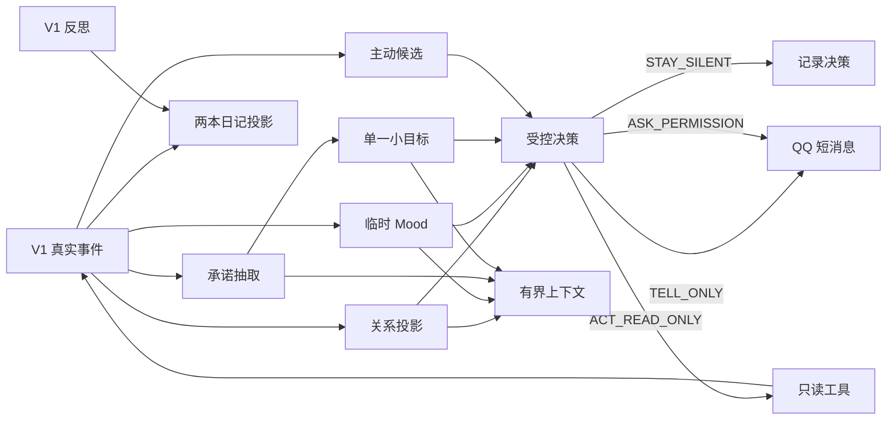

# Companion Self-Memory V2：关系、承诺与受控主动性计划

> 状态：Reviewed Future Plan（V1 完成且稳定观察两周后方可实施）  
> 前置：[`companion-self-memory-v1-plan.md`](./companion-self-memory-v1-plan.md) 全部完成，并稳定观察至少两周  
> V2 目标：让角色在真实自我经历之上形成有限关系状态、短期 Mood、可兑现承诺和一个受控小目标  
> 桌宠展示继续延后

---

## 1. V2 启动门槛

只有 V1 同时满足以下条件才进入 V2：

- proactive 与普通聊天人格一致；
- sent event 无已知假阳性；
- reflection 全部具有有效 source；
- actor 间无自我记忆串线；
- Self memory 注入没有明显增加幻觉；
- 20 轮 transcript 验收通过；
- 至少两周真实使用记录；
- 用户明确认为连续性有所提升；
- Token/费用可接受。

任一条件不满足，先修 V1，不用 V2 功能掩盖。

### 1.1 最新源码基线（HEAD 84f3755）

V1 核心链已经实现，但进入 V2 前还必须关闭以下稳定性缺口：

1. 非 owner/群聊仍可能进入全局 `memory_maintain`、daily、QA 等旧用户记忆路径。
2. proactive 发送后能核验 owner，但发送前 `qq_push` 仍允许任意 recipient；需做 tool-layer recipient pinning。
3. 群聊 `/角色` 仍可能修改 owner C2C active card。
4. Companion 完整 Agent 轮仍外显“思考中”、工具调用和工具结果轨迹。
5. proactive 动态 topic/insight/questions 仍有裸文本与 JSON 双重注入。
6. Reflection coordinator 在运行期间收到新事件时存在 lost-wakeup 风险。
7. 普通/proactive sent summary 需要统一脱敏，并把 logical turn ID 纳入无平台 ID 时的幂等键。
8. 必须完成真实 QQ 20 轮灰度 transcript 验收；自动测试不能替代。

这些属于 V1 stabilization，不使用 V2 功能绕过。

---

## 2. V2 范围

### 2.1 包含

1. **两本日记**
   - “给主人的信”：用户可读，但不自动发送；
   - “写给自己”：私人反思，不直接展示；
   - 两者都是 event/reflection 的可读投影，不是事实源。

2. **关系状态**
   - 阶段；
   - 边界；
   - 未完话题；
   - 可解释的互动统计。

3. **临时 Mood**
   - 有来源；
   - 自动衰减；
   - 不改变核心人格。

4. **角色承诺**
   - 只从确认发送的角色文本抽取；
   - 可完成、过期、失败、取消。

5. **单一小目标**
   - 同时最多一个；
   - 只允许低风险只读动作；
   - 可暂停和取消。

6. **受控主动循环**
   - 默认允许沉默；
   - 复用现有 proactive guard；
   - 只发送文本或请求许可。

### 2.2 不包含

- 桌宠、Live2D、VRM、TTS。
- 多 owner、多 tenant。
- 群聊关系。
- 通用 Outbox、exactly-once。
- 自动修改角色卡。
- 永久情绪。
- 单一“好感度”。
- 多目标规划。
- 高风险自主工具。
- 自动文件修改、公开发布、支付、账号操作。
- DSH Runtime 迁移。

### 2.3 补漏后必须包含

以下能力来自与 dsh-bili-whale 的完整对照，不得再次留成模糊待办：

- `day_phase`：quiet / morning / daytime / evening；
- `availability`：free / chatting / working / cooldown / resting；
- `activity_state`：活动开始、暂停、恢复、完成和失败；
- `self_preference`：角色自己的可逆主题偏好、新鲜度和疲劳度，与用户偏好分离；
- `outreach_feedback`：把回复、忽略、负反馈和边界关联到具体主动消息；
- `silence_reason`：区分无候选、策略否决、用户忙、重复、低价值和系统失败；
- reflection stale/contradict/supersede；
- private journal 到 reflection 的受控提炼；
- permission token：绑定具体 goal/action/arguments hash/过期时间；
- 最小 Companion CLI；
- `TrustedContext / UntrustedData` 包装，覆盖新增 V2 Prompt。
- retention/export/correct/reset 和派生状态 rebuild。
- 反思 topic-aware 召回、过期、supersede/refute。
- 活动 Token/读操作/时间/费用预算。
- V2 结束前把 TrustedContext/UntrustedData 扩展到现有 daily/RAG/fact-card/OCR/Web/tool output。

---

## 3. V2 架构



### 3.1 V2 必须基于的真实 V1 接口

当前 SQLite `user_version=1`，固定四表：

```text
companion_event
companion_reflection
companion_reflection_source
companion_cursor
```

V2 必须逐级提升 `SCHEMA_VERSION` 和 `apply_migration()`，不能假设已有通用 event payload、outreach 或 projection 表。

真实 Store 为同步 API：

```text
append_event
events_after / events_between
latest_reflections
get_cursor
begin_reflection_batch
record_reflection_failure
commit_reflection_batch
```

异步调用继续通过 `asyncio.to_thread()` 或受控 executor。

真实身份：

```text
principal_id = "owner"
actor_id = active_card or "assistant-default"
active_cards.json = {openid: card_id}
```

真实回执：

- 普通 QQ：`SendReceipt(confirmed, segments)`；
- proactive：`status/ok/to/failures/ids/actual_message/truncated`。

V2 outreach correlation 必须把两套回执统一投影到 companion.db，不能假设已有 Outbox。

真实 Agent state：

```text
GAState.active_card
GAState.companion_context = {actor_id, principal_id}
```

真实 Self-memory 目前只按时间取最近 3 条 reflection；V2 的 topic-aware recall 必须先迁移 schema/API。

---

## 4. 数据模型

V2 在 V1 `companion.db` 上按步骤执行增量 migration：

```text
v2：journal + journal sources
v3：relationship + open_thread
v4：mood
v5：commitment
v6：goal
v7：activity + self_preference + outreach_feedback
v8：reflection lifecycle + projector metadata + retention metadata
```

每步只创建本 Step 所需表，全部成功后才更新 `PRAGMA user_version`。

## 4.1 两本日记

```sql
CREATE TABLE companion_journal (
    journal_id        TEXT PRIMARY KEY,
    actor_id          TEXT NOT NULL,
    principal_id      TEXT NOT NULL,
    day               TEXT NOT NULL,
    visibility        TEXT NOT NULL CHECK (visibility IN ('to_owner', 'private')),
    body               TEXT NOT NULL,
    prompt_version     TEXT NOT NULL,
    status             TEXT NOT NULL CHECK (status IN ('draft', 'final', 'stale')),
    created_at         TEXT NOT NULL DEFAULT (datetime('now','+8 hours')),
    updated_at         TEXT NOT NULL DEFAULT (datetime('now','+8 hours')),
    UNIQUE (actor_id, principal_id, day, visibility)
);

CREATE TABLE companion_journal_event_source (
    journal_id        TEXT NOT NULL REFERENCES companion_journal(journal_id),
    event_id          TEXT NOT NULL REFERENCES companion_event(event_id),
    created_at        TEXT NOT NULL DEFAULT (datetime('now','+8 hours')),
    updated_at        TEXT NOT NULL DEFAULT (datetime('now','+8 hours')),
    PRIMARY KEY (journal_id, event_id)
);

CREATE TABLE companion_journal_reflection_source (
    journal_id        TEXT NOT NULL REFERENCES companion_journal(journal_id),
    reflection_id     TEXT NOT NULL REFERENCES companion_reflection(reflection_id),
    created_at        TEXT NOT NULL DEFAULT (datetime('now','+8 hours')),
    updated_at        TEXT NOT NULL DEFAULT (datetime('now','+8 hours')),
    PRIMARY KEY (journal_id, reflection_id)
);
```

语义：

- `to_owner`：“给主人的信”，写今天真实发生的事和最想告诉主人的一小段。
- `private`：“写给自己”，区分观察、解释、未解决问题，不自动展示或发送。
- 两本日记引用同一天的真实 event/reflection。
- 日记不是新的事实源，不参与 reflection source，不直接修改 persona。
- 它们与现有“关于用户”的 daily notes 分开，不能写入同一文件或同一 Prompt 区块。
- 生成失败或当天无实质事件时可以没有日记。
- 用户拥有数据，可通过调试/导出查看 private；“私人”仅表示不自动进入对话或推送。

## 4.2 Relationship

第一版关系不用连续“好感度”，保存可验证统计和派生阶段：

```sql
CREATE TABLE companion_relationship (
    actor_id               TEXT NOT NULL,
    principal_id           TEXT NOT NULL,
    stage                  TEXT NOT NULL CHECK (stage IN (
                             'new', 'familiar', 'established'
                           )),
    status                 TEXT NOT NULL DEFAULT 'stable' CHECK (status IN (
                             'stable', 'strained', 'repairing'
                           )),
    meaningful_interactions INTEGER NOT NULL DEFAULT 0,
    active_days            INTEGER NOT NULL DEFAULT 0,
    positive_feedback      INTEGER NOT NULL DEFAULT 0,
    user_boundaries_json   TEXT NOT NULL DEFAULT '[]'
                            CHECK (json_valid(user_boundaries_json)),
    actor_boundaries_json  TEXT NOT NULL DEFAULT '[]'
                            CHECK (json_valid(actor_boundaries_json)),
    last_negative_event_id TEXT REFERENCES companion_event(event_id),
    last_repair_event_id   TEXT REFERENCES companion_event(event_id),
    last_interaction_at_ms INTEGER,
    created_at             TEXT NOT NULL DEFAULT (datetime('now','+8 hours')),
    updated_at             TEXT NOT NULL DEFAULT (datetime('now','+8 hours')),
    PRIMARY KEY (actor_id, principal_id)
);

CREATE TABLE companion_open_thread (
    open_thread_id         TEXT PRIMARY KEY,
    actor_id               TEXT NOT NULL,
    principal_id           TEXT NOT NULL,
    topic                  TEXT NOT NULL,
    source_event_id        TEXT NOT NULL REFERENCES companion_event(event_id),
    status                 TEXT NOT NULL CHECK (status IN (
                             'open', 'resolved', 'cancelled'
                           )),
    created_at             TEXT NOT NULL DEFAULT (datetime('now','+8 hours')),
    updated_at             TEXT NOT NULL DEFAULT (datetime('now','+8 hours')),
    FOREIGN KEY (actor_id, principal_id)
        REFERENCES companion_relationship(actor_id, principal_id)
);
```

阶段规则：

```text
new → familiar
  meaningful_interactions >= 5
  active_days >= 2

familiar → established
  meaningful_interactions >= 20
  active_days >= 14
  至少一个承诺成功或等价可靠性事件
```

模型不能直接修改 stage。

关系与边界修复规则：

- 用户明确拒绝/设置边界 → 写 observed boundary event，更新 `user_boundaries_json`。
- 角色自身边界来自 persona/policy 配置，模型不得自行放宽。
- 明确冲突、越界或承诺严重失败可将 status 设为 `strained`；无回复不算冲突。
- 角色承认问题并获用户明确回应后进入 `repairing`。
- 后续至少一条正向 observed 互动后才回 `stable`。
- `strained/repairing` 时禁止 stage 升级和高频主动联系。
- 用户边界只能由用户明确放宽或配置修改，不能因后续气氛好自动删除。

## 4.3 Mood

```sql
CREATE TABLE companion_mood (
    actor_id          TEXT NOT NULL,
    principal_id      TEXT NOT NULL,
    label             TEXT NOT NULL CHECK (label IN (
                        'neutral', 'curious', 'happy',
                        'tired', 'concerned', 'frustrated'
                      )),
    valence           REAL NOT NULL CHECK (valence >= -1 AND valence <= 1),
    arousal           REAL NOT NULL CHECK (arousal >= 0 AND arousal <= 1),
    source_event_id   TEXT NOT NULL REFERENCES companion_event(event_id),
    expires_at_ms     INTEGER NOT NULL,
    created_at        TEXT NOT NULL DEFAULT (datetime('now','+8 hours')),
    updated_at        TEXT NOT NULL DEFAULT (datetime('now','+8 hours')),
    PRIMARY KEY (actor_id, principal_id)
);
```

规则：

- 默认中性。
- 只由事件规则更新，模型只可建议 label。
- 到期后不注入 Prompt。
- 用户未回复不自动等于悲伤。
- Mood 不修改关系阶段。

## 4.4 Commitment

```sql
CREATE TABLE companion_commitment (
    commitment_id     TEXT PRIMARY KEY,
    actor_id          TEXT NOT NULL,
    principal_id      TEXT NOT NULL,
    source_event_id   TEXT NOT NULL REFERENCES companion_event(event_id),
    quote             TEXT NOT NULL,
    action            TEXT NOT NULL,
    due_at_ms         INTEGER,
    success_criteria  TEXT NOT NULL,
    status            TEXT NOT NULL CHECK (status IN (
                        'proposed', 'active', 'overdue',
                        'succeeded', 'failed', 'cancelled'
                      )),
    result_event_id   TEXT REFERENCES companion_event(event_id),
    created_at        TEXT NOT NULL DEFAULT (datetime('now','+8 hours')),
    updated_at        TEXT NOT NULL DEFAULT (datetime('now','+8 hours'))
);
```

只分析 V1 的：

```text
agent.message.sent
proactive.message.sent
```

`quote` 必须是实际发送文本的精确子串。

## 4.5 Goal

```sql
CREATE TABLE companion_goal (
    goal_id            TEXT PRIMARY KEY,
    actor_id           TEXT NOT NULL,
    principal_id       TEXT NOT NULL,
    commitment_id      TEXT REFERENCES companion_commitment(commitment_id),
    text               TEXT NOT NULL,
    status             TEXT NOT NULL CHECK (status IN (
                         'proposed', 'approved', 'in_progress',
                         'succeeded', 'failed', 'cancelled'
                       )),
    allowed_tools_json TEXT NOT NULL DEFAULT '[]'
                       CHECK (json_valid(allowed_tools_json)),
    deadline_ms        INTEGER NOT NULL,
    result_event_id    TEXT REFERENCES companion_event(event_id),
    created_at         TEXT NOT NULL DEFAULT (datetime('now','+8 hours')),
    updated_at         TEXT NOT NULL DEFAULT (datetime('now','+8 hours'))
);

CREATE UNIQUE INDEX ux_one_active_goal
ON companion_goal(actor_id, principal_id)
WHERE status = 'in_progress';
```

V2 工具白名单只允许：

- 读取 memory/daily；
- 读取公开网页；
- 读取 B站/浏览历史；
- 读取时间；

禁止 Shell、文件写入、邮件、公开评论、账号操作。

V2 扩展 V1 `EVENT_KINDS`：

```text
read_action.succeeded
read_action.failed
goal.started
goal.succeeded
goal.failed
goal.cancelled
commitment.created
commitment.succeeded
commitment.failed
commitment.cancelled
```

只读工具执行结果必须写真实事件后，才能更新 goal/result。

---

## 5. V2 Prompt

## 5.1 两本日记 Prompt

两本日记使用同一批 source，但分别调用或一次结构化调用输出两个字段。

### System

```text
你是角色日记整理器，不是聊天角色。

只根据输入 events/reflections 写当天日记。

硬规则：
1. 不得新增没有发生的行动、对话或情绪。
2. 每本日记必须引用 source_event_ids/source_reflection_ids。
3. “给主人的信”自然、简短、有细节，但不是日报和流水账。
4. “写给自己”必须区分：
   - 我观察到什么；
   - 我怎样理解；
   - 我还不确定什么。
5. 私人日记不等于秘密人格，不得修改 persona。
6. 没有值得写的内容时允许返回 null。
7. 只输出 JSON。
```

### 输出

```json
{
  "to_owner": {
    "body": "今天我……",
    "source_event_ids": ["evt_1"],
    "source_reflection_ids": ["ref_1"]
  },
  "private": {
    "body": "观察：……\n理解：……\n仍不确定：……",
    "source_event_ids": ["evt_1", "evt_2"],
    "source_reflection_ids": ["ref_1"]
  }
}
```

代码校验 source 全部存在且属于同 actor/principal/day。

日记生成后：

- 不自动发送；
- 不直接注入完整 Prompt；
- “给主人的信”可作为后续 `TELL_ONLY` 候选；
- private 只通过现有 reflection/self-memory 间接影响角色，避免日记递归自证。

## 5.2 Commitment Extractor

```text
判断角色是否在已确认发送文本中明确答应未来完成一个可验证动作。

不算承诺：
- 客套话、愿望、建议；
- “我看看”“以后再说”；
- 用户要求但角色没有明确接受；
- 已经完成的事情。

只输出 JSON：
{
  "is_commitment": true,
  "quote": "输入文本精确子串",
  "action": "...",
  "due_text": "明天",
  "success_criteria": "...",
  "confidence": 0.0
}
```

代码校验：

- quote 精确命中；
- due_at 由代码解析 quote，不接受模型自由日期；
- confidence ≥0.85 自动 active；
- 0.60–0.85 proposed；
- 低于 0.60 不保存。

## 5.3 Goal Proposal

```text
根据 active commitment 或有证据 reflection，
最多提出一个短小、只读、可取消、可验证目标。

不得扩大 allowed_tools。
不得创建外发、写文件、付费、账号或不可逆动作。
没有合适目标时返回 null。
```

## 5.4 Active Decision

允许：

```text
STAY_SILENT
TELL_ONLY
ASK_PERMISSION
ACT_READ_ONLY
```

优先级：

1. 有风险或需要写操作 → ASK_PERMISSION。
2. 价值低、重复、打扰成本高 → STAY_SILENT。
3. 已有真实经历值得说 → TELL_ONLY。
4. 安全只读小目标 → ACT_READ_ONLY。

代码拥有最终否决权。

---

## 6. V2 实施步骤

每一步仍采用“代码/测试提交 + 独立 R5 文档提交”。

## V2-Step 1：两本日记（migration v2）

### 实现

- journal 三表 migration。
- 每天结束或下一次空闲时检查当天事件；无实质事件不调用模型。
- 生成 `to_owner/private` 两个结构化结果。
- source 校验和原子写入。
- 提供按 day 查询和导出。
- 不自动推送，不直接注入完整日记。
- private 日记可生成最多一条 reflection proposal，但必须重新经过 V1 Reflection 的 source 校验；private 原文自身不能作为唯一 source。
- 提供 stale/重新生成入口；用户纠错必须关联 journal 和原始 source。

### 验收

- 两本日记全部可回溯 source。
- 没有事件时 0 次 LLM。
- 日记不包含未发生行动。
- private 不进入普通聊天 Prompt。
- private 只能通过校验后的 reflection 间接影响后续。
- 同一天重复触发幂等。
- 生成失败不影响 V1 聊天和反思。

---

## V2-Step 2：关系与 Open Threads（migration v3）

### 实现

- migration v3 relationship/open_thread。
- 从 V1 的 owner input、sent、proactive sent 投影统计。
- 明确边界提取仍需用户原文证据。
- stage 只由规则派生。
- 实现 `stable → strained → repairing → stable` 修复状态机。
- 用户边界与角色自身边界分开保存。
- 负面事件、修复事件和边界变更全部引用 source event。

### 验收

- 单次互动不能直接跳 stage。
- 切角色关系隔离。
- open thread 有 source event。
- 用户明确说“不想聊这个”后 boundary 生效。
- 无回复不会自动进入 strained。
- strained 时不能升级 stage 或高频主动联系。
- 没有用户确认和后续正向事件时不能宣称修复完成。
- 角色自身边界不能被模型自动放宽。

---

## V2-Step 3：临时 Mood（migration v4）

### 实现

- migration mood。
- 事件到 mood 的确定性映射。
- 到期自动视为 neutral。
- Prompt 只注入未过期一行摘要。

### 验收

- Mood 有 source。
- 到期不注入。
- 用户不回复不会自动变负面。
- Mood 不修改 persona/relationship。

---

## V2-Step 4：承诺（migration v5）

### 实现

- migration commitment。
- 无工具 extractor。
- deterministic key。
- overdue sweeper。
- 人工查看/取消入口。

### 验收

- 只从确认发送文本抽取。
- quote 必须精确命中。
- 同 source 不重复。
- 承诺最终可完成、失败或取消。

---

## V2-Step 5：单一只读目标（migration v6）

### 实现

- migration goal。
- Goal Proposal。
- 一次最多一个 in_progress。
- deadline、取消和结果事件。
- 仅只读工具白名单。

### 验收

- 并发不能创建两个 active goal。
- 非白名单工具拒绝。
- 重启后不重复执行已完成目标。
- 失败有真实 result event。

---

## V2-Step 6：活动、偏好、反馈与受控主动循环（migration v7）

### 实现

复用现有：

- quiet hours；
- hot chat；
- daily quota；
- jitter；
- reply rate；
- owner 范围。

新增派生状态：

```text
day_phase = quiet | morning | daytime | evening
availability = free | chatting | working | cooldown | resting

activity_state:
  kind
  status = planned | active | paused | completed | failed | cancelled
  started_at
  resume_after
  source_goal_id
  last_result_event_id

self_preference:
  topic
  weight
  novelty
  fatigue
  source_event_ids
  expires_at

outreach_feedback:
  outreach_id
  sent_event_id
  reply_event_id
  kind = positive | negative | boundary | topic_shift | no_response
  response_delay_ms
```

规则：

- 角色偏好与用户偏好分离，不修改 persona；
- 偏好可衰减、可反转；
- 活动同时最多一个，可暂停和恢复；
- no_response 只降低下一次触达概率，不写成用户负面态度；
- 系统失败不得伪装成“角色不想说”。

每个活动必须携带预算：

```text
max_llm_calls
max_input_tokens
max_output_tokens
max_read_actions
deadline_ms
cancel_on_user_message
daily_cost_limit
```

超预算转 `cancelled|failed` 并写真实原因事件；禁止静默扩大预算重试。

流程：

```text
V1 events/reflections
→ relationship/mood/commitment
→ 规则候选
→ gate
→ Decision LLM（有候选才调用）
→ policy 收紧
→ silent / tell / ask / read-only action
```

沉默 reason code：

```text
NO_CANDIDATE
POLICY_BLOCKED
TOO_REPETITIVE
USER_BUSY
QUIET_HOURS
LOW_VALUE
SYSTEM_FAILURE
```

ASK_PERMISSION 必须生成绑定具体动作的 token：

```text
goal_id
action
exact_arguments_hash
expires_at
approved_by
```

### 验收

- 无候选 0 次 LLM。
- STAY_SILENT 不发消息。
- ASK_PERMISSION 不提前执行。
- read-only goal 不产生外部写入。
- 主动消息沿用 V1 的短消息节奏和 receipt。
- activity 可暂停/恢复，重启不重复完成。
- outreach 回复能关联到具体 sent event。
- SYSTEM_FAILURE 不生成角色自我叙事。
- 超过任一预算后停止活动，不继续调用模型/工具。

---

## V2-Step 7：生命周期、统一信任边界与端到端评估（migration v8）

Prompt 增加：

```text
Relationship ≤300 字符
Mood ≤100 字符
Open threads ≤300 字符
Active commitment/goal ≤400 字符
```

统一数据边界：

```text
TrustedContext：代码生成的身份、时间、权限、状态
UntrustedData：网页、OCR、日记正文、工具输出、用户文本
```

V2 的 Extractor/Decision/Journal Prompt 必须把动态材料放在独立结构化数据消息中，不插入 system 指令。

反思生命周期：

```text
active | stale | contradicted | retracted
```

每条 reflection 增加：

```text
topic_tags
valid_from
valid_to
expires_at
supersedes_id
refutes_id
projector_version
```

召回按 topic relevance + recency + confidence，过期/低 confidence 不注入。source 被纠错或删除时，依赖 reflection 标记 stale 并可重建。

所有派生表增加 projector version/cursor 和 rebuild 命令。重建只读源事件，禁止重发消息或重跑外部动作。

新增最小 CLI：

```text
companion status
companion events --day
companion reflections --with-sources
companion journals --day
companion commitments
companion goals
companion reset --dry-run
companion export --actor <id> --day <date>
companion correct --source <id> --dry-run
companion rebuild --projection <name> --dry-run
```

生命周期策略必须列明：

- 各类数据保留期；
- actor/日期/类型导出；
- 用户纠错的失效传播；
- reset 的作用范围；
- 向量、daily、日志和备份的处理边界。

端到端场景：

1. 角色答应后续查看某资料。
2. Commitment 被识别。
3. 生成一个只读 goal。
4. goal 成功产生 event。
5. 角色决定是否告诉用户。
6. 用户回复，relationship/open thread 更新。
7. Mood 到期回中性。
8. private 日记产生一条有原始 event source 的 reflection。
9. 主动消息回复被关联到 outreach，并影响下一次策略。
10. source 纠错后 relationship/mood/preference/reflection 可确定性重建。
11. daily/RAG/fact-card/OCR/Web/tool output 通过统一 UntrustedData 包装进入模型。

观察至少两周：

- 主动消息是否减少模板感；
- 是否出现不必要打扰；
- 承诺兑现率；
- silent 比例；
- 目标失败率；
- Token 成本；
- 用户是否认为角色更连续，而非更黏人。
- 日记、反思和活动是否都可从 CLI 回溯 source。
- Token/读操作/费用预算是否被严格执行。

---

## 7. V2 完成定义

- 两本日记全部由真实 event/reflection 投影，可查 source。
- “给主人的信”不自动发送，private 不直接进入 Prompt。
- 关系状态全部可由真实事件重建。
- Mood 全部有 source 且会过期。
- 承诺只来自确认发送文本。
- 每个 actor 同时最多一个 goal。
- 活动可暂停/恢复，角色偏好与用户偏好分离。
- 主动回复可归因到具体 outreach，沉默具有 reason code。
- reflection 支持 stale/contradicted/retracted。
- Companion CLI 能查看事件、来源、日记、承诺和目标。
- 派生状态可按 source event 和 projector version 重建。
- 活动受 Token、读操作、时间和费用预算约束。
- 现有 daily/RAG/fact-card/OCR/Web/tool output 使用统一 UntrustedData 边界。
- 用户可导出、纠错并预览 reset 影响。
- 主动决策允许沉默。
- 高风险行为不能自主执行。
- V1 记忆和短消息节奏无回归。
- 桌宠和 DSH 仍未耦合。

V2 完成后，再决定是否进入：

- 桌宠展示；
- 更完整生活循环；
- 通用 Outbox；
- DSH Runtime；
- 多用户。
