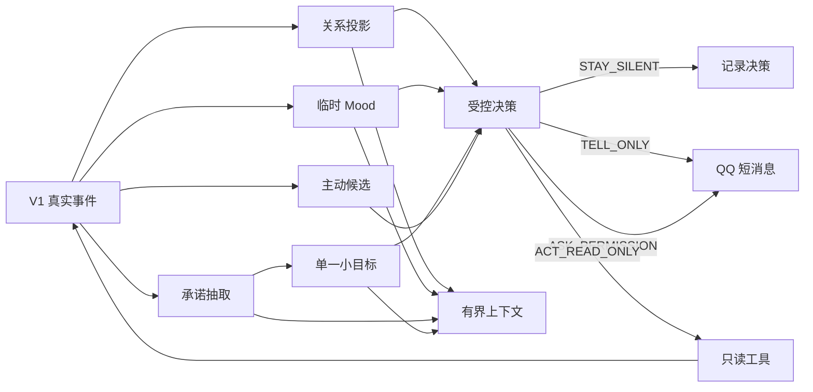

# Companion Self-Memory V2：关系、承诺与受控主动性计划

> 状态：Reviewed Future Plan（V1 完成且稳定观察两周后方可实施）  
> 前置：[`companion-self-memory-v1-plan.md`](./companion-self-memory-v1-plan.md) 全部完成，并稳定观察至少两周  
> V2 目标：让角色在真实自我经历之上形成有限关系状态、短期 Mood、可兑现承诺和一个受控小目标  
> 桌宠展示继续延后

---

## 1. V2 启动门槛

只有 V1 同时满足以下条件才进入 V2：

- proactive 与普通聊天人格一致；
- sent event 无已知假阳性；
- reflection 全部具有有效 source；
- actor 间无自我记忆串线；
- Self memory 注入没有明显增加幻觉；
- 20 轮 transcript 验收通过；
- 至少两周真实使用记录；
- 用户明确认为连续性有所提升；
- Token/费用可接受。

任一条件不满足，先修 V1，不用 V2 功能掩盖。

---

## 2. V2 范围

### 2.1 包含

1. **关系状态**
   - 阶段；
   - 边界；
   - 未完话题；
   - 可解释的互动统计。

2. **临时 Mood**
   - 有来源；
   - 自动衰减；
   - 不改变核心人格。

3. **角色承诺**
   - 只从确认发送的角色文本抽取；
   - 可完成、过期、失败、取消。

4. **单一小目标**
   - 同时最多一个；
   - 只允许低风险只读动作；
   - 可暂停和取消。

5. **受控主动循环**
   - 默认允许沉默；
   - 复用现有 proactive guard；
   - 只发送文本或请求许可。

### 2.2 不包含

- 桌宠、Live2D、VRM、TTS。
- 多 owner、多 tenant。
- 群聊关系。
- 通用 Outbox、exactly-once。
- 自动修改角色卡。
- 永久情绪。
- 单一“好感度”。
- 多目标规划。
- 高风险自主工具。
- 自动文件修改、公开发布、支付、账号操作。
- DSH Runtime 迁移。

---

## 3. V2 架构



---

## 4. 数据模型

V2 在 V1 `companion.db` 上按步骤执行增量 migration：

```text
v2：relationship + open_thread
v3：mood
v4：commitment
v5：goal
```

每步只创建本 Step 所需表，全部成功后才更新 `PRAGMA user_version`。

## 4.1 Relationship

第一版关系不用连续“好感度”，保存可验证统计和派生阶段：

```sql
CREATE TABLE companion_relationship (
    actor_id               TEXT NOT NULL,
    principal_id           TEXT NOT NULL,
    stage                  TEXT NOT NULL CHECK (stage IN (
                             'new', 'familiar', 'established'
                           )),
    meaningful_interactions INTEGER NOT NULL DEFAULT 0,
    active_days            INTEGER NOT NULL DEFAULT 0,
    positive_feedback      INTEGER NOT NULL DEFAULT 0,
    explicit_boundaries_json TEXT NOT NULL DEFAULT '[]'
                            CHECK (json_valid(explicit_boundaries_json)),
    last_interaction_at_ms INTEGER,
    created_at             TEXT NOT NULL DEFAULT (datetime('now','+8 hours')),
    updated_at             TEXT NOT NULL DEFAULT (datetime('now','+8 hours')),
    PRIMARY KEY (actor_id, principal_id)
);

CREATE TABLE companion_open_thread (
    open_thread_id         TEXT PRIMARY KEY,
    actor_id               TEXT NOT NULL,
    principal_id           TEXT NOT NULL,
    topic                  TEXT NOT NULL,
    source_event_id        TEXT NOT NULL REFERENCES companion_event(event_id),
    status                 TEXT NOT NULL CHECK (status IN (
                             'open', 'resolved', 'cancelled'
                           )),
    created_at             TEXT NOT NULL DEFAULT (datetime('now','+8 hours')),
    updated_at             TEXT NOT NULL DEFAULT (datetime('now','+8 hours')),
    FOREIGN KEY (actor_id, principal_id)
        REFERENCES companion_relationship(actor_id, principal_id)
);
```

阶段规则：

```text
new → familiar
  meaningful_interactions >= 5
  active_days >= 2

familiar → established
  meaningful_interactions >= 20
  active_days >= 14
  至少一个承诺成功或等价可靠性事件
```

模型不能直接修改 stage。

## 4.2 Mood

```sql
CREATE TABLE companion_mood (
    actor_id          TEXT NOT NULL,
    principal_id      TEXT NOT NULL,
    label             TEXT NOT NULL CHECK (label IN (
                        'neutral', 'curious', 'happy',
                        'tired', 'concerned', 'frustrated'
                      )),
    valence           REAL NOT NULL CHECK (valence >= -1 AND valence <= 1),
    arousal           REAL NOT NULL CHECK (arousal >= 0 AND arousal <= 1),
    source_event_id   TEXT NOT NULL REFERENCES companion_event(event_id),
    expires_at_ms     INTEGER NOT NULL,
    created_at        TEXT NOT NULL DEFAULT (datetime('now','+8 hours')),
    updated_at        TEXT NOT NULL DEFAULT (datetime('now','+8 hours')),
    PRIMARY KEY (actor_id, principal_id)
);
```

规则：

- 默认中性。
- 只由事件规则更新，模型只可建议 label。
- 到期后不注入 Prompt。
- 用户未回复不自动等于悲伤。
- Mood 不修改关系阶段。

## 4.3 Commitment

```sql
CREATE TABLE companion_commitment (
    commitment_id     TEXT PRIMARY KEY,
    actor_id          TEXT NOT NULL,
    principal_id      TEXT NOT NULL,
    source_event_id   TEXT NOT NULL REFERENCES companion_event(event_id),
    quote             TEXT NOT NULL,
    action            TEXT NOT NULL,
    due_at_ms         INTEGER,
    success_criteria  TEXT NOT NULL,
    status            TEXT NOT NULL CHECK (status IN (
                        'proposed', 'active', 'overdue',
                        'succeeded', 'failed', 'cancelled'
                      )),
    result_event_id   TEXT REFERENCES companion_event(event_id),
    created_at        TEXT NOT NULL DEFAULT (datetime('now','+8 hours')),
    updated_at        TEXT NOT NULL DEFAULT (datetime('now','+8 hours'))
);
```

只分析 V1 的：

```text
agent.message.sent
proactive.message.sent
```

`quote` 必须是实际发送文本的精确子串。

## 4.4 Goal

```sql
CREATE TABLE companion_goal (
    goal_id            TEXT PRIMARY KEY,
    actor_id           TEXT NOT NULL,
    principal_id       TEXT NOT NULL,
    commitment_id      TEXT REFERENCES companion_commitment(commitment_id),
    text               TEXT NOT NULL,
    status             TEXT NOT NULL CHECK (status IN (
                         'proposed', 'approved', 'in_progress',
                         'succeeded', 'failed', 'cancelled'
                       )),
    allowed_tools_json TEXT NOT NULL DEFAULT '[]'
                       CHECK (json_valid(allowed_tools_json)),
    deadline_ms        INTEGER NOT NULL,
    result_event_id    TEXT REFERENCES companion_event(event_id),
    created_at         TEXT NOT NULL DEFAULT (datetime('now','+8 hours')),
    updated_at         TEXT NOT NULL DEFAULT (datetime('now','+8 hours'))
);

CREATE UNIQUE INDEX ux_one_active_goal
ON companion_goal(actor_id, principal_id)
WHERE status = 'in_progress';
```

V2 工具白名单只允许：

- 读取 memory/daily；
- 读取公开网页；
- 读取 B站/浏览历史；
- 读取时间；

禁止 Shell、文件写入、邮件、公开评论、账号操作。

V2 扩展 V1 `EVENT_KINDS`：

```text
read_action.succeeded
read_action.failed
goal.started
goal.succeeded
goal.failed
goal.cancelled
commitment.created
commitment.succeeded
commitment.failed
commitment.cancelled
```

只读工具执行结果必须写真实事件后，才能更新 goal/result。

---

## 5. V2 Prompt

## 5.1 Commitment Extractor

```text
判断角色是否在已确认发送文本中明确答应未来完成一个可验证动作。

不算承诺：
- 客套话、愿望、建议；
- “我看看”“以后再说”；
- 用户要求但角色没有明确接受；
- 已经完成的事情。

只输出 JSON：
{
  "is_commitment": true,
  "quote": "输入文本精确子串",
  "action": "...",
  "due_text": "明天",
  "success_criteria": "...",
  "confidence": 0.0
}
```

代码校验：

- quote 精确命中；
- due_at 由代码解析 quote，不接受模型自由日期；
- confidence ≥0.85 自动 active；
- 0.60–0.85 proposed；
- 低于 0.60 不保存。

## 5.2 Goal Proposal

```text
根据 active commitment 或有证据 reflection，
最多提出一个短小、只读、可取消、可验证目标。

不得扩大 allowed_tools。
不得创建外发、写文件、付费、账号或不可逆动作。
没有合适目标时返回 null。
```

## 5.3 Active Decision

允许：

```text
STAY_SILENT
TELL_ONLY
ASK_PERMISSION
ACT_READ_ONLY
```

优先级：

1. 有风险或需要写操作 → ASK_PERMISSION。
2. 价值低、重复、打扰成本高 → STAY_SILENT。
3. 已有真实经历值得说 → TELL_ONLY。
4. 安全只读小目标 → ACT_READ_ONLY。

代码拥有最终否决权。

---

## 6. V2 实施步骤

每一步仍采用“代码/测试提交 + 独立 R5 文档提交”。

## V2-Step 1：关系与 Open Threads（migration v2）

### 实现

- migration v2 relationship/open_thread。
- 从 V1 的 owner input、sent、proactive sent 投影统计。
- 明确边界提取仍需用户原文证据。
- stage 只由规则派生。

### 验收

- 单次互动不能直接跳 stage。
- 切角色关系隔离。
- open thread 有 source event。
- 用户明确说“不想聊这个”后 boundary 生效。

---

## V2-Step 2：临时 Mood（migration v3）

### 实现

- migration mood。
- 事件到 mood 的确定性映射。
- 到期自动视为 neutral。
- Prompt 只注入未过期一行摘要。

### 验收

- Mood 有 source。
- 到期不注入。
- 用户不回复不会自动变负面。
- Mood 不修改 persona/relationship。

---

## V2-Step 3：承诺（migration v4）

### 实现

- migration commitment。
- 无工具 extractor。
- deterministic key。
- overdue sweeper。
- 人工查看/取消入口。

### 验收

- 只从确认发送文本抽取。
- quote 必须精确命中。
- 同 source 不重复。
- 承诺最终可完成、失败或取消。

---

## V2-Step 4：单一只读目标（migration v5）

### 实现

- migration goal。
- Goal Proposal。
- 一次最多一个 in_progress。
- deadline、取消和结果事件。
- 仅只读工具白名单。

### 验收

- 并发不能创建两个 active goal。
- 非白名单工具拒绝。
- 重启后不重复执行已完成目标。
- 失败有真实 result event。

---

## V2-Step 5：受控主动循环

### 实现

复用现有：

- quiet hours；
- hot chat；
- daily quota；
- jitter；
- reply rate；
- owner 范围。

流程：

```text
V1 events/reflections
→ relationship/mood/commitment
→ 规则候选
→ gate
→ Decision LLM（有候选才调用）
→ policy 收紧
→ silent / tell / ask / read-only action
```

### 验收

- 无候选 0 次 LLM。
- STAY_SILENT 不发消息。
- ASK_PERMISSION 不提前执行。
- read-only goal 不产生外部写入。
- 主动消息沿用 V1 的短消息节奏和 receipt。

---

## V2-Step 6：有界 Prompt 与端到端评估

Prompt 增加：

```text
Relationship ≤300 字符
Mood ≤100 字符
Open threads ≤300 字符
Active commitment/goal ≤400 字符
```

端到端场景：

1. 角色答应后续查看某资料。
2. Commitment 被识别。
3. 生成一个只读 goal。
4. goal 成功产生 event。
5. 角色决定是否告诉用户。
6. 用户回复，relationship/open thread 更新。
7. Mood 到期回中性。

观察至少两周：

- 主动消息是否减少模板感；
- 是否出现不必要打扰；
- 承诺兑现率；
- silent 比例；
- 目标失败率；
- Token 成本；
- 用户是否认为角色更连续，而非更黏人。

---

## 7. V2 完成定义

- 关系状态全部可由真实事件重建。
- Mood 全部有 source 且会过期。
- 承诺只来自确认发送文本。
- 每个 actor 同时最多一个 goal。
- 主动决策允许沉默。
- 高风险行为不能自主执行。
- V1 记忆和短消息节奏无回归。
- 桌宠和 DSH 仍未耦合。

V2 完成后，再决定是否进入：

- 桌宠展示；
- 更完整生活循环；
- 通用 Outbox；
- DSH Runtime；
- 多用户。
