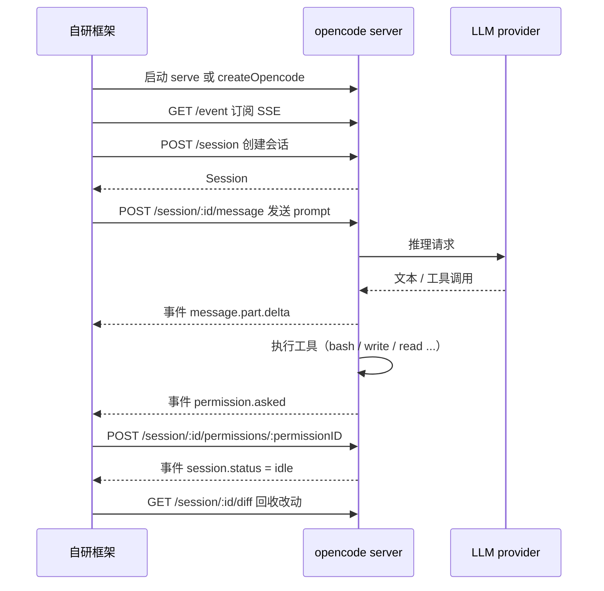

# 把 opencode 作为 agent 接入自研框架

面向需要复用 opencode 完整 agent 能力的自研框架：不重写模型接入，不重写工具循环，只做编排。

## 1. 适用边界

opencode 有两类可复用的东西，用途不同，选错会白做一遍。

| 你的需求 | 该用的东西 | 说明 |
|---|---|---|
| 需要 agent 真的去读写文件、跑 shell、调 MCP | `opencode serve` + 官方 SDK | 工具循环由 opencode 服务端执行，你只负责编排与结果回收 |
| 只需要裸模型的对话与 tool calling | `opencode-llm-proxy` 之类的模型代理 | 暴露 OpenAI/Anthropic/Gemini 兼容端点，工具由你的框架执行 |
| 只用本地 Ollama | Ollama 自带的 OpenAI 兼容端点 | 不需要经过 opencode |

本文只覆盖第一行。

## 2. 运行形态

opencode 的 TUI 是客户端，服务端才是本体。`opencode serve` 启动无头 HTTP 服务并暴露 OpenAPI 3.1 规范端点，官方 SDK 由该规范生成，所以"用 API 驱动 opencode"是它的原生用法，不是外部拼装出来的能力。参见 [Server 文档](https://opencode.ai/docs/server/)。

三种接入形态：

| 形态 | 启动方式 | 适用 |
|---|---|---|
| 独立服务 | `opencode serve --port 4096 --hostname 127.0.0.1` | 常驻，多客户端共享 |
| SDK 内嵌 | `createOpencode({ port: 4096 })` | 进程内托管，随脚本启停 |
| 连接已有服务 | `createOpencodeClient({ baseUrl })` | 复用已在跑的 server |

`opencode serve` 的默认值是 `--port 4096`、`--hostname 127.0.0.1`，另有 `--mdns`、`--mdns-domain`（默认 `opencode.local`）和可重复传递的 `--cors`。

有一个容易踩的点：如果 TUI 已经在运行，`opencode serve` 会再起一个新的服务器；TUI 自身使用随机端口，想让两者共用同一个服务器，必须在启动 TUI 时显式传入 `--hostname` 与 `--port`。

## 3. 交互时序



关键判断点有两个：权限请求必须应答，否则流程永久挂起；一轮结束的判据是 `session.status` 变为 `idle`，不要用"事件流安静了"来猜。

## 4. 接入步骤

### 4.1 前置

```bash
npm install -g opencode-ai
opencode auth login
```

provider 必须先在 opencode 侧登录完成，SDK 只是调用方，不负责凭据。

### 4.2 启动服务

```bash
opencode serve --port 4096 --hostname 127.0.0.1
```

需要局域网访问时改用 `--hostname 0.0.0.0`，同时按第 8 节配置认证。

### 4.3 创建会话并提问

JS/TS 用官方 SDK `@opencode-ai/sdk`：

```ts
import { createOpencode } from "@opencode-ai/sdk"

const opencode = await createOpencode({ port: 4096 })

const session = await opencode.client.session.create({
  body: { title: "my-task" },
})

const result = await opencode.client.session.prompt({
  path: { id: session.id },
  body: {
    model: { providerID: "github-copilot", modelID: "claude-sonnet-4.6" },
    parts: [{ type: "text", text: "把 README 里过期的示例改掉" }],
  },
})

opencode.server.close()
```

`session.prompt()` 是同步等待，内部工具循环跑完后一次性返回 `{ info: AssistantMessage, parts: Part[] }`。需要不阻塞就用 `prompt_async`，它返回 `204 No Content`。

Python 侧有两个 SDK，API 面不同，按需选：

| SDK | 来源 | 特点 |
|---|---|---|
| `opencode-ai` | 官方，Stainless 生成 | httpx 同步/异步双客户端，类型定义完整 |
| `opencode-py` | 社区 | 会自动下载 opencode 二进制，含 ToolExecutor 与类型化事件模型 |

`opencode-py` 的上下文管理器写法：

```python
from opencode import Opencode

with Opencode() as ai:                 # 自动起 server，退出时清理
    session = ai.create_session()
    print(session.prompt("把 README 里过期的示例改掉"))
    print(session.diff())              # 本次会话改动的文件差异
```

连接已有服务时改用 `OpencodeClient(base_url="http://127.0.0.1:4096", directory=".")`，异步版本是 `AsyncOpendcodeClient`。

### 4.4 订阅事件流

`session.prompt()` 只给最终结果。要做流式输出、进度展示、权限应答，都必须订阅 SSE。

```ts
const events = await opencode.client.event.subscribe()
for await (const event of events.stream) {
  // event.type 与 event.properties
}
```

服务端 `GET /event` 的首个事件固定为 `server.connected`，之后是总线事件。`opencode-py` 额外提供约 75 种事件的类型化模型（`message.part.delta`、`session.status`、`session.next.tool.called`、`file.edited`、`permission.asked` 等），用 `parse_stream_event()` 解析。

按 `sessionID` 过滤事件是必需的：一个事件流承载所有会话。

### 4.5 应答权限请求

agent 调用 `bash`、`write` 等工具时会挂起等待批准。收到 `permission.asked` 后调用：

```http
POST /session/:id/permissions/:permissionID
Content-Type: application/json

{ "response": "...", "remember": true }
```

`response` 的合法取值以 `GET /doc` 返回的 OpenAPI 规范为准，不同版本可能不同，不要凭记忆硬编码。

这是自动化接入最常见的失败点。如果框架只调 `session.prompt()` 而不订阅事件，会话会在权限处静默卡死，表现为"请求永不返回"。

### 4.6 收尾

```ts
await opencode.client.session.abort({ path: { id: session.id } })   // 需要中断时
await opencode.client.session.delete({ path: { id: session.id } })  // 清理会话
opencode.server.close()
```

## 5. 可直接复用的接口

服务端暴露的能力远不止"发消息"。以下按用途归类，均可在 SDK 中找到对应方法。

会话控制：

| 接口 | 用途 |
|---|---|
| `session.abort()` | 中断正在运行的会话 |
| `session.fork()` | 在某条消息处分叉会话 |
| `session.revert()` / `unrevert()` | 回退消息 / 恢复全部已回退消息 |
| `session.summarize()` | 压缩会话上下文 |
| `session.children()` | 列出子会话 |
| `session.diff()` | 获取本次会话的文件差异 |

上下文注入：`session.prompt({ body: { noReply: true, parts } })` 只写入 user 消息、不触发模型回答，适合把你的框架的系统提示或检索结果注入会话。

文件与检索：`find.text`（内容搜索）、`find.files`（按名查文件/目录）、`find.symbols`（工作区符号）、`file.read`、`file.status`。这套接口可以直接当作你框架的检索层，不必自己实现。

其他：`session.shell()` 执行 shell 命令，`session.command()` 执行斜杠命令，`GET /agent` 列出可用代理，`GET /config/providers` 列出 provider 与默认模型。

## 6. 权限与沙箱

两条路，按框架复杂度选。

事件应答适合需要动态判断的场景，权限决策在你手里，代价是必须维护事件循环。

`opencode-py` 的 `ToolExecutor` 适合策略固定的场景，一次性声明：

```python
from opencode import Opencode, ToolExecutor

with Opencode() as ai:
    session = ai.create_session()
    msg = session.ask(
        "Write test.py with print('hello')",
        tool_executor=ToolExecutor(
            permissions={"bash": "allow", "write": "deny", "grep": "ask"},
            workdir="/path/to/sandbox",   # 限制文件操作范围
        ),
        max_tool_rounds=25,               # 安全上限
        quiet=True,
    )
```

默认权限是 `bash` 为 `ask`、`read`/`glob`/`grep`/`write`/`edit` 为 `allow`。生产环境建议把 `workdir` 指向隔离目录，并始终设置 `max_tool_rounds`。

另需注意 `ask()` 的首轮响应会进入 plan mode，SDK 会自动回一句 "Exit plan mode and proceed" 让模型开始真正执行工具；如果你的框架自己实现 loop，需要处理同样的状态。

## 7. 结构化输出

在 prompt 里带 JSON Schema，模型会通过 `StructuredOutput` 工具返回经校验的 JSON：

```ts
const result = await opencode.client.session.prompt({
  path: { id: session.id },
  body: {
    parts: [{ type: "text", text: "Research Anthropic and provide company info" }],
    format: {
      type: "json_schema",
      schema: {
        type: "object",
        properties: {
          company: { type: "string", description: "Company name" },
          founded: { type: "number", description: "Year founded" },
        },
        required: ["company", "founded"],
      },
      retryCount: 2,
    },
  },
})

console.log(result.data.info.structured_output)
```

校验失败且重试耗尽时，响应里会带 `StructuredOutputError`，包含 `message` 与 `retries`。

两处需要注意。官方文档中 SDK 方法表写的是 `body.outputFormat`，而示例代码用的是 `body.format`，两者不一致，以你所用版本的 `GET /doc` 为准。另外该能力要求模型支持 `tool_choice="required"`（Claude、GPT-4 满足），免费的 `opencode/big-pickle` 不满足。

## 8. 安全

服务端认证通过环境变量开启：

```bash
OPENCODE_SERVER_PASSWORD=your-password opencode serve
```

用户名默认 `opencode`，可用 `OPENCODE_SERVER_USERNAME` 覆盖。该设置对 `opencode serve` 与 `opencode web` 同时生效。

默认绑定 `127.0.0.1`，改动前先想清楚暴露范围。局域网场景要同时满足：绑定 `0.0.0.0`、设置密码、防火墙限制来源。

由于工具由 opencode 侧执行，你的框架仍需对传入的 prompt 与工作目录负责：不要让不受信任的输入直接决定 `directory`，不要给 agent 超出必要的文件系统权限。凭据不要写进日志。

## 9. 错误处理

`opencode-py` 提供类型化异常层级，全部可从 `opencode` 导入，包含 `APIConnectionError`、`APITimeoutError`、`RateLimitError`（429）、`NotFoundError`（404）、`InternalServerError`（5xx）、`BinaryNotFoundError`、`ServerStartupTimeoutError` 等。

重试策略已内置：408、409、429、5xx 与超时会做带抖动的指数退避重试，并遵循 `Retry-After` 与 `retry-after-ms` 响应头。用 `max_retries` 控制次数。

```python
from opencode import OpencodeClient, RateLimitError, InternalServerError

client = OpencodeClient(max_retries=3)
try:
    health = client.health()
except RateLimitError:
    ...
except InternalServerError:
    ...
```

## 10. 调试

`GET /doc` 返回 OpenAPI 3.1 规范，可直接在 Swagger 里点着试接口，也是确认字段名与枚举值的权威来源。

`GET /global/health` 返回 `{ healthy: true, version: string }`，适合做存活探针。

请求级日志用 `OPENCODE_LOG=debug` 打开，会打印所有 HTTP 请求/响应及耗时。Windows PowerShell 下：

```powershell
$env:OPENCODE_LOG="debug"; python my_script.py
```

## 11. 已知限制

权限事件不应答会导致会话静默挂起，且不会报错。这是最需要防御性处理的地方。

TUI 与 `opencode serve` 是两套服务器实例，共用需要显式指定端口。

结构化输出的字段名在官方文档内部存在 `format` / `outputFormat` 的不一致。

Python 侧两个 SDK 并存，方法命名风格不同（例如官方版为 `session_send`，社区版为 `session.prompt`），切换 SDK 需要改代码。

`opencode-py` 会自动下载 opencode 二进制到 `~/.opencode/bin/`，该二进制不加入 PATH；若已通过 npm 全局安装 opencode，SDK 会优先使用 PATH 版本。

## 12. 与模型代理方案的分工

两者解决的不是同一个问题，混用会同时失去两边的优势。

| 维度 | opencode serve + SDK | opencode-llm-proxy |
|---|---|---|
| 你拿到的东西 | 一个能自己干活的 agent | 一个模型端点 |
| 工具由谁执行 | opencode 服务端 | 你的框架（代理返回真实 tool_calls） |
| 接口形态 | 会话/消息/事件/文件等专用 API | OpenAI / Anthropic / Gemini 兼容 |
| 适合 | 我编排，opencode 执行 | 我的框架要自己控制工具循环 |

需要 opencode 的工具循环就用本文方案；只需要模型而工具逻辑必须掌握在自己手里，用模型代理方案。

## 官方文档入口

- Server：[opencode.ai/docs/server](https://opencode.ai/docs/server/)
- SDK（JS/TS）：[opencode.ai/docs/sdk](https://opencode.ai/docs/zh-cn/sdk/)
- 官方 Python SDK：[pypi.org/project/opencode-ai](https://pypi.org/project/opencode-ai/)
- 社区 Python SDK：[pypi.org/project/opencode-py](https://pypi.org/project/opencode-py/0.5.1/)
