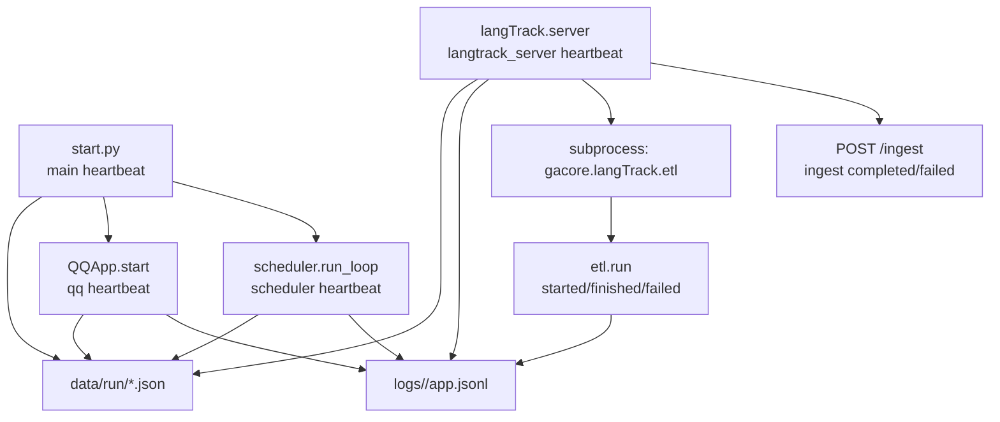

# withlanggraph 可观测性 P0 实现计划

> 设计依据：`apps/withlanggraph/docs/observability-design.md`
> 目标读者：未参与本轮讨论、但熟悉 Python/pytest 的实现者
> 工作目录：`D:\AAAmyPrj\github\myrepos\mono`
> 约束：遵守根 `AGENTS.md` 与 `apps/withlanggraph/AGENTS.md`；小步提交；每步测试先失败再实现。

## 0. 范围与前置状态

本次只做设计文档的 P0：

1. `Logger.exception()` 异常栈助手
2. `Heartbeat` 心跳模块
3. scheduler 心跳 + `stop_event` 优雅停机 + 崩溃回调 + `Job finished` 状态
4. QQ 心跳（放在 Task 3B）
5. langTrack server `/ingest` 日志 + 心跳 + ETL 子进程归属（含超时）
6. ETL `etl.run.*` 运行摘要
7. 测试日志隔离回归守卫

**不做**：`gacore.ops` CLI、深度 `/health`、日志轮转、跨 app schema 统一、全仓 `stack_trace=str(e)` 清扫。

当前工作区有未提交的 KG extract 改动：

```text
 M .gitignore
 M apps/withlanggraph/docs/architecture-flow.mmd
 M apps/withlanggraph/docs/kg-extract-plan.md
 M apps/withlanggraph/docs/langTrack-tech.md
 M apps/withlanggraph/src/gacore/langTrack/extract/material.py
 M apps/withlanggraph/src/gacore/langTrack/extract/runner.py
 M apps/withlanggraph/src/gacore/opencode_llm.py
 M apps/withlanggraph/tests/test_langTrack_extract_events.py
 M apps/withlanggraph/tests/test_langTrack_extract_material.py
 M apps/withlanggraph/tests/test_langTrack_extract_retry.py
 M apps/withlanggraph/tests/test_opencode_llm.py
```

这些文件**不属于本计划**。不要回滚、不要格式化、不要顺手改；提交时只 stage 本计划涉及的文件。

## 1. 目标架构



## 2. 技术约定

- 日志：统一用 `gacore.jsonl_logger.get_logger`；字段名见设计文档第 14 节。
- 心跳：统一用 `gacore.heartbeat.Heartbeat`；调用方必须从自己的循环 `beat()`。
- 时间：日志用 logger 自带 `ts`；心跳用 `+08:00` ISO + `updated_at_epoch`。
- 测试：不得写真实 `apps/withlanggraph/logs` 或 `data/run`；必须 `tmp_path`。
- 编码：Python 3.12；行宽 120；ruff 只跑 `E4/E7/E9/F` 基线。
- 提交：中文 `type(scope): 描述`；每完成一个可独立验证的任务就提交。

## 3. 任务分解

### Task 1：Logger.exception + 异常字段

**文件**

- 修改：`apps/withlanggraph/src/gacore/jsonl_logger.py`
- 新增：`apps/withlanggraph/tests/test_jsonl_logger_exception.py`

**先写测试**

```python
def test_exception_inside_except_records_real_traceback(monkeypatch):
    records = []
    monkeypatch.setattr(Logger, "_emit", lambda self, level, message, fields: records.append(fields))
    log = get_logger("test_exception")
    try:
        raise RuntimeError("boom")
    except RuntimeError as exc:
        log.exception("job failed", exc=exc, job="daily")
    assert records[-1]["error_type"] == "RuntimeError"
    assert records[-1]["error_message"] == "boom"
    assert "Traceback (most recent call last)" in records[-1]["stack_trace"]
    assert records[-1]["job"] == "daily"


def test_exception_without_active_exception_still_emits(monkeypatch):
    ...
    log.exception("no active exception")
    assert records[-1]["error_type"] is None
    assert records[-1]["stack_trace"] is None
```

**实现**

- `Logger.exception(self, message, *, exc: BaseException | None = None, context=None, error_type=None, **fields) -> None`
- `exc is None` 时取 `sys.exc_info()[1]`。
- 有异常：`error_type=type(exc).__name__`，`error_message=str(exc)`，`stack_trace="".join(traceback.format_exception(type(exc), exc, exc.__traceback__))`。
- 无异常：三个字段均为 `None`。
- `Logger.error` 增加可选 `error_message` 参数，保持现有调用兼容。
- 不要在这里做“把 `str(e)` 自动变 traceback”的魔法；显式调用 `exception`。

**验证**

```powershell
uv run pytest apps/withlanggraph/tests/test_jsonl_logger_exception.py -q
uv run ruff check apps/withlanggraph/src/gacore/jsonl_logger.py apps/withlanggraph/tests/test_jsonl_logger_exception.py
```

**提交**

```text
feat(logging): 增加异常栈日志助手
```

---

### Task 2：Heartbeat 模块

**文件**

- 新增：`apps/withlanggraph/src/gacore/heartbeat.py`
- 新增：`apps/withlanggraph/tests/test_heartbeat.py`
- 修改：`apps/withlanggraph/.env.example`

**接口**

```python
DEFAULT_INTERVAL_SECONDS: Final = 15
RUN_DIR_ENV: Final = "GACORE_RUN_DIR"


def run_dir(root: Path) -> Path:
    """Return the heartbeat directory: GACORE_RUN_DIR override, else <root>/data/run."""


@final
class Heartbeat:
    def __init__(
        self,
        component: str,
        *,
        root: Path,
        interval_sec: int = DEFAULT_INTERVAL_SECONDS,
        stale_after_sec: int | None = None,
    ) -> None: ...

    def start(self, **detail: object) -> None: ...
    def beat(
        self,
        *,
        state: str | None = None,
        stale_after_sec: int | None = None,
        **detail: object,
    ) -> None: ...
    def stop(self, *, state: str = "stopped", **detail: object) -> None: ...
```

**行为**

- 文件：`<root>/<component>.json`；`root` 是已经解析好的目录，由调用方传 `run_dir(cfg.root)` 或测试 `tmp_path/"run"`。
- 字段严格按设计文档 5.2；`detail` 放在 `detail` 子对象，不摊平。
- `seq` 每次 `start/beat/stop` 自增；`instance_id` 每个实例生成一次。
- `stale_after_sec` 默认 `max(60, interval_sec * 3)`；`beat(stale_after_sec=1800)` 只覆盖本次写入，下一次不带参数时回到默认窗口。
- `beat(state=None)` 沿用上一次状态（`_state`），周期心跳不会把 `reconnecting` 冲成 `running`；`start()` 设 `starting`，`stop()` 设传入状态。
- `detail` 每次写入整体替换；周期心跳不传 detail 时写空对象。调用方需要保留的线索每次自带。
- 原子写：临时文件 + `os.replace`；临时名含 `pid/instance/seq`；失败时删除临时文件。
- 写失败不抛；`WARNING` 按 60s 节流，字段 `component/path/error_type/error_message`。
- `run_dir` 支持 `GACORE_RUN_DIR` 绝对路径或相对项目根目录。
- 模块顶部按项目惯例 `logger = get_logger("heartbeat")`；不要自建 stdlib logger。

**测试**

```python
def test_start_beat_stop_writes_contract(tmp_path):
    hb = Heartbeat("scheduler", root=tmp_path / "run", interval_sec=30)
    hb.start(poll_interval=30)
    first = json.loads((tmp_path / "run" / "scheduler.json").read_text(encoding="utf-8"))
    assert first["component"] == "scheduler"
    assert first["state"] == "starting"
    assert first["interval_sec"] == 30
    assert first["stale_after_sec"] == 90
    assert first["detail"] == {"poll_interval": 30}

    hb.beat(state="busy", stale_after_sec=1800, job="daily-report")
    second = json.loads(...)
    assert second["state"] == "busy"
    assert second["stale_after_sec"] == 1800
    assert second["seq"] > first["seq"]

    # 不带 state：沿用 busy；不带 stale_after_sec：回到默认 90
    hb.beat()
    third = json.loads(...)
    assert third["state"] == "busy"
    assert third["stale_after_sec"] == 90
    assert third["detail"] == {}

    hb.stop()
    fourth = json.loads(...)
    assert fourth["state"] == "stopped"


def test_write_failure_does_not_raise(tmp_path):
    blocker = tmp_path / "run"
    blocker.write_text("not a directory", encoding="utf-8")
    hb = Heartbeat("scheduler", root=blocker)
    hb.beat()  # must not raise


def test_run_dir_env_override(tmp_path, monkeypatch):
    monkeypatch.setenv("GACORE_RUN_DIR", str(tmp_path / "custom"))
    assert run_dir(tmp_path) == tmp_path / "custom"
```

**同时**

- 在 `apps/withlanggraph/.env.example` 增加 `GACORE_RUN_DIR=`（可留空，注释说明默认 `data/run`）。R9 要求新键登记。

**验证**

```powershell
uv run pytest apps/withlanggraph/tests/test_heartbeat.py -q
uv run ruff check apps/withlanggraph/src/gacore/heartbeat.py apps/withlanggraph/tests/test_heartbeat.py
```

**提交**

```text
feat(observability): 增加组件心跳文件
```

---

### Task 3：scheduler 心跳、启动计划、崩溃回调、Job 状态

**文件**

- 修改：`apps/withlanggraph/src/gacore/scheduler.py`
- 修改：`apps/withlanggraph/start.py`
- 修改/新增测试：`apps/withlanggraph/tests/test_scheduler.py`、`apps/withlanggraph/tests/test_scheduler_heartbeat.py`、`apps/withlanggraph/tests/test_scheduler_done_callback.py`

#### 3.1 `Job finished` 增加状态

`run_job` 中：

- 新增局部 `error_type: str | None = None`、`error_message: str | None = None`。
- `except Exception as e` 时：`error_type = type(e).__name__`，`error_message = str(e)`，用 `logger.exception("Job failed", exc=e, job=name, error=error)`（`error` 仍是原来的 `f"{type(e).__name__}: {e}"` 复合串，兼容旧消费方）。
- `INCOMPLETE_REPLY` / `EMPTY_REPLY` 分支把 `error_type` 设为对应 `exit_reason`，`error_message` 设为该分支的说明文案。
- `Job finished` 增加：

```python
status="ok" if error is None else "error",
error_type=error_type,
error_message=error_message,
```

#### 3.2 `_log_proactive_failure` / `_log_extract_failure` / `run_extract_job`

改为：

```python
logger.exception("proactive job raised top-level exception", exc=exc)
logger.exception("kg-extract job raised top-level exception", exc=exc)
logger.exception("kg-extract failed", exc=e, job=job.name, day=day)
```

`run_extract_job` 内层 `except Exception as e`（当前只写 `error/stack_trace=str(e)`，scheduler.py:239-247）换成 `logger.exception`，保证池内抽取失败有真栈。

#### 3.3 `run_loop` 心跳与优雅停机

签名增加：

```python
def run_loop(
    cfg: Config | None = None,
    poll_interval: int = _POLL_INTERVAL_SECONDS,
    graph_runner: Callable[[str, Config, int], str | None] | None = None,
    max_iterations: int | None = None,
    clock: Callable[[], datetime] | None = None,
    stop_event: threading.Event | None = None,
) -> int:
```

主体：

```python
from gacore.heartbeat import Heartbeat, run_dir

heartbeat = Heartbeat(
    "scheduler",
    root=run_dir(resolved_cfg.root),
    interval_sec=poll_interval,
)
heartbeat.start(poll_interval=poll_interval, max_iterations=max_iterations)
failed = False
try:
    now = now_fn()
    jobs = load_jobs(resolved_cfg)
    for job in jobs:
        state = states.get(job.name, JobState())
        nxt = next_run_time(job.schedule, state.last_run, now)
        logger.info(
            "scheduler job registered",
            job=job.name,
            type=job.type,
            schedule=job.schedule,
            next_run=nxt.isoformat(timespec="seconds") if nxt else None,
        )
    while (max_iterations is None or iterations < max_iterations) and not (
        stop_event is not None and stop_event.is_set()
    ):
        iterations += 1
        now = now_fn()
        jobs = load_jobs(resolved_cfg)
        heartbeat.beat(state="running", iteration=iterations, job_count=len(jobs))
        ...
        # 阻塞型 job 前
        heartbeat.beat(
            state="busy",
            job=job.name,
            job_type=job.type,
            stale_after_sec=1800,
        )
        result = run_job(job, resolved_cfg, graph_runner=graph_runner)
        heartbeat.beat(
            state="running",
            last_job=job.name,
            last_status="ok" if result.error is None else "error",
        )
        ...
        if max_iterations is None:
            if stop_event is not None:
                stop_event.wait(poll_interval)
            else:
                time.sleep(poll_interval)
except Exception as exc:
    failed = True
    logger.exception("scheduler loop crashed", exc=exc, iterations=iterations, jobs_run=jobs_run)
    heartbeat.stop(
        state="error",
        error_type=type(exc).__name__,
        error_message=str(exc),
        iterations=iterations,
    )
    raise
finally:
    if not failed:
        heartbeat.stop(iterations=iterations, jobs_run=jobs_run)
```

注意：

- 生产循环必须在 `stop_event` 置位时立刻退出；`stop_event.wait(poll_interval)` 替代原来的 `time.sleep`，测试传 `None` 时行为不变。
- 只在**同步阻塞**的 `run_job` 分支写 `busy`；proactive/extract 是池任务，轮询继续，保持 `running`。
- `heartbeat.stop()` 在 `finally` 里只执行一次；异常分支已经写 `error`，用 `failed` 防止被覆盖成 `stopped`。
- `next_run_time` 为 `None` 时日志字段写 `None`，不要抛。
- 不要给 `Job` 写不存在的 `enabled` 字段；调度启停看 `schedule.json` 原配置。

#### 3.4 `scheduler.on_scheduler_done` 与 `start.py` 停机

把回调放在 `scheduler.py`（不依赖 QQ/botpy，测试可直接 import）：

```python
# gacore/scheduler.py
def on_scheduler_done(task: asyncio.Task[None], stop_event: threading.Event) -> None:
    if task.cancelled():
        logger.info("Scheduler task cancelled")
        return
    exc = task.exception()
    if exc is not None:
        logger.exception("Scheduler task died", exc=exc)
    elif stop_event.is_set():
        logger.info("Scheduler task stopped")
    else:
        logger.warning("Scheduler task exited unexpectedly")
```

在 `start.py` 的 `_main()`：

```python
import functools
from gacore.scheduler import on_scheduler_done, run_loop

stop_event = threading.Event()
scheduler_task = asyncio.create_task(asyncio.to_thread(run_loop, cfg, stop_event=stop_event))
scheduler_task.add_done_callback(functools.partial(on_scheduler_done, stop_event=stop_event))
```

同时加 `main` 心跳：

```python
heartbeat = Heartbeat("main", root=run_dir(cfg.root))
heartbeat.start(launcher="start.py")
heartbeat.beat(state="running", launcher="start.py")

async def _beat_main() -> None:
    while True:
        await asyncio.sleep(DEFAULT_INTERVAL_SECONDS)
        heartbeat.beat(launcher="start.py")  # 不传 state，沿用当前状态
```

停机：

- `finally` 里先 `stop_event.set()`，再 `await scheduler_task`；**不要用 `scheduler_task.cancel()` 当正常停机**（`asyncio.to_thread` 的线程不可取消，cancel 只停外壳）。
- `await scheduler_task` 用 `try/except Exception: pass` 包住（异常已由 done callback 记录）；若有阻塞型 job，优雅停机要等它结束。
- `beat_task` 同样 cancel + await，再 `heartbeat.stop()`。
- 把 `build_config()` 和 `app.start()` 一起放进 `try`，避免 `build_config` 失败时 scheduler task 泄漏。

**测试**

新增 `tests/test_scheduler_heartbeat.py`：

```python
def test_run_loop_writes_stopped_heartbeat(tmp_path):
    cfg = Config.for_tests(tmp_path)
    run_loop(cfg=cfg, max_iterations=1, clock=lambda: datetime(2026, 10, 21, 12, 0, tzinfo=UTC))
    data = json.loads((tmp_path / "data" / "run" / "scheduler.json").read_text(encoding="utf-8"))
    assert data["state"] == "stopped"
    assert data["detail"]["jobs_run"] == 0


def test_run_loop_crash_sets_error_heartbeat(tmp_path, monkeypatch):
    cfg = Config.for_tests(tmp_path)
    monkeypatch.setattr("gacore.scheduler.load_jobs", lambda cfg: (_ for _ in ()).throw(RuntimeError("boom")))
    with pytest.raises(RuntimeError):
        run_loop(cfg=cfg, max_iterations=1)
    data = json.loads((tmp_path / "data" / "run" / "scheduler.json").read_text(encoding="utf-8"))
    assert data["state"] == "error"
    assert data["detail"]["error_type"] == "RuntimeError"


def test_run_loop_stop_event_exits_and_writes_stopped(tmp_path):
    cfg = Config.for_tests(tmp_path)
    stop_event = threading.Event()
    stop_event.set()
    jobs_run = run_loop(cfg=cfg, poll_interval=1, stop_event=stop_event)
    assert jobs_run == 0
    data = json.loads((tmp_path / "data" / "run" / "scheduler.json").read_text(encoding="utf-8"))
    assert data["state"] == "stopped"
```

新增 `tests/test_scheduler_done_callback.py`：

```python
import gacore.scheduler as scheduler_module


class _FakeTask:
    def __init__(self, *, cancelled=False, exc=None):
        self._cancelled = cancelled
        self._exc = exc

    def cancelled(self):
        return self._cancelled

    def exception(self):
        return self._exc


def _recorder(monkeypatch):
    events = []
    class Rec:
        def debug(self, message, **fields): events.append((message, fields))
        def info(self, message, **fields): events.append((message, fields))
        def warning(self, message, **fields): events.append((message, fields))
        def error(self, message, **fields): events.append((message, fields))
        def exception(self, message, *, exc=None, **fields): events.append((message, fields | {"exc": exc}))
    monkeypatch.setattr(scheduler_module, "logger", Rec())
    return events


def test_scheduler_done_callback_logs_exception(monkeypatch):
    events = _recorder(monkeypatch)
    stop_event = threading.Event()
    scheduler_module.on_scheduler_done(_FakeTask(exc=RuntimeError("boom")), stop_event)
    assert events[-1][0] == "Scheduler task died"
    assert events[-1][1]["exc"].__class__ is RuntimeError


def test_scheduler_done_callback_logs_stopped(monkeypatch):
    events = _recorder(monkeypatch)
    stop_event = threading.Event()
    stop_event.set()
    scheduler_module.on_scheduler_done(_FakeTask(), stop_event)
    assert events[-1][0] == "Scheduler task stopped"


def test_scheduler_done_callback_logs_unexpected(monkeypatch):
    events = _recorder(monkeypatch)
    scheduler_module.on_scheduler_done(_FakeTask(), threading.Event())
    assert events[-1][0] == "Scheduler task exited unexpectedly"
```

`start.py` 只做 `functools.partial(on_scheduler_done, stop_event=stop_event)` 注册，不自己实现 callback；测试因此不 import `start.py`，不依赖 QQ/botpy。

在 `test_scheduler.py` 增加：

```python
import gacore.scheduler as scheduler

class _Recorder:
    def __init__(self): self.events = []
    def debug(self, message, **fields): self.events.append((message, fields))
    def info(self, message, **fields): self.events.append((message, fields))
    def warning(self, message, **fields): self.events.append((message, fields))
    def error(self, message, **fields): self.events.append((message, fields))
    def exception(self, message, *, exc=None, **fields): self.events.append((message, fields | {"exc": exc}))


def test_job_finished_has_status_and_error_fields(tmp_path, monkeypatch):
    recorder = _Recorder()
    monkeypatch.setattr(scheduler, "logger", recorder)
    job = scheduler.Job(name="demo", schedule="00:00", prompt="p")
    cfg = Config.for_tests(tmp_path)
    result = scheduler.run_job(job, cfg, graph_runner=lambda *a: "ok", deliver=False)
    assert result.error is None
    finished = [f for m, f in recorder.events if m == "Job finished"][-1]
    assert finished["status"] == "ok"
    assert "error_type" in finished
    assert "error_message" in finished


def test_job_finished_error_has_traceback(tmp_path, monkeypatch):
    recorder = _Recorder()
    monkeypatch.setattr(scheduler, "logger", recorder)
    job = scheduler.Job(name="demo", schedule="00:00", prompt="p")
    cfg = Config.for_tests(tmp_path)

    def boom(*a):
        raise RuntimeError("boom")

    result = scheduler.run_job(job, cfg, graph_runner=boom, deliver=False)
    assert result.error is not None
    failed = [f for m, f in recorder.events if m == "Job failed"][-1]
    assert "Traceback (most recent call last)" in failed["stack_trace"]
    finished = [f for m, f in recorder.events if m == "Job finished"][-1]
    assert finished["status"] == "error"
    assert finished["error_type"] == "RuntimeError"
```

**验证**

```powershell
uv run pytest apps/withlanggraph/tests/test_scheduler.py apps/withlanggraph/tests/test_scheduler_heartbeat.py apps/withlanggraph/tests/test_scheduler_done_callback.py apps/withlanggraph/tests/test_proactive.py apps/withlanggraph/tests/test_scheduler_extract_job.py -q
uv run ruff check apps/withlanggraph/src/gacore/scheduler.py apps/withlanggraph/start.py apps/withlanggraph/tests/test_scheduler.py apps/withlanggraph/tests/test_scheduler_heartbeat.py apps/withlanggraph/tests/test_scheduler_done_callback.py
```

**提交**

```text
feat(scheduler): 心跳 + 优雅停机 + 崩溃回调 + 作业状态
```

---

### Task 3B：QQ 前端心跳

**文件**

- 修改：`apps/withlanggraph/src/gacore/frontends/qq.py`
- 新增：`apps/withlanggraph/tests/test_qq_heartbeat.py`（能 import botpy 才跑；否则 `pytest.importorskip`）

**实现**

- `QQApp.__init__` 增加 `self._heartbeat: Heartbeat | None = None`。
- `QQApp.start` 开头：

```python
heartbeat = Heartbeat("qq", root=run_dir(Config.default().root))
self._heartbeat = heartbeat
heartbeat.start(launcher="qq")
heartbeat.beat(state="connecting", launcher="qq")
beat_task = asyncio.create_task(_heartbeat_loop(heartbeat))
try:
    ...原重连循环...
finally:
    beat_task.cancel()
    with suppress(asyncio.CancelledError):
        await beat_task
    heartbeat.stop()
```

- `_make_bot_class` 里的 `on_ready`：

```python
async def on_ready(self) -> None:
    name = getattr(getattr(self, "robot", None), "name", "QQBot")
    if app._heartbeat is not None:
        app._heartbeat.beat(
            state="running",
            connected_at=datetime.now(timezone.utc).astimezone().isoformat(timespec="seconds"),
        )
    logger.info(f"QQ bot ready: {name}")
```

- 重连循环异常分支：

```python
except Exception as e:
    logger.exception("QQ bot error", exc=e)
    if self._heartbeat is not None:
        self._heartbeat.beat(state="reconnecting", retry_in_sec=delay)
...
if self._heartbeat is not None:
    self._heartbeat.beat(state="reconnecting", retry_in_sec=delay)
await asyncio.sleep(delay)
```

- `_heartbeat_loop` 模块级：

```python
async def _heartbeat_loop(heartbeat: Heartbeat) -> None:
    while True:
        await asyncio.sleep(DEFAULT_INTERVAL_SECONDS)
        heartbeat.beat()  # 不传 state，不覆盖 connecting/reconnecting/running
```

- 现有 `logger.error(f"QQ bot error: {e}")` 换成 `logger.exception("QQ bot error", exc=e)`，拿到真栈。
- 心跳目录注入：默认 `run_dir(Config.default().root)`；测试如需覆盖用 `monkeypatch.setenv("GACORE_RUN_DIR", tmp_path/"run")`。

**测试**

`tests/test_qq_heartbeat.py`：

```python
botpy = pytest.importorskip("botpy")


def test_qq_start_writes_heartbeat_and_stops(tmp_path, monkeypatch):
    monkeypatch.setenv("GACORE_RUN_DIR", str(tmp_path / "run"))
    # 用 fake client：QQApp.start 里 _make_bot_class(self)() 返回的对象 start 立刻抛异常一次再被 fake sleep 结束
    # 最小做法：monkeypatch QQApp 的依赖，让 while 循环在第一轮抛出 CancelledError 退出；
    # 断言 finally 后 qq.json 存在且 state == "stopped"。
```

如果为 `QQApp.start` 造 fake botpy client 成本过高，至少做两件事：

1. 直接测 `_heartbeat_loop`：建 `Heartbeat`，跑一个周期后 cancel，断言文件更新且状态不被覆盖。
2. 在 `on_ready` 的代码路径上用 `_make_bot_class` 的 fake `app` 调一次回调，断言状态变 `running`。

**验证**

```powershell
uv run pytest apps/withlanggraph/tests/test_qq_heartbeat.py -q
uv run ruff check apps/withlanggraph/src/gacore/frontends/qq.py apps/withlanggraph/tests/test_qq_heartbeat.py
```

**提交**

```text
feat(qq): 增加前端心跳
```

---

### Task 4：langTrack server 日志、心跳、ETL 子进程归属

**文件**

- 修改：`apps/withlanggraph/src/gacore/langTrack/server.py`
- 修改：`apps/withlanggraph/tests/test_langTrack_server.py`

#### 4.1 日志出口

```python
from gacore.heartbeat import Heartbeat, run_dir
from gacore.jsonl_logger import get_logger

logger = get_logger("langTrack.server")
```

把现有 `logger.info("...", arg)` / `logger.warning("...%s", arg)` 全部改成关键字字段：

```python
logger.info("periodic ETL finished", trigger=trigger, returncode=result.returncode, duration_ms=duration_ms)
logger.warning("periodic ETL failed", trigger=trigger, returncode=result.returncode, duration_ms=duration_ms, stderr_tail=tail)
logger.exception("periodic ETL crashed", exc=e, trigger=trigger)
```

清单（实现时逐个核对，不要漏）：

- 第 51-58 行 `_ETL_STATE` 初始化附近：无需日志。
- `_run_etl_once` 的 `logger.warning("periodic ETL failed...")`、`logger.info("periodic ETL ok")`、`logger.error(f"ETL 执行异常: {e}")`。
- `_etl_loop` 的 `logger.warning("periodic ETL thread crashed...")`。
- 模块底部 `logger.info("periodic ETL loop started")` / `logger.info("periodic ETL loop stopped")`。

改完后删除 `import logging` 与 `logging.getLogger(...)`（避免两套出口）。`logger = get_logger("langTrack.server")` 放到 imports 后。

#### 4.2 `create_app` 注入心跳目录

```python
def create_app(storage: Storage, *, heartbeat_dir: Path | None = None) -> FastAPI:
    hb_dir = heartbeat_dir or run_dir(_PROJECT_ROOT)
    ...
```

lifespan（保留现有 ETL 线程块，只加心跳；注意 `create_app` 的默认 `_PROJECT_ROOT` 保持不变）：

```python
def _make_lifespan(hb_dir: Path):
    @asynccontextmanager
    async def _lifespan(app: FastAPI):
        heartbeat = Heartbeat("langtrack_server", root=hb_dir)
        heartbeat.start(etl_interval_sec=_ETL_INTERVAL_SECONDS)
        heartbeat.beat(state="running", etl_interval_sec=_ETL_INTERVAL_SECONDS)
        beat_task = asyncio.create_task(_heartbeat_loop(heartbeat))
        etl_stop = threading.Event()
        etl_thread = threading.Thread(
            target=_etl_loop, args=(etl_stop,), daemon=True, name="langTrack-etl"
        )
        etl_thread.start()
        logger.info("periodic ETL thread started (interval=%ss)", _ETL_INTERVAL_SECONDS)
        try:
            yield
        finally:
            etl_stop.set()
            etl_thread.join(timeout=5)
            beat_task.cancel()
            with suppress(asyncio.CancelledError):
                await beat_task
            heartbeat.stop()
    return _lifespan
```

`create_app` 用 `FastAPI(..., lifespan=_make_lifespan(hb_dir))`。**不要**直接复用模块级 `_lifespan` 再试图闭包捕获 `hb_dir`——原实现是模块级函数，捕获不到 `create_app` 参数；必须改成工厂或在 `app.state` 上存目录。

`_heartbeat_loop` 模块级：

```python
async def _heartbeat_loop(heartbeat: Heartbeat) -> None:
    while True:
        await asyncio.sleep(DEFAULT_INTERVAL_SECONDS)
        heartbeat.beat(etl_interval_sec=_ETL_INTERVAL_SECONDS)  # 不传 state
```

#### 4.3 `/ingest` 日志

```python
@app.post("/ingest")
def ingest(req: IngestRequest) -> dict:
    started = time.perf_counter()
    client_device_id = req.device_id
    device_id = canonical_device_id(client_device_id)
    try:
        storage.upsert_device(device_id, req.client_ts)
        inserted = storage.ingest_batch(...)
    except Exception as exc:
        logger.exception(
            "ingest failed",
            exc=exc,
            batch_id=req.batch_id,
            device_id=device_id,
            event_count=len(req.events),
        )
        raise
    duration_ms = round((time.perf_counter() - started) * 1000, 1)
    logger.info(
        "ingest completed",
        batch_id=req.batch_id,
        device_id=device_id,
        client_device_id=client_device_id if client_device_id != device_id else None,
        event_count=len(req.events),
        inserted=len(req.events) if inserted else 0,
        deduplicated=not inserted,
        duration_ms=duration_ms,
    )
    ...
```

**字段口径**：

- `inserted` 是“本批插入的事件数”（首次 = `len(req.events)`，幂等命中 = 0）；不查库。
- `client_device_id` **恒写键**，无别名归一时显式写 `None`（JSON `null`），不要省略键。
- `event_count == 0` 也要打一行，便于发现客户端空批次。
- 不要记录 `req.events[*].data`。

#### 4.4 HTTP 中间件

只记 `status >= 400` 和未捕获异常；`/ingest` 的异常跳过，交给路由的 `ingest failed`：

```python
@app.middleware("http")
async def _log_failed_requests(request, call_next):
    started = time.perf_counter()
    try:
        response = await call_next(request)
    except Exception as exc:
        if request.url.path != "/ingest":
            logger.exception(
                "http request crashed",
                exc=exc,
                method=request.method,
                path=request.url.path,
                status=500,
                duration_ms=round((time.perf_counter() - started) * 1000, 1),
            )
        raise
    if response.status_code >= 400:
        logger.warning(
            "http request failed",
            method=request.method,
            path=request.url.path,
            status=response.status_code,
            duration_ms=round((time.perf_counter() - started) * 1000, 1),
        )
    return response
```

422（FastAPI 校验失败）走 `response.status_code` 分支；`/ingest` 500 只在路由 `ingest failed` 出现一次。

#### 4.5 ETL 触发来源、超时与状态

- `_run_etl_once(trigger: str = "manual") -> bool`
- `_try_start_etl(trigger: str = "manual") -> bool`
- `_etl_loop` 调 `_try_start_etl("periodic")`
- `/etl/run` 调 `_try_start_etl("manual")`
- `_ETL_STATE` 增加 `last_trigger`、`last_duration_ms`、`last_error`：
  - `_task` 的 `finally` 在锁内统一写 `running=False`、`last_ok`、`last_finished_at`、`last_trigger`、`last_duration_ms`（`time.perf_counter()` 在 `_task` 里测量）。
  - `last_error` 由 `_run_etl_once` 在返回前写进 `_ETL_STATE`（锁内）：失败写 `f"rc={result.returncode}"`（加 `stderr_tail` 截断）或 `f"{type(e).__name__}: {e}"`，成功写 `None`。
- `_run_etl_once` 记录 `duration_ms`、`returncode`、失败 `stderr_tail`（截最后 2000 字符）。
- `test_etl_status_shape` 同步断言新增键：`{"last_trigger", "last_duration_ms", "last_error"}` 在 `/etl/status` 返回里。
- **必须捕获 `subprocess.TimeoutExpired`**：

```python
started = time.perf_counter()
try:
    result = subprocess.run(..., timeout=_ETL_TIMEOUT_SECONDS, ...)
except subprocess.TimeoutExpired as exc:
    duration_ms = round((time.perf_counter() - started) * 1000, 1)
    logger.warning(
        "ETL timeout",
        trigger=trigger,
        timeout_sec=_ETL_TIMEOUT_SECONDS,
        duration_ms=duration_ms,
        stderr_tail=_tail(exc.stderr),
    )
    return False
```

- `_tail(value, limit=2000)`：`None` → `""`；`bytes` → `decode("utf-8", errors="replace")`；`str` 直接用；返回 `value[-limit:]`。
- 子进程被 kill 后可能只有 `etl.run.started`，父进程这行 `ETL timeout` 是权威信号。

**测试**

修改 `tests/test_langTrack_server.py`：

```python
import gacore.langTrack.server as server_mod


@pytest.fixture
def client(tmp_path, monkeypatch):
    monkeypatch.setattr(server_mod, "_ETL_INTERVAL_SECONDS", 3600)
    monkeypatch.setattr(server_mod, "_ETL_TIMEOUT_SECONDS", 3600)
    storage = Storage(tmp_path / "langTrack.db")
    app = create_app(storage, heartbeat_dir=tmp_path / "run")
    with TestClient(app) as c:
        yield c, storage
    storage.close()
```

（把 ETL interval/timeout 钉在测试值，避免环境变量把真实 ETL 拉起来。注意 fixture 改成 `with TestClient` 后，所有既有用例都会真正执行 lifespan——这正是为了统一注入心跳目录；间隔钉住后 ETL 线程只阻塞在 `stop_event.wait(3600)`，退出时立刻返回，不会拉起真实子进程。）

日志读取助手放同文件顶部：

```python
def _read_jsonl_logs() -> list[dict]:
    root = Path(os.environ["GACORE_LOG_ROOT"])
    out: list[dict] = []
    for path in root.glob("*/app.jsonl"):
        for line in path.read_text(encoding="utf-8").splitlines():
            if line.strip():
                out.append(json.loads(line))
    return out
```

新增：

```python
def test_ingest_emits_completed_log(client):
    c, _ = client
    payload = {... "batch_id": "log-b1" ...}
    assert c.post("/ingest", json=payload).status_code == 200
    lines = _read_jsonl_logs()
    hit = [x for x in lines if x.get("message") == "ingest completed" and x.get("batch_id") == "log-b1"]
    assert len(hit) == 1
    assert hit[0]["event_count"] == 1
    assert hit[0]["inserted"] == 1
    assert hit[0]["deduplicated"] is False
    assert hit[0]["client_device_id"] is None
    assert "duration_ms" in hit[0]


def test_ingest_failure_logs_once(tmp_path, monkeypatch):
    storage = Storage(tmp_path / "langTrack.db")
    app = create_app(storage, heartbeat_dir=tmp_path / "run")
    monkeypatch.setattr(storage, "ingest_batch", lambda *a, **k: (_ for _ in ()).throw(RuntimeError("boom")))
    with TestClient(app, raise_server_exceptions=False) as c:
        r = c.post("/ingest", json={...})
    assert r.status_code == 500
    failed = [x for x in _read_jsonl_logs() if x.get("message") == "ingest failed"]
    crashed = [x for x in _read_jsonl_logs() if x.get("message") == "http request crashed" and x.get("path") == "/ingest"]
    assert len(failed) == 1
    assert crashed == []
    assert "Traceback (most recent call last)" in failed[-1]["stack_trace"]
    storage.close()


def test_ingest_422_logs_http_failed(client):
    c, _ = client
    assert c.post("/ingest", json={"bad": "payload"}).status_code == 422
    hit = [x for x in _read_jsonl_logs() if x.get("message") == "http request failed" and x.get("path") == "/ingest"]
    assert hit and hit[-1]["status"] == 422


def test_lifespan_writes_server_heartbeat(tmp_path):
    storage = Storage(tmp_path / "langTrack.db")
    app = create_app(storage, heartbeat_dir=tmp_path / "run")
    with TestClient(app):
        data = json.loads((tmp_path / "run" / "langtrack_server.json").read_text(encoding="utf-8"))
        assert data["state"] == "running"
    data = json.loads((tmp_path / "run" / "langtrack_server.json").read_text(encoding="utf-8"))
    assert data["state"] == "stopped"
    storage.close()
```

`_read_jsonl_logs()` 读 `Path(os.environ["GACORE_LOG_ROOT"]).glob("*/app.jsonl")`，逐行 `json.loads`；过滤空行。测试日志文件可能包含其他用例的行，按 `message + batch_id` 精确匹配。

`test_etl_run_endpoint_triggers_and_guards` 的 fake 改为接受参数：

```python
def fake_once(trigger="manual"):
    ...
```

**验证**

```powershell
uv run pytest apps/withlanggraph/tests/test_langTrack_server.py -q
uv run ruff check apps/withlanggraph/src/gacore/langTrack/server.py apps/withlanggraph/tests/test_langTrack_server.py
```

**提交**

```text
feat(langTrack): /ingest 与 ETL 子进程可观测
```

---

### Task 5：ETL 运行摘要

**文件**

- 修改：`apps/withlanggraph/src/gacore/langTrack/etl.py`
- 新增：`apps/withlanggraph/tests/test_langTrack_etl_summary.py`

#### 5.1 薄包装

把现有 `def run(...)` 改名为 `def _run_impl(...) -> dict[str, object]`，新增：

```python
def run(
    db_path: Path = DB_PATH,
    device_id: str | None = None,
    run_geocode: bool = True,
    run_route: bool = True,
    run_poi: bool = True,
    incremental: bool = False,
) -> None:
    run_id = uuid.uuid4().hex[:8]
    started = time.monotonic()
    mode = "incremental" if incremental else "full"
    logger.info("etl.run.started", run_id=run_id, mode=mode, db_path=str(db_path), device_id=device_id,
                geocode=run_geocode, route=run_route, poi=run_poi)
    try:
        metrics = _run_impl(db_path, device_id, run_geocode, run_route, run_poi, incremental)
    except Exception as exc:
        logger.exception("etl.run.failed", exc=exc, run_id=run_id, mode=mode, db_path=str(db_path),
                         duration_ms=round((time.monotonic() - started) * 1000, 1))
        raise
    except BaseException as exc:
        logger.warning("etl.run.interrupted", run_id=run_id, mode=mode, db_path=str(db_path),
                       error_type=type(exc).__name__, error_message=str(exc),
                       duration_ms=round((time.monotonic() - started) * 1000, 1))
        raise
    logger.info("etl.run.finished", run_id=run_id, status="ok", mode=mode, db_path=str(db_path),
                duration_ms=round((time.monotonic() - started) * 1000, 1), **metrics)
```

注意：`_run_impl` 的调用参数用位置或关键字都可，但必须保持原 `run` 的默认值语义。`run()` 返回值仍为 `None`。

#### 5.2 `_run_impl` 末尾收集摘要

- `n_geo: int | None = None`、`n_route: int | None = None`、`n_poi: int | None = None`、`n_stays_v2: int | None = None` 在主体前初始化。
- 各 `try` 分支成功时赋值，不要只赋值给 `n`。
- 末尾新开连接：

```python
conn = sqlite3.connect(db_path)
try:
    table_counts = _collect_table_counts(conn)
    watermarks = _read_watermarks(conn)
    max_event_ts = conn.execute("SELECT MAX(ts) FROM events").fetchone()[0]
finally:
    conn.close()
return {
    "events": len(events),
    "sessions": len(sessions),
    "daily_stats": len(daily),
    "anomalies": n_anom,
    "route_changes": n_rc,
    "contract_coverage": n_cov,
    "geocode": n_geo,
    "route": n_route,
    "poi": n_poi,
    "incremental_active": incremental_active,
    "affected_days": len(affected_days),
    "v2_location": v2_location,
    "alias_merged": n_alias,
    "stays_v2": n_stays_v2,
    "table_counts": table_counts,
    "watermarks": watermarks,
    "max_event_ts": max_event_ts,
    "db_size_bytes": db_path.stat().st_size if db_path.exists() else None,
}
```

`_collect_table_counts`：

```python
_SUMMARY_TABLES = ("events", "sessions", "daily_stats", "places", "stays", "trips", "anomalies", "contract_coverage")


def _collect_table_counts(conn: sqlite3.Connection) -> dict[str, int | None]:
    counts: dict[str, int | None] = {}
    for table in _SUMMARY_TABLES:
        try:
            counts[table] = conn.execute(f"SELECT COUNT(*) FROM {table}").fetchone()[0]
        except sqlite3.OperationalError:
            counts[table] = None
    return counts
```

- 表名来自固定常量，不得接受外部输入拼接。
- `_run_impl` 末尾原来打印 `[etl] 完成` 保留；日志摘要不替代 stdout。

#### 5.3 模块级 logger

```python
import uuid
from gacore.jsonl_logger import get_logger

logger = get_logger("langTrack.etl")
```

把 `build_contract_coverage` 里的局部 `from gacore.jsonl_logger import get_logger` / `log = get_logger(...)` 删除，改用模块级 `logger`。**不要**为了包装额外 import `traceback`——栈由 `Logger.exception` 内部 `traceback.format_exception` 生成。

**测试断言口径**：JSON 序列化时 `Path` 会被 `default=str` 兜底成字符串；但 `_run_impl` 返回的 `db_size_bytes` 必须是 int，`db_path` 在日志里显式 `str(...)`。

**测试**

`tests/test_langTrack_etl_summary.py`：

```python
def _read_logs():
    root = Path(os.environ["GACORE_LOG_ROOT"])
    out = []
    for path in root.glob("*/app.jsonl"):
        for line in path.read_text(encoding="utf-8").splitlines():
            if line.strip():
                out.append(json.loads(line))
    return out


def test_run_logs_started_and_finished(tmp_path, monkeypatch):
    monkeypatch.setattr(etl, "_run_impl", lambda *a, **k: {"events": 3, "sessions": 1})
    etl.run(db_path=tmp_path / "x.db", run_geocode=False, run_route=False, run_poi=False)
    logs = [x for x in _read_logs() if x.get("module") == "langTrack.etl"]
    started = [x for x in logs if x["message"] == "etl.run.started"][-1]
    finished = [x for x in logs if x["message"] == "etl.run.finished"][-1]
    assert started["run_id"] == finished["run_id"]
    assert started["mode"] == "full"
    assert finished["status"] == "ok"
    assert finished["events"] == 3
    assert finished["duration_ms"] >= 0


def test_run_logs_failure_with_traceback(tmp_path, monkeypatch):
    def boom(*a, **k):
        raise RuntimeError("boom")
    monkeypatch.setattr(etl, "_run_impl", boom)
    with pytest.raises(RuntimeError):
        etl.run(db_path=tmp_path / "x.db")
    failed = [x for x in _read_logs() if x["message"] == "etl.run.failed"][-1]
    assert failed["error_type"] == "RuntimeError"
    assert failed["error_message"] == "boom"
    assert "Traceback (most recent call last)" in failed["stack_trace"]


def test_collect_table_counts_tolerates_missing_tables(tmp_path):
    conn = sqlite3.connect(tmp_path / "x.db")
    conn.execute("CREATE TABLE events (id INTEGER)")
    conn.executemany("INSERT INTO events VALUES (?)", [(1,), (2,)])
    conn.commit()
    counts = etl._collect_table_counts(conn)
    conn.close()
    assert counts["events"] == 2
    assert counts["sessions"] is None
```

**验证**

```powershell
uv run pytest apps/withlanggraph/tests/test_langTrack_etl_summary.py apps/withlanggraph/tests/test_langTrack_etl_location.py apps/withlanggraph/tests/test_langTrack_location_rebuild.py -q
uv run ruff check apps/withlanggraph/src/gacore/langTrack/etl.py apps/withlanggraph/tests/test_langTrack_etl_summary.py
```

**提交**

```text
feat(langTrack): ETL 运行摘要日志
```

---

### Task 6：测试日志隔离守卫

**文件**

- 修改：`apps/withlanggraph/tests/conftest.py`
- 新增：`apps/withlanggraph/tests/test_log_isolation.py`

**实现**

- 保留 `os.environ["GACORE_LOG_ROOT"] = tempfile.mkdtemp(prefix="gacore-pytest-logs-")`。
- 清掉开发者环境可能带入的心跳覆盖，避免测试写进真实目录：

```python
os.environ.pop("GACORE_RUN_DIR", None)  # 或 delenv 等价的 import-time 处理
```

- 在设置后重置 `jsonl_logger._sink`（如果已经构建），确保测试用新根目录：

```python
from gacore import jsonl_logger as _jsonl_logger
_jsonl_logger._sink = None
```

注意：如果某个 logging.Logger 实例在重置前已经绑定了旧 sink，`_sink = None` 不会自动换 handler；本仓库 logger 在首次 `get_logger` 时才建 handler，conftest 在测试模块导入前执行，所以正常路径没问题。若 `test_sink_uses_test_log_root` 仍失败，先查是不是有模块在 conftest 之前调用了 `get_logger`，不要用 try/except 糊过去。

- 新增测试：

```python
def test_test_log_root_is_not_project_logs():
    root = Path(os.environ["GACORE_LOG_ROOT"]).resolve()
    project_logs = (Path(__file__).resolve().parents[1] / "logs").resolve()
    assert root != project_logs
    assert project_logs not in root.parents
    assert "GACORE_RUN_DIR" not in os.environ


def test_sink_uses_test_log_root():
    from gacore import jsonl_logger
    root = Path(os.environ["GACORE_LOG_ROOT"]).resolve()
    sink = jsonl_logger._get_sink()
    assert isinstance(sink, jsonl_logger._DailyFileHandler)
    assert Path(sink._log_root).resolve() == root
```

**验证**

```powershell
uv run pytest apps/withlanggraph/tests/test_log_isolation.py apps/withlanggraph/tests/test_jsonl_logger_daily.py -q
```

**提交**

```text
test(logging): 锁定测试日志根目录
```

---

### Task 7：文档同步（R5）

**文件**

- 修改：`apps/withlanggraph/docs/langTrack-tech.md`
- 修改：`apps/withlanggraph/docs/ROADMAP.md`（合并前为 `apps/withlanggraph/ROADMAP.md` + `docs/langTrack-roadmap.md` 两份）
- 修改：`apps/withlanggraph/docs/architecture-flow.mmd`
- 修改：`apps/withlanggraph/AGENTS.md`（仅当需要登记 `GACORE_RUN_DIR`；否则不改）

**要求**

- `langTrack-tech.md` 增加“可观测性”小节：
  - 心跳文件契约、组件、stale 判定
  - `/ingest` 日志字段
  - `etl.run.*` 字段
  - `Logger.exception` 约定
  - 引用设计文档相对链接 `./observability-design.md`
- `ROADMAP.md` 追加执行记录：
  - 背景：2026-10-21 日志只有 ETL、无 server/心跳
  - 已完成：P0 七项（含 QQ 心跳、scheduler 优雅停机）
  - 实测验证：测试命令、冒烟结果
  - 偏差说明：未做 ops CLI/保留策略
  - 待办：P1/P2
- `apps/withlanggraph/docs/ROADMAP.md` 按仓库 R5 追加本轮执行记录（背景/已完成/验证/偏差/待办），；2026-10-24 起两份路书已并为同一文件，不再需要互指链接。
- `architecture-flow.mmd`：
  - 在 langTrack 子图加 `HB[("data/run/*.json")]`，从 `IG`、`ET`、`SC`、`QQ` 指向它
  - 在 `LG` 节点补充 `Logger.exception`
  - 节点必须能回溯到真实符号：`gacore.heartbeat.Heartbeat`、`langTrack.server.get_logger`、`etl.run`
  - 用 codemap 走查后再落盘；如果 codemap 不可用，至少用 `codegraph query Heartbeat` / `codegraph explore` 核对符号存在
  - **注意**：`architecture-flow.mmd` 当前有未提交的 KG extract 改动（KG 子图）。本轮提交只加可观测性节点，不要回滚/重排 KG 部分；用 `git diff` 先看，必要时 `git add -p` 只暂存本轮的 hunks。如果无法干净拆分，先提交本轮其他文件，架构图等用户处理完 KG 改动后再单独提交。

**验证**

- Mermaid 语法：用 `apps/mermaid-viewer` 或 `npx @mermaid-js/mermaid-cli` 渲染（若本机可用）。
- 三处符号名、字段名与代码一致，不能写“大概”。

**提交**

```text
docs(langTrack): 同步可观测性设计
```

---

### Task 8：端到端冒烟 + 评审

#### 8.1 自动化全绿

```powershell
uv run ruff check apps/withlanggraph/src apps/withlanggraph/tests
uv run pytest apps/withlanggraph/tests -q
```

如果全量 pytest 太慢，至少跑：

```powershell
uv run pytest apps/withlanggraph/tests/test_heartbeat.py apps/withlanggraph/tests/test_scheduler.py apps/withlanggraph/tests/test_scheduler_heartbeat.py apps/withlanggraph/tests/test_scheduler_done_callback.py apps/withlanggraph/tests/test_qq_heartbeat.py apps/withlanggraph/tests/test_langTrack_server.py apps/withlanggraph/tests/test_langTrack_etl_summary.py apps/withlanggraph/tests/test_jsonl_logger_exception.py apps/withlanggraph/tests/test_log_isolation.py -q
```

#### 8.2 ETL 冒烟（临时库 + 临时心跳目录，不碰真实数据）

```powershell
$tmp = Join-Path $env:TEMP "langtrack-observability-smoke.db"
$run = Join-Path $env:TEMP "langtrack-observability-smoke-run"
Remove-Item $tmp -ErrorAction SilentlyContinue
Remove-Item $run -Recurse -Force -ErrorAction SilentlyContinue
$env:GACORE_RUN_DIR = $run
uv run python -m gacore.langTrack.etl --db $tmp --no-geocode --no-route --no-poi
Select-String -Path apps\withlanggraph\logs\*\app.jsonl -Pattern '"message":"etl.run.finished"' | Select-Object -Last 1
Remove-Item Env:\GACORE_RUN_DIR
```

预期：`status=ok`、`duration_ms>=0`、`table_counts` 存在、`run_id` 与 started 行一致。

#### 8.3 server 冒烟（临时库 + 临时心跳目录 + 临时端口）

```powershell
$tmp = Join-Path $env:TEMP "langtrack-observability-server.db"
$run = Join-Path $env:TEMP "langtrack-observability-server-run"
Remove-Item $tmp -ErrorAction SilentlyContinue
Remove-Item $run -Recurse -Force -ErrorAction SilentlyContinue
$env:GACORE_RUN_DIR = $run
Start-Process -WindowStyle Hidden -FilePath "uv" -ArgumentList "run","python","-m","gacore.langTrack","--db",$tmp,"--port","8011" -WorkingDirectory "D:\AAAmyPrj\github\myrepos\mono\apps\withlanggraph"
Start-Sleep -Seconds 3
Invoke-RestMethod -Method Post -Uri "http://127.0.0.1:8011/ingest" -ContentType "application/json" -Body '{"device_id":"smoke","batch_id":"smoke-1","client_ts":1761050000000,"events":[{"type":"usage","ts":1761050000000,"data":{"pkg":"com.x"}}]}'
Invoke-RestMethod -Uri "http://127.0.0.1:8011/health"
Get-Content (Join-Path $run "langtrack_server.json") -Raw | ConvertFrom-Json
Select-String -Path apps\withlanggraph\logs\*\app.jsonl -Pattern '"message":"ingest completed"' | Select-Object -Last 1
```

停止测试进程：按命令行匹配 `--port","8011"` 或 `langTrack`，不要误杀真实 8000 服务。

`start.py`/QQ 心跳不在这条冒烟里（会连真实 QQ、拉真实 graph）：由 `test_scheduler_done_callback.py` + `test_qq_heartbeat.py` 覆盖 callback/lifespan 分支；上线后按设计 12.2 查 `main.json`、`qq.json`。

#### 8.4 评审

- 派 `general` 子 agent 检视本次 diff，重点：
  1. 心跳是否真的 loop-driven，有无假活；`beat()` 不传 state 时是否保留 `reconnecting/connecting`
  2. scheduler `stop_event` 是否让 idle 循环及时退出；有没有残留 `task.cancel()` 当停机
  3. 测试是否可能写生产日志/心跳（`GACORE_RUN_DIR`/`GACORE_LOG_ROOT` 双隔离）
  4. ETL 包装是否改变原 `run()` 行为；`table_counts` 统计时点是否在 `_update_etl_state` 之后
  5. server 日志是否泄露 payload；`/ingest` 失败是否只有一行
  6. 异常栈是否真实 traceback（不是 `str(e)`）
  7. R5 三处文档是否与代码一致
- 把 blocking issues 转成 todo，逐条修复后重新检视。
- 报告必须附检视结论。

**最终提交**

```text
feat(observability): 落地 P0 心跳与关键链路日志
```

（如果前面已按任务小步提交，最后这个提交只应包含剩余文档/修正；不要重复提交同一批改动。）

## 4. 验收清单

> 2026-10-22 收口：全部条目已达成；「子 agent 检视」一轮 FAIL 一轮 PASS，FAIL 的 blocking 已逐条修复并复检（结论见 `apps/withlanggraph/docs/ROADMAP.md` 同日「检视结论」）。

- [x] `Logger.exception` 输出真实 `stack_trace`（inside/outside except 两条路径都有测试）
- [x] `Heartbeat` 原子写、状态机、`beat()` 保留状态、失败不抛
- [x] `scheduler.json` 正常 `stop_event` 退出写 `stopped`，异常写 `error`
- [x] `scheduler.on_scheduler_done` 三分支（cancelled/died/stopped）有测试
- [x] `qq.json` 在 QQ 连接循环期间持续更新，`on_ready` 后 `running`
- [x] `langtrack_server.json` 在 FastAPI lifespan 期间持续更新
- [x] `/ingest` 成功/失败各一行，含 batch/device/event_count/duration
- [x] `/ingest` 失败不重复打 `http request crashed`；422 打 `http request failed`
- [x] `/ingest` 不记录事件 payload
- [x] ETL 每次运行有 started + finished/failed，含表行数/水位/耗时
- [x] ETL 超时有 `ETL timeout` 行，带 `timeout_sec/stderr_tail`
- [x] `Job finished` 含 `status/error_type/error_message`；`Job failed` 含真栈
- [x] 测试日志/心跳双隔离回归守卫（`GACORE_LOG_ROOT` + `GACORE_RUN_DIR`）
- [x] `langTrack-tech.md` / `ROADMAP.md`（合并前为两份） / `architecture-flow.mmd` 同步（与并发入库的 KG 文档改动干净拆分，无重复章节）
- [x] ruff + 目标 pytest 全绿
- [x] 子 agent 检视通过（4 组并行检视；2 组 FAIL 的 blocking 全部修复后复检通过）

## 5. 风险与回滚

| 风险 | 应对 |
| --- | --- |
| 心跳写失败影响业务 | 所有写异常捕获；只节流 WARNING |
| 测试写生产日志/心跳 | Task 6 双隔离守卫；CI 失败即阻断 |
| `to_thread` cancel 停不掉线程 | 用 `stop_event` + `stop_event.wait` 正常停机；文档明确强杀靠 stale |
| ETL 超时缺摘要 | `subprocess.TimeoutExpired` 捕获并记 `ETL timeout`；父进程行是权威信号 |
| ETL 包装改变行为 | `_run_impl` 只改名不改主体；现有 ETL 测试全跑 |
| server 日志泄露 payload | 只记 batch/device/count/duration；review 重点检查 |
| 心跳文件被旧实例覆盖 | `instance_id/seq`；P1 ops CLI 检测 seq 回退 |
| 日志体积增长 | 每批一行、每 ETL 两行；P1 做保留 |
| 全量 pytest 太慢 | 先跑目标文件，再跑全量；记录耗时 |
| 架构图 KG 改动混入 | `git add -p` 只暂存可观测性 hunks；拆不干净就拆提交 |

回滚：按任务粒度 `git revert`；心跳模块和日志助手是新增文件，回滚不影响业务逻辑。
