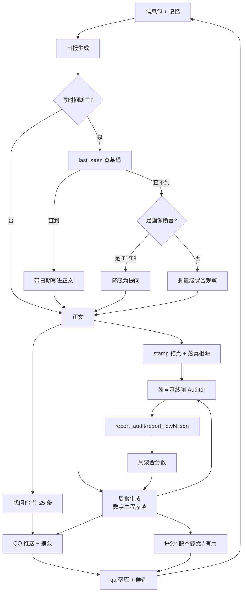

# 日报评测与提问回路 · 设计

- 日期：2026-10-24
- 范围：`apps/withlanggraph`（日报生成链路 + `gacore.feedback`）
- 状态：**已确认（2026-10-25）**。P0 探针已完成；实施计划见 `docs/superpowers/plans/2026-10-24-daily-report-audit-p1.md`

---

## 1. 起因：一个可复现的失败

### 1.1 P0 探针实测

对 `logs/delivered_report/` 下全部 **58 篇已投递日报**（598 条 bullet）扫“时间量级断言”（`N 天/周/月/年` 配 `沉寂/首次/连续/时隔/重新` 等词）：

| 指标 | 数值 |
|---|---|
| 识别到的时间量级断言 | 30 条 |
| 正文内**无锚点**（既没写日期，也没写“上次/第 N 天”） | 17 条（56.7%）|
| 人工核对这 17 条：与记忆库**硬冲突** | **2 条** |
| 人工核对这 17 条：方向对但没标基线 | 14 条 |
| 规则误报（量词属于引文/视频名而非断言） | 1 条 |

### 1.2 两条硬冲突

**案例 A · 2026-10-20 `[关键变化-1]`**

> 硬件线**半年**沉寂后重新点火

记忆库反证（`memory/global_mem_insight.txt` + `memory/daily/`）：

- 2026-08-20 ESP32 DIY 线立线
- 2026-09-19/20/22 均有硬件信号（桌面支架、复古硬件）
- **2026-10-03 仍有硬件信号**（AI 管家/ESP32 脉络交叉）

最近一次距 10-20 只有 **17 天**，且项目数据起点是 08-04，“半年”在任何口径下都不成立。

**案例 B · 2026-10-12 `[关键变化-1]`**

> 工学椅调研**时隔两个月**重启

记忆库反证：2026-09-15 有《西昊新品 H300 人体工学椅体验分享》×2，10-06 的 facts 仍在提“工学椅升级”。实际间隔约 **27 天**。

### 1.3 关键观察

同一套记忆在 **2026-09-02** 自己写过：

> 距 8/10–8/12 密集调研**约 3 周**

算对过。所以这不是“没数据”，也不是“模型不会算”，而是**生成日报时没有查表这一步**：

- “接哪条长期画像线”是语义联想 → 它做对了（“接长期画像硬件 DIY 线”）
- “断了多久”是数值查询 → 它用修辞顶替（“半年”“两个月”）

**数字靠查表，不靠语感。** 这是整套设计的支点。

### 1.4 提问的消失

2026-09-28 `[明日计划-3]`：

> 顺口告诉我：你和南京中华中等专业学校的什么关系（在读/教务）？

这条提问来自一个**异常信号**（`erp.njzhzz.cn` 当日登录 7 次，画像里没有任何学校线索），是全量 58 篇里最“活”的一笔。之后 26 篇再未出现提问。代码里已有 `feedback.clarify_feedback`（LLM 主持式澄清），但它**只在你主动发起订正且信息不全时触发**，不会由日报主动发起；你回答了也没有任何地方接住。

---

## 2. 目标 / 非目标 / 反目标

### 目标

- **G1 可追溯**：每条时间量级断言三选一——指向基线日期、降级成问句、或删掉量级只留观察；不允许“裸数字”。
- **G2 提问有回路**：问 → 你答 → 沉淀 → 下期引用。提问从彩蛋变成机制。
- **G3 可对照**：产出一份可复算的分数，任何 prompt 改动都能看前后差异。

### 非目标

- 不做通用 LLM 评测平台，只服务这一个日报。
- 不建人工标注流水线——标注就来自你的回答和每周两个评分。
- P0/P1 不动信息包取数逻辑（`daily_info_pack` 的 SOURCES）。

### 反目标（做到这些也算失败）

- 日报变得干瘪、不敢推断。宁可少推断，也不能没有推断。
- 提问变噪音：一期超过 5 条、重复问、无据而问。
- 分数涨了但你觉得没变好——说明指标选错了。

---

## 3. 设计原则

| 编号 | 原则 | 落点 |
|---|---|---|
| P1 | 推断可以大胆，但必须**可被你否掉** | 推断带模态词+依据，或写成问句 |
| P2 | 数字必须**来自查表** | `last_seen` 工具 + 强制调用规则 |
| P3 | 提问必须**有据且有回路** | 挂 evidence 锚；回答落库并被引用 |
| P4 | 自动测客观、人工测主观 | 审计器管事实；周报两个 0–5 分管“像不像我 / 有用” |

---

## 4. 总体结构



---

## 5. 组件设计

### 5.1 断言基线闸（Auditor）

**输入**：已打锚点的日报正文（`logs/delivered_report/{date}.md`）。

**规则表**：

| 规则 | 判定 | 级别 | 例子 |
|---|---|---|---|
| R1 量级无锚 | `N 天/周/月/年` + `沉寂/首次/时隔/连续` 等，同一 bullet 内无日期、无“上次/第 N 天/至今” | warn | 10-20 “半年沉寂” |
| R2 量级与记忆冲突 | 抽取断言主语，查 `last_seen`，按 §7 容差带判定 | **error** | 10-12 “两个月” vs 实际 27 天 |
| R3 引文污染 | 量级落在 `《》/「」/**...**` 内或紧跟视频标题 | ignore | “养老口号 40 年” |
| R4 首现断言无锚 | `首次/第一次/久违`，记忆库查不到该主题任何先例 | warn | “首次入列”若无历史可查 |
| R5 计数自相矛盾 | `连续 N 天` 与相邻日报的计数不连续 | warn | **P1 不实现**：需跨篇语料，随 P2 一起做 |

**输出**：`logs/report_audit/{date}.v{n}.json`（v1 = 首次投递快照）

```json
{
  "date": "2026-10-20",
  "score": 82,
  "findings": [
    {
      "rule": "R2",
      "severity": "error",
      "section": "关键变化",
      "anchor": "关键变化-1",
      "claim": "硬件线半年沉寂",
      "claimed_gap_days": 180,
      "actual_last_seen": "2026-10-03",
      "actual_gap_days": 17,
      "evidence": "memory/global_mem_insight.txt:104"
    }
  ]
}
```

**阻断策略**：P1 只标记不阻断投递。连续 3 期出现 `error` 才升级为“投递前重写该节”。

### 5.2 `last_seen` 工具（数字查表的落点）

```
last_seen(topic: str, before_date: str) -> {
  found: bool,
  date: str | None,
  gap_days: int | None,
  source: str,      # memory/daily/... + 行号
  snippet: str
}
```

- 数据源：`memory/daily/*.md` + `global_mem_insight.txt` + `global_mem_facts.txt` + 历史 `delivered_report`
- **口径与审计对齐（决策 23）**：历史 `delivered_report` 只读 v1 冻结快照——P1 起审计把投递原文存进 `logs/report_audit/{date}.v1.json` 的 `report_text` 字段，无快照的报告不作为证据源；`memory/` 下文件是主证据源，不受此约束
- 匹配：主题词全等优先，退化为同义词表（硬件/ESP32/STM32/单片机；工学椅/人体工学椅/西昊/永艺）
- **契约**：日报 prompt 增加硬规则——写任何“N 天/月没做 X”前必须调 `last_seen`，然后三选一：带 `（上次：YYYY-MM-DD，间隔 N 天）`、改成问句、删掉量级。没查就写 = 违反 P2。

**第三种允许的写法（关键补充）**：删掉量级、保留观察——写成 `最近又在看硬件线`，既不查表也不提问。

理由：58 篇里大多数量级断言根本不是人物画像断言，而是取数链路状态（`B站源连续第 3 日失败`）或事实卡计数（`听歌连续 4 日归零`、`工学椅连续第 2 天`）。对这些强行查表或提问，只会制造噪音。**提问只留给 T1（语义缺失）和 T2（画像冲突），T3（量级不关键）走删量级**。

这是整套设计里最便宜、收益最高的一步：**它把“模型自觉”换成“工具调用”**。

### 5.3 提问回路

**触发条件（三选一，必须有 evidence）**：

| 编号 | 场景 | 处理 |
|---|---|---|
| T1 | 信号存在但语义缺失 | 提问（09-28 学校系统登录 ×7，画像里没有学校线索）|
| T2 | 画像两处自相矛盾 | 提问（长期记忆一处说“已放弃工学椅”，另一处说“待办”）|
| T3 | 断言缺基线且量级对叙事不关键 | 删量级，不提问（`最近又在看硬件`）|

**数量与排序**：0–5 条，按“回答后能消除多少不确定性”排序。少于 5 条完全正常；**0 条也可以**，不允许为凑数生成。

**形态**：新增固定标题 `# 想问你`（不要塞进 `明日计划`，否则无法抽取/统计）。每条：

```
- [想问你-1] 你今天 9 次登录 erp.njzhzz.cn，画像里没有学校线索 —— 你是在读，还是在那边上班？（依据：10-20 浏览记录）
```

要求：**一句铺垫（我看到了什么）+ 一个问句 + 一个依据锚**。禁止无依据的寒暄式提问。

**去重与重问**：
- `question_key = sha1(主题 + 意图)`，已回答的永不再问
- 未回答的最多重问 2 期，之后归档为“用户不关心”
- 同一期不得出现两个语义相近的问题（先粗聚类再去重）

**投放面（基于现状的硬约束）**：日报目前 `deliver_to: "email"`，QQ 收不到正文；`feedback_route()` 也只认“日报/订正/补充”等关键词，且 `on_message` 不读 `message_reference`。所以“直接回复那条消息”在现状下**不成立**，必须另定投放与捕获路径：

- **投放**：`# 想问你` 随邮件走；同时由 `type: "proactive"` 的 job 经 `qq_push` 单独推送一段“今天想问你 3 个”的短消息（已确认要做）。推送时刻定**次日 08:30**（决策 25）：日报 23:50 邮件先走，QQ 提问错峰到早晨，回答窗口到当晚 23:50 生成前约 15 小时。
- **捕获**：新开 `proactive_qa` 处理器，**不走订正阶梯**。理由：若把 `[想问你-1] 在读` 交给 `parse_feedback`，它会被当成对 `想问你` 节的订正，触发 `revise_report_llm` 重写正文、再触发“确认重发”补发邮件——完全跑偏。
- **裸回答**：维护一个持久化的 `open_question` 指针（落盘，不放内存），当前有且仅有 1 条待答问题时，`在读` 这种裸回答直接归给它；多条时要求带 `[想问你-N]`。
- **不重发**：回答只影响**下一期**，不重生成、不重投当天日报。当天正文是历史快照，改它会让审计与人物闸的对照失真。

**生成后硬闸（不靠 prompt 自觉）**：`# 想问你` 节生成后过一次确定性检查——

- 条数 > 5 → 按排序截断并记 `over_limit`
- `question_key` 重复（同 key 或 token 重合 > 60%）→ 去重
- 每条必须能匹配到 evidence 锚，否则删
- 不做额外 LLM 调用；需要改写的场景复用已有的 `_diff_gate` 纪律，只允许动 `想问你` 节

**沉淀**：

- `data/qa/{date}.jsonl`：`{question_key, question, answer, answered_at, created_at, updated_at}`
- `data/qa/candidates.jsonl`：从回答里抽出的**画像候选**，状态 `pending/confirmed/rejected`
- **不自动写长期画像**：一次口误会变成永久事实，必须你二次确认（对应第 12 节第 4 问）
- 次日注入走 `daily_info_pack` 新增 `_QA` 源（独立 cap **600 字·初值**，决策 24，含“最近 7 天已回答问答”+“仍未回答的问题 key”，超限优先保留未答 key 与最近 3 组问答），不让它去挤 `preferences.json` 的 400 字预算

**度量**：每期提问数、回答率、7 天内被引用率、去重命中数。

### 5.4 周报 + 人物闸（每周一次）

**为什么用周报承载反馈**：日尺度只能看出“状态”，周尺度才能看出“变化”。而且反馈需要一个值得读的载体——只发两个数字的问题，三周后你就不想回了。

**结构（正文 ≤1200 字，不含数字表；首屏 ≤120 字，30 秒能读完）**：

```
# 本周一句话（≤120 字）
# 数字（程序生成）        ← 7 天序列 + 环比：提交/睡眠/屏幕/审计分/提问回答
# 三条变化                ← 每条 ≤2 行，带 ≥2 个日期依据；≥1 条带可回验预测（触发条件+时间窗，决策 26）
# 一条你可能没注意到的      ← 全周信息增益最高的一条
# 上周说的，这周对了吗      ← 回看上期“三条变化”的可回验预测 + 提问（question_key），逐条给结果（决策 26）
# 画像候选（1–3 条）       ← 值得进长期记忆的，可确认/否掉
# 本周未解                ← 未答提问、未消解的画像冲突
# 想问你（≤3）
# 给这周打分
```

比日报多出来的三块，也是周报真正的价值所在：**数字趋势**（日报只有当天）、**上周回看**（闭环，日报做不了）、**画像候选**（把周报变成有操作的文档，而不只是读物）。

**不重述日报**：日报写过的活动不重复罗列，只写“跨日才成立”的东西。把 7 篇日报缩写成一篇，是冗余不是丰富。

**每条变化 ≤2 行**：超了说明在讲过程，不是在讲变化。

**铁律：数字由程序填，叙事由模型写。** 本周提交数、睡眠、屏幕时长、审计分必须由代码算好放进 prompt 的只读区，模型只能引用，不能自己数。这就是 10-20「半年」病的 7 天版预防。

**周报同样要过审计器**：`audit_report` 接受任意报告文本，周报也跑 R1/R2——「本周第 3 天」「连续三周」一样会编。

**评分（只问机器测不了的两件事）**：

| 维度 | 0–5 锚点 |
|---|---|
| **像不像我** | 5=有一句让我“这确实是我没注意到的”；4=大体像我，一两处别扭；3=记录没错但像流水账；2=多处不像我；1=基本是别人；0=冒犯/编造 |
| **有用** | 5=这周有一次据此改了决定；3=读完有印象但没行动；0=纯噪音 |

**不问“准确度”**：审计器已经在测，让人再评一遍是重复劳动，而且人容易被“看起来专业”骗。

**rubric 版本化**：`alive` / `useful` 必须与 `rubric_version` 一起存（完整字段见下）。锚点一改 `rubric_version + 1`，跨版本只比趋势不比绝对值——否则你第 1 周的 3 分和第 10 周的 3 分不是一回事。

**回答入口**：与 5.3 共用 `proactive_qa`。格式 `5 4`（像不像我 5、有用 4），可追加 `3` 表示第 3 条最不像我，再可追加一句自由文本。

**存储**：`data/eval/human/{YYYY-Www}.json`，字段 `{week, alive, useful, rubric_version, least_like_me, raw, created_at, updated_at}`。

**画像候选可交互**：周报里的候选条目编号 `[候选-1]`；确认回 `N`（可多选 `1 3`），否掉回 `-N`（可混写 `1 -2`），单独 `0` = 本期全部否掉，未提及保持 `pending`（决策 27；单候选时 `1`/`0` 与原语义兼容）。复用 `data/qa/candidates.jsonl` 的 `pending/confirmed/rejected` 状态，不新增状态机。

**与日报提问的分工**：日报提问管“当天异常、隔夜失效”的（09-28 那种）；周报提问管“跨日模式、需要回头看”的。日报上限仍是 5、周报 ≤3；一周最多 8 条的噪音风险，先跑两周看回答率再收紧。

**投放**：周日 20:30 生成（数据窗 周一 00:00 – 周日 20:00），邮件正文存档 + QQ 推摘要与评分提示。

---

## 6. 数据与存储

**文件优先，不建表。**

理由：规模是 58 篇/年 ~ 365 篇，SQL 查询没有收益，反而要背 R6 迁移成本。等真需要跨年分析再迁。

```
apps/withlanggraph/
├─ logs/report_audit/{report_id}.v{n}.json # 自动审计结果（v1 = 首次投递快照）
│                                          # report_id: 2026-10-20（日报）/ 2026-W43（周报）
├─ logs/delivered_weekly/{YYYY-Www}.md     # 周报正文（与日报同口径，可被审计）
├─ data/qa/{date}.jsonl                    # 提问-回答
├─ data/qa/candidates.jsonl                # 画像候选（pending/confirmed/rejected）
├─ data/eval/human/{YYYY-Www}.json         # 周报评分（alive/useful/rubric_version）
└─ memory/daily/{date}.md                  # 已有
```

所有 JSONL 记录带 `created_at` / `updated_at`（东八区 `datetime('now','+8 hours')` 同口径），即使不建表也保留这两个字段，方便后续迁移。

---

## 7. 分数（可复算，只用于看趋势）

**R2 容差（避免把“约数”判成撒谎）**：仅当 `claimed ≥ 2 × actual` **且** `claimed − actual ≥ 14 天` 时判冲突；日级断言允许 ±1 天偏差。用 P0 两例回测：180 vs 17（163 天 / 10.6×）、60 vs 27（33 天 / 2.2×）均判冲突；“两周”vs 13 天不判。

**审计冻结点**：真相源 `logs/delivered_report/{date}.md` 会被订正就地重写，所以审计按版本落 `{date}.v{n}.json`；v1 是首次投递快照，**历史基线与周均值一律用 v1**，否则你改两句话就能把趋势刷上去。“连续 3 期”也按日历日 + v1 计。

```
score = 100
      - 25 × 硬冲突数(R2)
      - 5  × 无锚断言数(R1/R4)
      - 10 × 超限提问（>5 条）
      + 5  × 有回答的提问数（上限 15）
```

- 单篇分数波动不看，**只看周均值**。
- 权重先按上面跑 4 周，再按你的实际感受调——权重不是重点，**同一套权重长期不变**才是重点。
- 分数低于阈值不触发任何自动行为，只进周报。

**人物评分不入这个分**：`alive` / `useful` 单独一条趋势，和审计分并排展示。不然「机器分高、你觉得没用」会被平均掉，正好掩盖最该看的分歧。

---

## 8. 分阶段实施

| 阶段 | 内容 | 交付物 | 是否改生成逻辑 |
|---|---|---|---|
| **P0** | 探针：历史日报扫时间断言 + 记忆反查 | 本设计第 1 节 + 临时脚本 | 否 |
| **P1** | Auditor 产品化 + `last_seen` 工具 + 单测 | `gacore/audit.py`、`tests/test_audit.py`、历史 58 篇基线报告 | 否（离线） |
| **P2** | prompt 接入：强制查表 + `# 想问你` 节 | `config/schedule.json` 改动 | 是 |
| **P3** | 提问回路：QQ 推送与捕获、qa 落库、`_QA` 注入 | `feedback.py` 扩展 + `daily_info_pack` 新源 + `proactive` job | 是 |
| **P4** | 周报生成（程序填数字）+ 评分两问 + 画像候选确认 + 周趋势 | 周报 prompt/job + 周聚合脚本 + `logs/delivered_weekly/` + 复用 `_audit_claims` 审计周报 + QQ 评分/候选捕获 | 是（新增每周 job） |

P0 已完成。**建议先做 P1**：它不改生成逻辑，能立刻给出一份历史基线，之后 P2 的 prompt 改动才有对照。

---

## 9. 验收标准

| 指标 | 现状（P0 实测） | 目标 |
|---|---|---|
| 硬冲突（R2） | 2 条 / 58 篇（按 §7 容差带仍判冲突） | ≤ 0.1 篇/周 |
| 无锚率（断言口径） | 56.7% | < 20% |
| 提问数 | 1 条 / 58 篇 | 0–5 条/期，平均 ≥ 1 |
| 提问回答率 | 0%（无回路） | > 50% |
| 周报评分回收率 | 未测 | > 80% |
| 周报「像不像我」 | 未测 | 周均 ≥ 3.5 |
| 你判“不像我” | 未测 | ≤ 1 条/周 |

---

## 10. 风险

| 风险 | 影响 | 缓解 |
|---|---|---|
| Auditor 误报 | 分数失真，你不再信任它 | 当前误报 1/17；R2 才自动扣分，R1/R4 只提示 |
| prompt 变长挤占预算 | 日报质量反而下降 | 新增规则压到 200 字内；用工具契约替代大段说教 |
| 提问骚扰 | 你开始烦日报 | 硬上限 5 条；0 条合法；7 天未答自动降权 |
| QA 落库含隐私 | 数据外泄 | 仅本地，不进 git（R11）；与现有 `data/` 同边界 |
| 评测自嗨 | 分数好看但体感没变 | 分数只做趋势；周报两个评分是最终裁判 |

---

## 11. 我替你做的决定（可推翻）

1. **文件优先，不建 DB**——58 篇/年的规模不值得背迁移成本。
2. **P1 不阻断投递**——先观察误报率；审计钩子放在 `stamp_report_bullets`/`save_delivered` 与 `_deliver` 之间，将来要阻断只改开关，不重构。
3. **提问上限 5 条、下限 0 条**（你说 5 条以内可接受，我把 0 也定为合法）。
4. **新开 `# 想问你` 节**，不塞进 `明日计划`——否则无法稳定抽取。
5. **周报评分走 QQ**，回复 `5 4` 两个数字（与提问共用推送通道，已确认）。
6. **评分权重先按第 7 节初值**，跑 4 周再调。
7. **允许“删量级”作为第三条路**——多数断言是取数状态/事实卡计数，不该被逼成提问。
8. **问答不走订正阶梯**——否则会被当成对 `想问你` 节的订正并触发重发。
9. **回答只影响下一期**，不重生成、不重投当天。
10. **回答不自动写长期画像**——先进 `candidates`，你确认才落。
11. **问答注入走新 `_QA` 源**，不挤 `preferences.json` 的 400 字预算。
12. **提问规则用确定性硬闸**（计数/去重/必须有 evidence），不额外加 LLM 调用。
13. **审计 v1 冻结**，历史基线与周均值只认 v1。
14. **R2 用容差带**（≥2 倍且 ≥14 天才判冲突），避免把约数判成撒谎。
15. **周清单按周编号**，回答 `1 3` 这种两段数字。
16. **人物闸改由周报承载**——不再发裸问卷，周报本身就是反馈载体。
17. **只评两个维度**（像不像我 / 有用）；准确度交给审计器，不问人。
18. **周报数字由程序填**，模型只写叙事；周报同样过 `audit_report`。
19. **周报周日 20:30 生成**，数据窗 周一 00:00 – 周日 20:00。
20. **周报比日报丰富，但丰富在结构不在字数**：正文 ≤1200 字、首屏 ≤120 字、每条变化 ≤2 行。
21. **周报新增三块日报没有的**：数字趋势、上周回看、画像候选；不重述日报内容。
22. **画像候选可交互**：回 `1` 确认、`0` 否掉，复用 `candidates.jsonl` 的 `pending/confirmed/rejected`，不新增状态机。
23. **`last_seen` 与审计同口径**：历史日报只读 v1 冻结快照（P1 审计把投递原文存进 `{date}.v1.json` 的 `report_text`），无快照不作为证据；`memory/` 文件不受影响。
24. **`_QA` 源 cap = 600 字（初值）**：超限优先保留未答 key + 最近 3 组问答；随评分权重一起 4 周复评。
25. **proactive QQ 推送定次日 08:30**：日报 23:50 邮件先走、提问错峰到早晨，回答窗口到当晚 23:50 生成前约 15 小时。
26. **周报预测落点定死**：“三条变化”≥1 条带可回验预测（触发条件+时间窗）；“上周说的”回看对象 = 上期可回验预测 + 提问（question_key）。
27. **候选确认格式**：确认 `N`（多选 `1 3`）、否掉 `-N`（可混写 `1 -2`）、`0` = 本期全部否掉、未提及保持 pending；单候选 `1`/`0` 兼容原语义。
28. **审计主题词表外置 `config/audit_topics.json`**：P1 从记忆库高频主题导出初版 + 人工过一遍；漏配 fail-open（查不到不判冲突，不错杀）。

---

## 12. 待你定 → 已定（2026-10-24）

| # | 问题 | 结论 |
|---|---|---|
| 1 | 提问单独推 QQ？ | **推**。`proactive` job + `qq_push`，与日报邮件并行 |
| 2 | 硬冲突阻断投递？ | **不阻断**，只标记；审计钩子预留开关，将来一条语句可切 |
| 3 | `# 想问你` 进邮件正文？ | **进**。邮件是存档，QQ 是提醒 |
| 4 | 回答自动写长期画像？ | **不自动**。进 `candidates`，你确认才落 |
| 5 | 价值取舍类提问？ | **允许但严控**，见下 |

### 12.1 价值取舍类提问的准入（回答“LLM 能固定出更好的选项吗”）

**不能。** 模型没有依据知道你想要什么，它给的“A 还是 B”多数是**臆造的二选一**，而且一提选项就把你往两个框里推（锚定效应），比不问更差。所以只在能落地时才准问：

1. 两个选项必须在**近 14 天数据里各自被观测到**（例：连续三天在比永艺 ACT240 Pro 和西昊 H300），不是模型自己想出来的组合；
2. 一期最多 1 条；
3. 必须允许“都不是 / 说不清”，且这两种回答不计入未答；
4. 只进 `# 想问你`，不进 `明日计划`。

达不到这四条 → 退回 T3“删量级”，不问。

---

## 13. 附：P0 探针说明

- 脚本为一次性探针，放在临时目录，未入库。
- 输入：58 篇 `logs/delivered_report/*.md`；记忆侧 `memory/daily/*.md`、`global_mem.txt`、`global_mem_facts.txt`、`global_mem_insight.txt`。
- 规则先用正则，遮掉 `《》「」**...**` 与 `HH:MM`，要求量级词与断言词距离 ≤12 字——第一版未遮引文时 184 条断言 / 103 条无锚（56%）且含大量误报，遮罩后收敛到 30 / 17。
- P1 产品化时需把“主语抽取”从词袋打分换成显式主题词表 + 同义词映射，当前版本只适合做规模估计，不适合直接当门禁。

---

## 14. 交接（给下一个接手的助手）

### 14.1 当前状态

- **P0 完成**：探针跑完，结果见 §1。脚本是一次性的，放在系统临时目录，**未入库**；产品代码零改动。
- **设计已确认**（2026-10-25），第 11–12 节共 28 条定案（含同日补的实施决策 23–28），无遗留问题。
- **下一步 P1**，实施计划：`docs/superpowers/plans/2026-10-24-daily-report-audit-p1.md`。

### 14.2 已定死、不要重新讨论的事

第 11、12 节共 28 条。最容易被“顺手优化”掉的六条：

1. **审计 v1 冻结**——不要改成每次重算，否则趋势会被订正刷高。
2. **R2 用容差带**（≥2 倍且 ≥14 天）——不要退回精确相等，会把约数判成撒谎。
3. **问答不走 `parse_feedback`**——否则会被当成对 `想问你` 节的订正，触发 `revise_report_llm` + “确认重发”邮件。
4. **回答不自动写长期画像**——先进 `candidates`。
5. **提问 0–5 条，0 条合法**——不要为了“显得活”凑数。
6. **周报只评「像不像我 / 有用」两项**，不评准确度；周报里的数字必须程序填，模型不得改写。

### 14.3 环境与命令

```powershell
# 从 mono 根跑单测
uv run pytest apps/withlanggraph/tests/test_audit.py -q

# 或在 app 目录
cd apps/withlanggraph
$env:PYTHONPATH = "src"
uv run pytest tests/test_audit.py -q

# lint / 全仓门禁
uv run ruff check apps packages tests
tools/scripts/check.ps1
```

### 14.4 仓库硬规则（违反会被打回）

- **R5 三处同步**：`apps/withlanggraph/docs/ROADMAP.md` + `docs/langTrack-tech.md` + `docs/architecture-flow.mmd`。架构图先用 codemap 走查再改，禁止手改。
- **R7**：ruff + pytest 全绿才能提交。
- **测试封闭性**：`tests/` 禁止真实 LLM / 网络 / 真实 `memory/` 与 `logs/`；一律 `Config.for_tests(tmp_path)`。
- **日志**：用 `gacore.jsonl_logger.get_logger`，禁止 `print`。
- **提交**：中文，`type(scope): 描述`；提交前 `codegraph sync`。

### 14.5 已知坑

1. mono 根 `uv sync` 必须带 `--extra vector --extra qq`，否则依赖被 prune（见 app 级 AGENTS 踩坑 16）。
2. 测试要 `$env:PYTHONPATH="src"`，否则 `import gacore` 失败。
3. `logs/delivered_report/{date}.md` 会被订正**就地重写**，所以审计必须按版本落盘。
4. PowerShell 5.1 不支持 `&&`；控制台中文会乱码，读输出用 read 工具或 `python -X utf8` 重定向到文件。
5. 08 月的历史日报是旧格式（无 `# 节` 标题），bullet 无锚点，审计要容忍 `section=""`。
6. 单测耗时 >2s 基本就是踩了真实资源，提交前看一眼 `--durations=10`。

### 14.6 P1 验收（可逐条勾）

- [ ] `uv run pytest apps/withlanggraph/tests/test_audit.py -q` 全绿
- [ ] `python -m gacore.audit --backfill` 在真实 58 篇上跑通
- [ ] 10-20「硬件线半年沉寂」判为 R2 conflict（actual 2026-10-03，17 天）
- [ ] 10-12「工学椅时隔两个月」判为 R2 conflict（actual 2026-09-15，27 天）
- [ ] 输出 `logs/report_audit/{date}.v1.json` + `logs/report_audit/baseline.md`
- [ ] 基线数字与 §1 同量级（断言 ~30 / 无锚 ~17 / 硬冲突 2）
- [ ] `scheduler.py` 的生成与投递逻辑**零改动**

---

## 15. 变更记录

| 日期 | 变更 | 影响 |
|---|---|---|
| 2026-10-24 | 初版：断言审计 + 提问回路 + “两个勾”人物闸 | P1–P4 全部 |
| 2026-10-25 | 人物闸改由**周报**承载；评分定为 `像不像我` / `有用` 两个 0–5（`rubric_version` 版本化）；周报结构扩到 9 节，新增数字趋势 / 上周回看 / 画像候选；画像候选可交互（决策 22） | §5.4 重写、§4 图加周报分支、§8 P4 扩容、§9 加两条验收、§11 加 16–22 |
| 2026-10-25 | 补 6 条实施决策（23–28）：`last_seen` 只认 v1 快照、`_QA` cap 600 字、proactive 推送次日 08:30、周报预测落点、候选确认格式、主题词表外置 `config/audit_topics.json` | §5.2 / §5.3 / §5.4 / §11 / §14 |

**给下一个助手的两句提醒**：

1. P1（离线审计）与这次变更**无关**，按原计划执行即可；P2 只受“日报提问 ≤5”约束，也未变。
2. P3 的 `proactive_qa` 在 P4 会被复用，做 P3 时就把解析写成可扩展的，一次覆盖四种形态：`5 4`（周报评分）、`1` / `0`（候选确认）、`[Q1] 答案`（提问回答）。
